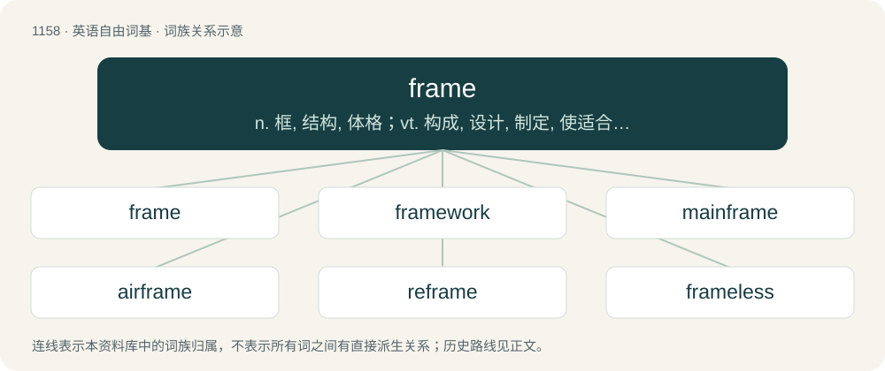

# 1236 · frame — n. 框, 结构, 体格；vt. 构成, 设计, 制定, 使适合, 陷害；\[计\] 框架, 图文框, 帧

[总目录](../00_总目录_按常用程度.md)

**类型**：英语自由词基　｜　**来源语言**：见词源记录

## 核心含义与来源

- 核心含义：n. 框, 结构, 体格；vt. 构成, 设计, 制定, 使适合, 陷害；\[计\] 框架, 图文框, 帧
- 英文含义：To fit, as for a specific end or purpose; make suitable or comfortable; adapt; adjust.
- 词形：frame

**多个词源／构词路径**：同一拼写可能有不同来源；以下按词性和含义分别列出。

**来源记录 1**（动词；To fit, as for a specific end or purpose; make suitable or comfortable; adapt; adjust.）

From Middle English framen, fremen, fremmen (“to construct, build, strengthen, refresh, perform, execute, profit, avail”), from Old English framian, fremian, fremman (“to profit, avail, advance”), from Proto-West Germanic \*frammjan, from Proto-Germanic \*framjaną (“to further, promote, perform”), from Proto-Indo-European \*promo- (“front, forward”). Cognate with Low German framen (“to commit, effect”), Danish fremme (“to promote, further, perform”), Swedish främja (“to promote, encourage, foster”), Icelandic fremja (“to commit”). More at from.

**来源记录 2**（名词；The structural elements of a building or other constructed object.）

From Middle English frame (“profit, benefit, advantage; a structure composed according to a plan”), from the verb (above) and also from Old Norse frami (“advantage, fame, bravery, efficiency, privilege, honor”); and frame (“a framework or structure of any kind”) which is of uncertain origin. The latter is usually regarded as a derivative of former; however, compare the rare Anglo-Norman and Old French frame, fraine (“frame, framework”), itself of uncertain origin, which might be a borrowing from the English, from the Norse, or even possibly ultimately from Frankish \*hramu (“frame”) related to Dutch raam (“window frame”).

## 词族图

## 单词速览（常用到不常用）

| 单词 | 音标 | 释义 |
|---|---|---|
| [frame](#w-1) | /ˈfɹeɪ̯m/ | n. 框, 结构, 体格；vt. 构成, 设计, 制定, 使适合, 陷害；\[计\] 框架, 图文框, 帧 |
| [framework](#w-2) | 英 /ˈfɹeɪm.wɜːk/；美 /ˈfɹeɪm.wɝk/ | n. 结构, 骨架, 参照标准, 准则, 观点；\[医\] 构架组织 |
| [mainframe](#w-3) | 美 /ˈmeɪnˌfɹeɪm/ | n. 主机；\[电\] 主机 |
| [airframe](#w-4) | /ˈɛɹ.fɹe(ɪ)m/ | n. 机身 |
| [reframe](#w-5) | /ˈriːˈfreim/ | vt. 再构造, 重新制订, 再组织, 给...装上新框架 |
| [frameless](#w-6) |  | \[计\] 无框架的 |
| [framer](#w-7) | 美 /ˈfɹeɪmɚ/ | n. 组成者, 构成者, 筹划者；\[电\] 调帧器 |
| [doorframe](#w-8) | 英 /ˈdɔːˌfɹeɪm/；美 /ˈdɔɹˌfɹeɪm/ | n. 门框 |

## 逐词详解

### 1. frame

**词性**：动词　｜　**音标**：/ˈfɹeɪ̯m/

**中文释义**：n. 框, 结构, 体格；vt. 构成, 设计, 制定, 使适合, 陷害；\[计\] 框架, 图文框, 帧

**英文义项**：To fit, as for a specific end or purpose; make suitable or comfortable; adapt; adjust. / To construct by fitting together or uniting various parts; fabricate by union of constituent parts.

**词源与演化**：

From Middle English framen, fremen, fremmen (“to construct, build, strengthen, refresh, perform, execute, profit, avail”), from Old English framian, fremian, fremman (“to profit, avail, advance”), from Proto-West Germanic \*frammjan, from Proto-Germanic \*framjaną (“to further, promote, perform”), from Proto-Indo-European \*promo- (“front, forward”). Cognate with Low German framen (“to commit, effect”), Danish fremme (“to promote, further, perform”), Swedish främja (“to promote, encourage, foster”), Icelandic fremja (“to commit”). More at from.

**例句**：

> The gun had obviously been placed in her car in an effort to frame her.

该用例对应义项：Conspire to falsely incriminate an innocent person.

### 2. framework

**词性**：名词　｜　**音标**：英 /ˈfɹeɪm.wɜːk/；美 /ˈfɹeɪm.wɝk/

**中文释义**：n. 结构, 骨架, 参照标准, 准则, 观点；\[医\] 构架组织

**英文义项**：A support structure comprising joined parts or conglomerated particles and intervening open spaces of similar or larger size. / The arrangement of support beams that represent a building's general shape and size.

**构词拆分**：frame + work

**词源与演化**：

From frame + work.

**例句**：

> These ‘three principles of connexion’ compose the framework of principles in Hume's account of the association of ideas.

该用例对应义项：A basic conceptual structure.

### 3. mainframe

**词性**：名词　｜　**音标**：美 /ˈmeɪnˌfɹeɪm/

**中文释义**：n. 主机；\[电\] 主机

**英文义项**：A large, powerful computer able to manage very many simultaneous tasks and communicate with very many connected terminals; used by large, complex organizations (such as banks and supermarkets) where continuously sustained operation is vital. / A computer chassis that hosts and interconnects modules that perform various tasks.

**构词拆分**：main + frame

**词源与演化**：

From main + frame.

**例句**：

> The scientists used an IBM mainframe computer to make their calculations.

### 4. airframe

**词性**：名词　｜　**音标**：/ˈɛɹ.fɹe(ɪ)m/

**中文释义**：n. 机身

**英文义项**：The main body and structure of an aircraft (without the powerplant).

**构词拆分**：air + frame

**词源与演化**：

From air + frame.

**例句**：

> Crashes in the early days of commercial jets tended to be caused by technical faults, such as metal fatigue in the airframe or engines.

### 5. reframe

**词性**：动词　｜　**音标**：/ˈriːˈfreim/

**中文释义**：vt. 再构造, 重新制订, 再组织, 给...装上新框架

**英文义项**：To mount in a frame again. / To redescribe, from a different perspective; to portray or construe anew, from a different analytic viewpoint or via a different metaphor; (sometimes euphemistically, merely) to relabel.

**构词拆分**：re- + frame

**词源与演化**：

From re- + frame.

**例句**：

> We must reframe our marketing efforts to prove to our prospects how we can save them money and make their jobs easier.

该用例对应义项：To redescribe, from a different perspective; to portray or construe anew, from a different analytic viewpoint or via a different metaphor; (sometimes euphemistically, merely) to relabel.

### 6. frameless

**词性**：形容词

**中文释义**：\[计\] 无框架的

**英文义项**：Without a frame. / Without frames.

**构词拆分**：frame + -less

**词源与演化**：

From frame + -less.

### 7. framer

**词性**：名词　｜　**音标**：美 /ˈfɹeɪmɚ/

**中文释义**：n. 组成者, 构成者, 筹划者；\[电\] 调帧器

**英文义项**：A person who makes frames for paintings. / A person who assembles the frame of a ship.

**构词拆分**：From frame + -er.

**词源与演化**：

From frame + -er.

### 8. doorframe

**词性**：名词　｜　**音标**：英 /ˈdɔːˌfɹeɪm/；美 /ˈdɔɹˌfɹeɪm/

**中文释义**：n. 门框

**英文义项**：The frame into which a door is fitted.

**构词拆分**：door + frame

**词源与演化**：

From door + frame.

**例句**：

> He was leaning against the doorframe and waiting for me with his arms crossed.
