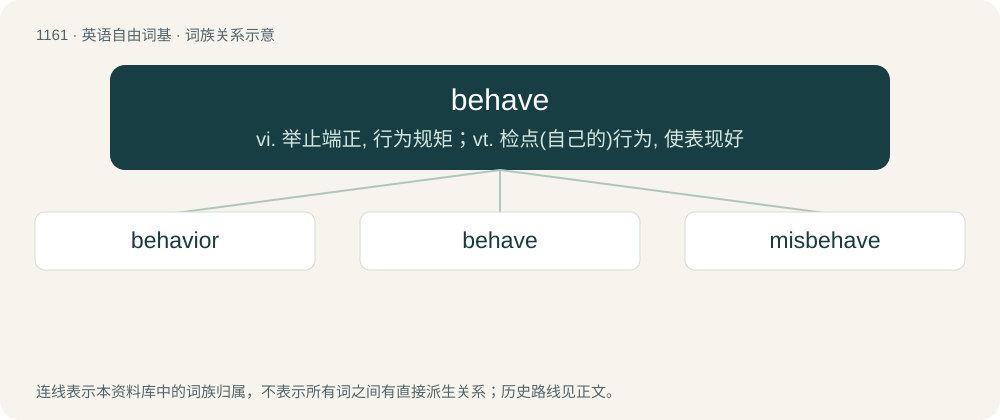

# 1240 · behave — vi. 举止端正, 行为规矩；vt. 检点(自己的)行为, 使表现好

[总目录](../00_总目录_按常用程度.md)

**类型**：英语自由词基　｜　**来源语言**：见词源记录

## 核心含义与来源

- 核心含义：vi. 举止端正, 行为规矩；vt. 检点(自己的)行为, 使表现好
- 英文含义：To conduct (oneself) well, or in a given way; to conform.
- 词形：behave

**来源记录 1**（动词；To conduct (oneself) well, or in a given way; to conform.）

From Middle English behaven, bihabben (“to restrain, behave”), from Old English behabban (“to surround, embrace, hold, contain, hold back, withhold, restrain”), from Proto-West Germanic \*bihabbjan, equivalent to be- + have. Cognate with Middle Low German behebben, behāven (“to receive, acquire, reach, keep”), Low German behebben (“to act, behave”), German behaben (“to behave”).

## 词族图

## 单词速览（常用到不常用）

| 单词 | 音标 | 释义 |
|---|---|---|
| [behavior](#w-1) | 英 /bɪˈheɪ.vjə/；美 /bɪˈheɪ.vjəɹ/ | n. 行为, 举止；\[医\] 行为 |
| [behave](#w-2) | 英 /bᵻˈheɪv/；美 /bɪˈheɪv/ | vi. 举止端正, 行为规矩；vt. 检点(自己的)行为, 使表现好 |
| [misbehave](#w-3) | /.misbiˈheiv/ | v. (使)行为无礼貌, (使)行为不端 |

## 逐词详解

### 1. behavior

**词性**：名词　｜　**音标**：英 /bɪˈheɪ.vjə/；美 /bɪˈheɪ.vjəɹ/

**中文释义**：n. 行为, 举止；\[医\] 行为

**英文义项**：Human conduct relative to social norms. / An inappropriate or forbidden action.

**构词拆分**：behave + -ior

**词源与演化**：

From Middle English behavoure, behaver, from behaven (modern behave), morphologically equivalent to behave + -ior. The suffix was adopted in imitation of havour (modern haviour, havior), an etymologically unrelated word that was corrupted from Anglo‐Norman Anglo-Norman aveir and Old French Old French avoir (“property, wealth”) through false association with the native English verb have. The French term derives ultimately from Latin Latin habēre (“to have, hold”). Compare Scots havings (“behavior”), from have (“to behave”). Replaced Old English ġebǣru.

**例句**：

> When a patient has a behavior, document it in their records.

该用例对应义项：An inappropriate or forbidden action.

### 2. behave

**词性**：动词　｜　**音标**：英 /bᵻˈheɪv/；美 /bɪˈheɪv/

**中文释义**：vi. 举止端正, 行为规矩；vt. 检点(自己的)行为, 使表现好

**英文义项**：To conduct (oneself) well, or in a given way; to conform. / To act, conduct oneself in a specific manner; used with an adverbial of manner.

**构词拆分**：be- + have

**词源与演化**：

From Middle English behaven, bihabben (“to restrain, behave”), from Old English behabban (“to surround, embrace, hold, contain, hold back, withhold, restrain”), from Proto-West Germanic \*bihabbjan, equivalent to be- + have. Cognate with Middle Low German behebben, behāven (“to receive, acquire, reach, keep”), Low German behebben (“to act, behave”), German behaben (“to behave”).

**例句**：

> His mother threatened to spank him if he didn't behave.

该用例对应义项：To act in a polite or proper way.

### 3. misbehave

**词性**：动词　｜　**音标**：/.misbiˈheiv/

**中文释义**：v. (使)行为无礼貌, (使)行为不端

**英文义项**：To act or behave in an inappropriate, improper, incorrect, or unexpected manner.

**构词拆分**：mis- + behave

**词源与演化**：

From Middle English misbehaven, equivalent to mis- + behave.

**例句**：

> He doesn't mean to misbehave; he just doesn't know better.

该用例对应义项：To act or behave in an inappropriate, improper, incorrect, or unexpected manner.
