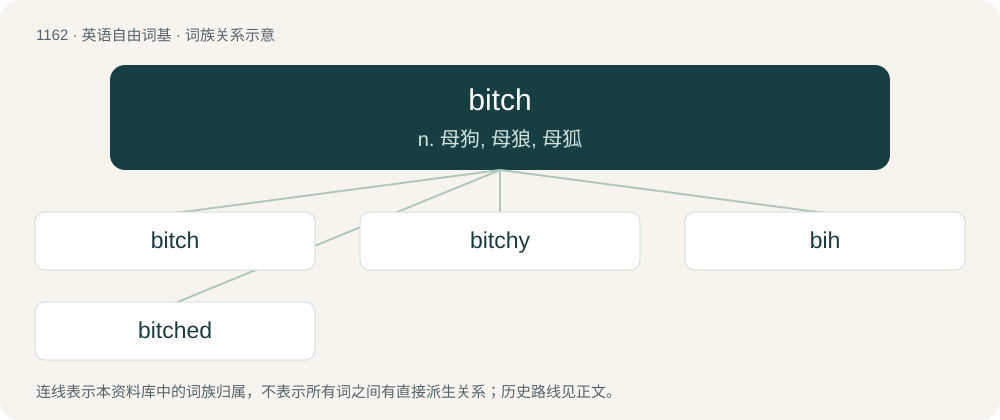

# 1241 · bitch — n. 母狗, 母狼, 母狐

[总目录](../00_总目录_按常用程度.md)

**类型**：英语自由词基　｜　**来源语言**：见词源记录

## 核心含义与来源

- 核心含义：n. 母狗, 母狼, 母狐
- 英文含义：A female dog or other canine, particularly a recent mother.
- 词形：bitch

**来源记录 1**（名词；A female dog or other canine, particularly a recent mother.）

From Middle English biche, bicche, from Old English biċċe, from Proto-West Germanic \*bikkjā, from Proto-Germanic \*bikjǭ (“female dog”) (compare Norwegian bikkje (“dog, bitch”), Old Danish bikke (“bitch”)), from Proto-Germanic \*bikjaną (“to thrust, attack”) (compare Old Norse bikkja (“to plunge into water”), Dutch bikken (“to hack”)). Related to bicker.

## 词族图

## 单词速览（常用到不常用）

| 单词 | 音标 | 释义 |
|---|---|---|
| [bitch](#w-1) | /bɪt͡ʃ/ | n. 母狗, 母狼, 母狐 |
| [bitchy](#w-2) | /ˈbɪt͡ʃi/ | a. 开下流玩笑的, 好挑剔的 |
| [bih](#w-3) | /bɪ(ː)/ | abbr. 国际时间局（bureau internationale de l’heure） |
| [bitched](#w-4) | /bɪt͡ʃt/ | v. 埋怨( bitch的过去式 ); 发牢骚; 挖苦; （背后）说坏话 |

## 逐词详解

### 1. bitch

**词性**：名词　｜　**音标**：/bɪt͡ʃ/

**中文释义**：n. 母狗, 母狼, 母狐

**英文义项**：A female dog or other canine, particularly a recent mother. / A despicable or disagreeable, aggressive person, usually a woman.

**词源与演化**：

From Middle English biche, bicche, from Old English biċċe, from Proto-West Germanic \*bikkjā, from Proto-Germanic \*bikjǭ (“female dog”) (compare Norwegian bikkje (“dog, bitch”), Old Danish bikke (“bitch”)), from Proto-Germanic \*bikjaną (“to thrust, attack”) (compare Old Norse bikkja (“to plunge into water”), Dutch bikken (“to hack”)). Related to bicker.

**例句**：

> You're so weak-willed with your girlfriend. You must be the real bitch in the relationship.

该用例对应义项：A submissive person who does what others want; (prison slang) a man forced or coerced into a homosexual relationship.

### 2. bitchy

**词性**：形容词　｜　**音标**：/ˈbɪt͡ʃi/

**中文释义**：a. 开下流玩笑的, 好挑剔的

**英文义项**：Spiteful or malevolent; catty; malicious; unpleasant. / Irritable.

**构词拆分**：bitch + -y

**词源与演化**：

From bitch + -y (adjectival suffix).

**例句**：

> What she said—and what she did—was really bitchy.

该用例对应义项：Spiteful or malevolent; catty; malicious; unpleasant.

### 3. bih

**词性**：名词　｜　**音标**：/bɪ(ː)/

**中文释义**：abbr. 国际时间局（bureau internationale de l’heure）

**英文义项**：A bitch.

**构词拆分**：bitch + -h

**词源与演化**：

From bitch + -h.

### 4. bitched

**词性**：形容词　｜　**音标**：/bɪt͡ʃt/

**中文释义**：v. 埋怨( bitch的过去式 ); 发牢骚; 挖苦; （背后）说坏话

**英文义项**：Causing difficulty; nasty; unpleasant; problematic; (intensifier) damned, bloody

**构词拆分**：bitch + -ed

**词源与演化**：

From Middle English bicched, equivalent to bitch + -ed.

**例句**：

> The coach bitched out the players when the team lost.
