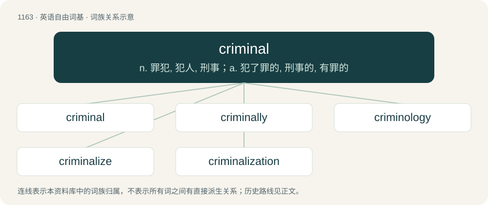

# 1242 · criminal — n. 罪犯, 犯人, 刑事；a. 犯了罪的, 刑事的, 有罪的

[总目录](../00_总目录_按常用程度.md)

**类型**：英语自由词基　｜　**来源语言**：见词源记录

## 核心含义与来源

- 核心含义：n. 罪犯, 犯人, 刑事；a. 犯了罪的, 刑事的, 有罪的
- 英文含义：Against the law; forbidden by law.
- 词形：criminal

**来源记录 1**（形容词；Against the law; forbidden by law.）

From Middle English cryminal, borrowed from Anglo-Norman criminal, from Late Latin criminalis, from Latin crimen (“crime”).

## 词族图

## 单词速览（常用到不常用）

| 单词 | 音标 | 释义 |
|---|---|---|
| [criminal](#w-1) | 英 /ˈkɹɪm.ɪ.nəl/；/ˈkɹɪm.ə.nəl/ | n. 罪犯, 犯人, 刑事；a. 犯了罪的, 刑事的, 有罪的 |
| [criminally](#w-2) |  | \[法\] 刑法上, 犯罪上 |
| [criminology](#w-3) | /.krimiˈnɒlədʒi/ | n. 犯罪学, 刑事学；\[医\] 犯罪学 |
| [criminalize](#w-4) |  | \[法\] 使有罪, 定罪 |
| [criminalization](#w-5) | /ˌkɹɪmɪnəlaɪzˈeɪʃən/ | \[法\] 定罪, 宣布犯有罪行 |

## 逐词详解

### 1. criminal

**词性**：形容词　｜　**音标**：英 /ˈkɹɪm.ɪ.nəl/；/ˈkɹɪm.ə.nəl/

**中文释义**：n. 罪犯, 犯人, 刑事；a. 犯了罪的, 刑事的, 有罪的

**英文义项**：Against the law; forbidden by law. / Guilty of breaking the law.

**词源与演化**：

From Middle English cryminal, borrowed from Anglo-Norman criminal, from Late Latin criminalis, from Latin crimen (“crime”).

**例句**：

> His long criminal record suggests that he is a dangerous man.

该用例对应义项：Of or relating to crime or penal law.

### 2. criminally

**词性**：副词

**中文释义**：\[法\] 刑法上, 犯罪上

**英文义项**：In a criminal manner.

**构词拆分**：criminal + -ly

**词源与演化**：

From criminal + -ly.

**例句**：

> The alterations in the document were ruled to be criminally fraudulent.

该用例对应义项：in violation of the law; in a criminal manner

### 3. criminology

**词性**：名词　｜　**音标**：/.krimiˈnɒlədʒi/

**中文释义**：n. 犯罪学, 刑事学；\[医\] 犯罪学

**英文义项**：The study of crime and criminals, especially their behaviour.

**构词拆分**：criminal + -logy

**词源与演化**：

From criminal + -logy.

**例句**：

> Criminology will help you understand the motivations of lawbreakers.

该用例对应义项：The study of crime and criminals, especially their behaviour.

### 4. criminalize

**词性**：动词

**中文释义**：\[法\] 使有罪, 定罪

**英文义项**：To make (something) a crime; to make illegal under criminal law; to ban. / To treat as a criminal.

**构词拆分**：criminal + -ize

**词源与演化**：

From criminal + -ize.

**例句**：

> In the 1970s, the Algerian government attempted to criminalize Berber.

### 5. criminalization

**词性**：名词　｜　**音标**：/ˌkɹɪmɪnəlaɪzˈeɪʃən/

**中文释义**：\[法\] 定罪, 宣布犯有罪行

**英文义项**：The act of making a previously legal activity illegal, the act of making something a criminal offence. / The act of turning someone into a criminal by making their activities illegal.

**构词拆分**：criminal + -ization；criminalize + -ation

**词源与演化**：

From criminal + -ization or criminalize + -ation.

**例句**：

> The criminalization of marijuana.

该用例对应义项：legislation that makes something illegal
