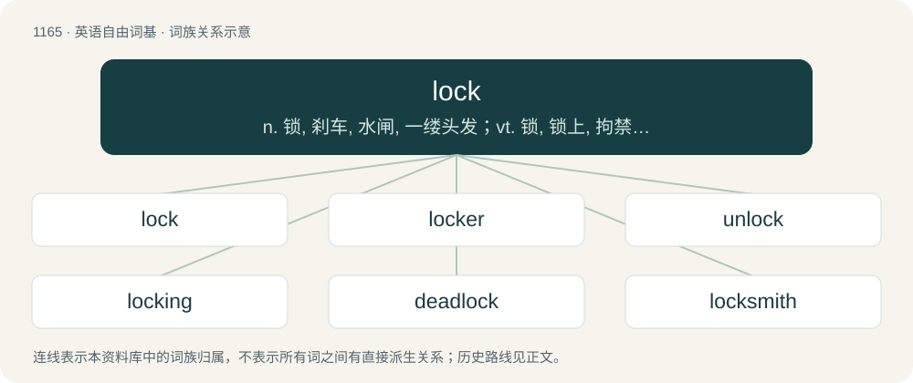

# 1243 · lock — n. 锁, 刹车, 水闸, 一缕头发；vt. 锁, 锁上, 拘禁, 隐藏, (用锁等)拴住, 刹住；vi. 锁住, (齿轮等)啮合, (船)过闸

[总目录](../00_总目录_按常用程度.md)

**类型**：英语自由词基　｜　**来源语言**：见词源记录

## 核心含义与来源

- 核心含义：n. 锁, 刹车, 水闸, 一缕头发；vt. 锁, 锁上, 拘禁, 隐藏, (用锁等)拴住, 刹住；vi. 锁住, (齿轮等)啮合, (船)过闸
- 英文含义：Something used for fastening, which can only be opened with a key or combination.
- 词形：lock

**多个词源／构词路径**：同一拼写可能有不同来源；以下按词性和含义分别列出。

**来源记录 1**（名词；Something used for fastening, which can only be opened with a key or combination.）

From Middle English lok, from Old English loc, from Proto-West Germanic \*lok, from Proto-Germanic \*luką from Proto-Indo-European \*lewg- (“to bend; turn”). Cognate with Cimbrian loch, lòch (“hole”), Dutch lok (“hole”), German Loch (“hole”), German Low German Lock (“hole”), Luxembourgish Lach (“hole”), Vilamovian łöch (“hole”), Yiddish לאָך (lokh, “hole”), Danish låg (“lid, cover”), Norwegian Bokmål lokk (“lid, cover”), Norwegian Nynorsk lok, lokk (“lid, cover”). more detail The verb is from Middle English locken, lokken, louken, from Old English lūcan, Proto-West Germanic \*lūkan, from Proto-Germanic \*lūkaną. Cognate with Dutch luiken (“to close, to shut”), Danish, Norwegian Bokmål lukke (“to close, to shut”), Faroese lúka (“to end, to finish”), Icelandic ljúka (“to close, to shut”), Norwegian Nynorsk lukka (“to close, to shut”). Related to luxe via Latin.

**来源记录 2**（名词；A tuft or length of hair, wool, etc.）

From Middle English lok, lokke, from Old English locc (“hair of the head, hair, lock of hair, curl, ringlet”), from Proto-West Germanic \*lokk, from Proto-Germanic \*lukkaz, from Proto-Indo-European \*lugnó-, from Proto-Indo-European \*lewg- (“to bend”). Cognate with Alemannic German lokha (“hair”), Dutch lok (“lock of hair, curl”), German Locke (“lock of hair, curl”), Danish lok (“lock of hair, curl”), Faroese, Icelandic lokkur (“lock of hair, curl”), Norwegian Bokmål, Norwegian Nynorsk lokk (“lock of hair, curl”), Swedish lock (“lock of hair, curl”). It has been theorised that the word may be related to the Gothic verb \*𐌻𐌿𐌺𐌰𐌽 (\*lukan, “to shut”) in its ancient meaning "to curb".

**来源记录 3**（名词；A single dreadlock.）

Ellipsis of dreadlock

## 词族图

## 单词速览（常用到不常用）

| 单词 | 音标 | 释义 |
|---|---|---|
| [lock](#w-1) | 英 /lɒk/；美 /lɑk/ | n. 锁, 刹车, 水闸, 一缕头发；vt. 锁, 锁上, 拘禁, 隐藏, (用锁等)拴住, 刹住；vi. 锁住, (齿轮等)啮合, (船)过闸 |
| [locker](#w-2) | 英 /ˈlɒk.ə(ɹ)/；美 /ˈlɑ.kɚ/ | n. 抽屉, 小柜, 上锁人；\[机\] 锁柜 |
| [unlock](#w-3) | 英 /ʌnˈlɒk/；美 /ʌnˈlɑk/ | vt. 开...的锁, 开启, 表露, 放出；vi. 被开启, 揭开, 解放；\[计\] 解出锁定 |
| [locking](#w-4) | /ˈlɔkiŋ/ | \[计\] 锁定; 加锁 |
| [deadlock](#w-5) | 英 /ˈdɛdˌlɒk/；美 /ˈdɛdˌlɑk/ | n. 僵局, 停顿；v. (使)停顿, (使)相持不下；\[计\] 死锁 |
| [locksmith](#w-6) | 英 /ˈlɒksmɪθ/；美 /ˈlɑksmɪθ/ | n. 锁匠 |
| [gridlock](#w-7) | 英 /ˈɡɹɪdˌlɒk/；美 /ˈɡɹɪdˌlɑk/ | n. 交通全面大堵塞; 僵局；v. （交通等）堵塞 |
| [airlock](#w-8) |  | n. 气塞, 气闸, 气密舱；\[化\] 风闸; 气封; 气窝(塑料表面的) |
| [interlock](#w-9) | /ˌɪntə(ɹ)ˈlɒk/ | v. (使)连结, (使)连锁；n. 连锁, 连结；\[计\] 相关; 互锁 |
| [headlock](#w-10) | /ˈhedlɒk/ | n. (摔跤中的)夹头 |
| [lovelock](#w-11) | 英 /ˈlʌvˌlɒk/ | 【英文】A lock of hair that hangs down and is worn apart from the hair that remains. |
| [lockstep](#w-12) | 英 /ˈlɒkstɛp/ | n. 紧密行进步伐, 因循守旧 |
| [lockjaw](#w-13) | /ˈlɒkdʒɒː/ | n. 破伤风, 牙关紧闭；\[医\] 牙关紧闭, 破伤风 |
| [lockbox](#w-14) | /ˈlɔkbɔks/ | n. 有锁的箱子 |
| [flintlock](#w-15) | 英 /ˈflɪntˌlɒk/ | n. 燧石发火装置, 燧发机, 明火枪 |
| [lockable](#w-16) | 美 /ˈlɔ.kə.bəl/ | \[计\] 可封闭的, 可锁定的 |

## 逐词详解

### 1. lock

**词性**：动词　｜　**音标**：英 /lɒk/；美 /lɑk/

**中文释义**：n. 锁, 刹车, 水闸, 一缕头发；vt. 锁, 锁上, 拘禁, 隐藏, (用锁等)拴住, 刹住；vi. 锁住, (齿轮等)啮合, (船)过闸

**英文义项**：To become fastened in place. / To fasten with a lock.

**词源与演化**：

From Middle English lok, from Old English loc, from Proto-West Germanic \*lok, from Proto-Germanic \*luką from Proto-Indo-European \*lewg- (“to bend; turn”). Cognate with Cimbrian loch, lòch (“hole”), Dutch lok (“hole”), German Loch (“hole”), German Low German Lock (“hole”), Luxembourgish Lach (“hole”), Vilamovian łöch (“hole”), Yiddish לאָך (lokh, “hole”), Danish låg (“lid, cover”), Norwegian Bokmål lokk (“lid, cover”), Norwegian Nynorsk lok, lokk (“lid, cover”). more detail The verb is from Middle English locken, lokken, louken, from Old English lūcan, Proto-West Germanic \*lūkan, from Proto-Germanic \*lūkaną. Cognate with Dutch luiken (“to close, to shut”), Danish, Norwegian Bokmål lukke (“to close, to shut”), Faroese lúka (“to end, to finish”), Icelandic ljúka (“to close, to shut”), Norwegian Nynorsk lukka (“to close, to shut”). Related to luxe via Latin.

**例句**：

> Frequently-vandalized pages are generally locked to prevent further damage.

该用例对应义项：To prevent a page from being edited by other users.

### 2. locker

**词性**：名词　｜　**音标**：英 /ˈlɒk.ə(ɹ)/；美 /ˈlɑ.kɚ/

**中文释义**：n. 抽屉, 小柜, 上锁人；\[机\] 锁柜

**英文义项**：A type of storage compartment with a lock, usually used to store personal possessions for public use, such as in schools, railway stations, place of work, gyms, sports centers. / A lockable cubicle.

**构词拆分**：lock + -er (patient suffix)

**词源与演化**：

From lock + -er (patient suffix) or -er (agent noun suffix). Related to German Loch, Dutch luik, and Dutch loket.

**例句**：

> The locker of the trapped chest must be careful, so as not to spring the trap.

该用例对应义项：One who locks something.

### 3. unlock

**词性**：动词　｜　**音标**：英 /ʌnˈlɒk/；美 /ʌnˈlɑk/

**中文释义**：vt. 开...的锁, 开启, 表露, 放出；vi. 被开启, 揭开, 解放；\[计\] 解出锁定

**英文义项**：To undo or open a lock or something locked by, for example, turning a key, or selecting a combination. / To obtain access to something; to meet the requirements of a security or protection system.

**构词拆分**：un- + lock

**词源与演化**：

From Middle English unloken, unlouken, onlouken, from Old English onlūcan (“to unlock”), equivalent to un- + lock. Cognate with Dutch ontluiken (“to unlock”).

**例句**：

> This computer game is shareware, but you can pay for a code to unlock the full version.

该用例对应义项：To obtain access to something; to meet the requirements of a security or protection system.

### 4. locking

**词性**：名词　｜　**音标**：/ˈlɔkiŋ/

**中文释义**：\[计\] 锁定; 加锁

**英文义项**：The use of a lock or a mutex to restrict access to a part of the code to at most one process.

**构词拆分**：lock + -ing

**词源与演化**：

From lock + -ing.

**例句**：

> I went to bed after locking all the doors and windows.

### 5. deadlock

**词性**：名词　｜　**音标**：英 /ˈdɛdˌlɒk/；美 /ˈdɛdˌlɑk/

**中文释义**：n. 僵局, 停顿；v. (使)停顿, (使)相持不下；\[计\] 死锁

**英文义项**：A standstill resulting from the opposition of two evenly matched forces; a stalemate or impasse. / An inability to continue due to two programs or devices each requiring a response from the other before completing an operation.

**构词拆分**：dead + lock

**词源与演化**：

From dead + lock.

**例句**：

> The negotiation ended in deadlock, with neither party willing to compromise on the price.

该用例对应义项：A standstill resulting from the opposition of two evenly matched forces; a stalemate or impasse.

### 6. locksmith

**词性**：名词　｜　**音标**：英 /ˈlɒksmɪθ/；美 /ˈlɑksmɪθ/

**中文释义**：n. 锁匠

**英文义项**：One who practices locksmithing. / Someone who only bets when they are sure they will win.

**构词拆分**：lock + smith

**词源与演化**：

From Middle English loksmith; equivalent to lock + smith.

**例句**：

> How much would it cost to get a locksmith to unlock my car?

### 7. gridlock

**词性**：名词　｜　**音标**：英 /ˈɡɹɪdˌlɒk/；美 /ˈɡɹɪdˌlɑk/

**中文释义**：n. 交通全面大堵塞; 僵局；v. （交通等）堵塞

**英文义项**：A condition of total, interlocking traffic congestion on the streets or highways of a crowded city, in which no one can move because everyone is in someone else's way. / On a smaller scale, the situation in which cars enter a signal-controlled intersection too late during the green light cycle, and are unable to clear the intersection (due to congestion in the next block) when the light turns red, thus blocking the cross traffic when it's their turn to go. Repeated at enough intersections, this phenomenon can lead to citywide gridlock.

**构词拆分**：grid + lock

**词源与演化**：

From grid + lock.

**例句**：

> That really would cause some serious gridlock.

### 8. airlock

**词性**：名词

**中文释义**：n. 气塞, 气闸, 气密舱；\[化\] 风闸; 气封; 气窝(塑料表面的)

**英文义项**：A sealed, airtight chamber, such as in a manned spacecraft or submarine, used to provide access to and from the sealed area without allowing air out or water in. / A vestibule, foyer or entranceway with doors to the exterior on one end and doors to the interior on the other, functioning to keep indoor and outdoor air, humidity, and air temperatures separate.

**构词拆分**：air + lock

**词源与演化**：

From air + lock.

**例句**：

> What is the access number for this airlock door to the Martian surface?

### 9. interlock

**词性**：名词　｜　**音标**：/ˌɪntə(ɹ)ˈlɒk/

**中文释义**：v. (使)连结, (使)连锁；n. 连锁, 连结；\[计\] 相关; 互锁

**英文义项**：A safety device that prevents activation in unsafe conditions.

**构词拆分**：inter- + lock

**词源与演化**：

From inter- + lock.

**例句**：

> The demonstrator couldn't figure out why the machine wouldn't work, until he remembered that there was an interlock so it wouldn't operate with the cover open.

该用例对应义项：A safety device that prevents activation in unsafe conditions.

### 10. headlock

**词性**：名词　｜　**音标**：/ˈhedlɒk/

**中文释义**：n. (摔跤中的)夹头

**英文义项**：A wrestling move where the attacker puts their arm tightly round their opponent's head, from which the opponent cannot easily escape.

**构词拆分**：head + lock

**词源与演化**：

From head + lock.

**例句**：

> Tom put Mary in a headlock.

### 11. lovelock

**词性**：名词　｜　**音标**：英 /ˈlʌvˌlɒk/

**英文义项**：A lock of hair that hangs down and is worn apart from the hair that remains. / A flowing lock of hair that is dressed apart from the hair that remains.

**构词拆分**：love + lock

**词源与演化**：

From love + lock.

**例句**：

> The name Gaia for planet Earth was coined by the scientist James Lovelock from the eponymous Greek goddess.

### 12. lockstep

**词性**：名词　｜　**音标**：英 /ˈlɒkstɛp/

**中文释义**：n. 紧密行进步伐, 因循守旧

**英文义项**：A step whereby the toe of one man is brought very close to the heel of the man in front. / Close connection, unison, rigid synchronization.

**构词拆分**：lock + step

**词源与演化**：

From lock + step.

**例句**：

> How politically realistic are the climate action goals that European governments are setting in lockstep with the United States?

### 13. lockjaw

**词性**：名词　｜　**音标**：/ˈlɒkdʒɒː/

**中文释义**：n. 破伤风, 牙关紧闭；\[医\] 牙关紧闭, 破伤风

**英文义项**：A spasmodic, nervous system disease brought on by the tetanus bacteria, causing muscles to seize up and may cause death by suffocation.

**构词拆分**：lock + jaw

**词源与演化**：

From lock + jaw.

### 14. lockbox

**词性**：名词　｜　**音标**：/ˈlɔkbɔks/

**中文释义**：n. 有锁的箱子

**英文义项**：A box with a built-in lock; usually, a portable one.

**构词拆分**：lock + box

**词源与演化**：

From lock + box.

### 15. flintlock

**词性**：名词　｜　**音标**：英 /ˈflɪntˌlɒk/

**中文释义**：n. 燧石发火装置, 燧发机, 明火枪

**英文义项**：An early type of firearm, using a spring-loaded flint to strike sparks into the firing pan. / A type of lock used on muskets, rifles, and pistols from the early 17th to the mid-19th century.

**构词拆分**：flint + lock

**词源与演化**：

From flint + lock.

### 16. lockable

**词性**：形容词　｜　**音标**：美 /ˈlɔ.kə.bəl/

**中文释义**：\[计\] 可封闭的, 可锁定的

**英文义项**：Capable of being locked.

**构词拆分**：lock + -able

**词源与演化**：

From lock + -able.
