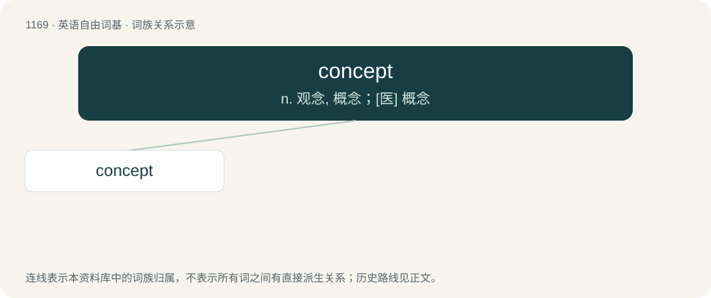

# 1246 · concept — n. 观念, 概念；\[医\] 概念

[总目录](../00_总目录_按常用程度.md)

**类型**：英语自由词基　｜　**来源语言**：见词源记录

## 核心含义与来源

- 核心含义：n. 观念, 概念；\[医\] 概念
- 英文含义：An abstract and general idea; an abstraction.
- 词形：concept

**来源记录 1**（名词；An abstract and general idea; an abstraction.）

Borrowed from Middle French concept, from Latin conceptus (“a thought, purpose, also a conceiving, etc.”), from concipiō (“to take in, conceive”). Doublet of conceit and concetto. See conceive.

## 词族图

## 单词速览（常用到不常用）

| 单词 | 音标 | 释义 |
|---|---|---|
| [concept](#w-1) | 英 /ˈkɒn.sɛpt/；美 /ˈkɑn.sɛpt/ | n. 观念, 概念；\[医\] 概念 |

## 逐词详解

### 1. concept

**词性**：名词　｜　**音标**：英 /ˈkɒn.sɛpt/；美 /ˈkɑn.sɛpt/

**中文释义**：n. 观念, 概念；\[医\] 概念

**英文义项**：An abstract and general idea; an abstraction. / Understanding retained in the mind, from experience, reasoning and imagination; a generalization (generic, basic form), or abstraction (mental impression), of a particular set of instances or occurrences (specific, though different, recorded manifestations of the concept).

**词源与演化**：

Borrowed from Middle French concept, from Latin conceptus (“a thought, purpose, also a conceiving, etc.”), from concipiō (“to take in, conceive”). Doublet of conceit and concetto. See conceive.

**例句**：

> They implemented a communication policy so as to promote their new concept.
