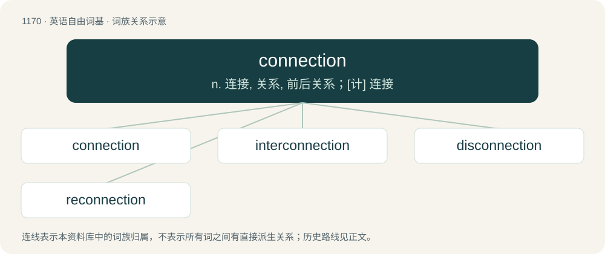

# 1247 · connection — n. 连接, 关系, 前后关系；\[计\] 连接

[总目录](../00_总目录_按常用程度.md)

**类型**：英语自由词基　｜　**来源语言**：见词源记录

## 核心含义与来源

- 核心含义：n. 连接, 关系, 前后关系；\[计\] 连接
- 英文含义：The act of connecting.
- 词形：connection

**来源记录 1**（名词；The act of connecting.）

From Middle English conneccioun, connexioun, conneccyon, conneccion, from Latin connexionem (nominative connexio (“a conclusion, binding together”)), from connectō, an alternative spelling of cōnectō (“to bind together”), from compound of co- (“together”) and nectō (“to bind”). In American English mid-18c., spelling shifted from connexion to connection (equivalent to connect + -ion), thus making connexion British dated and connection in international use.

## 词族图

## 单词速览（常用到不常用）

| 单词 | 音标 | 释义 |
|---|---|---|
| [connection](#w-1) | /kəˈnɛkʃ(ə)n/ | n. 连接, 关系, 前后关系；\[计\] 连接 |
| [interconnection](#w-2) | 美 /ˌɪn.tɚ.kəˈnɛk.ʃən/ | n. 互相连络；\[计\] 互连 |
| [disconnection](#w-3) | /ˌdɪs.kəˈnɛk.ʃən/ | n. 分离, 断开, 分开；\[计\] 断开, 拆接, 不连接 |
| [reconnection](#w-4) | /ˈriːkəˈnekʃən/ | \[计\] 重新接人, 重新连接 |

## 逐词详解

### 1. connection

**词性**：名词　｜　**音标**：/kəˈnɛkʃ(ə)n/

**中文释义**：n. 连接, 关系, 前后关系；\[计\] 连接

**英文义项**：The act of connecting. / Coherence; lack of disjointedness.

**构词拆分**：connect + -ion

**词源与演化**：

From Middle English conneccioun, connexioun, conneccyon, conneccion, from Latin connexionem (nominative connexio (“a conclusion, binding together”)), from connectō, an alternative spelling of cōnectō (“to bind together”), from compound of co- (“together”) and nectō (“to bind”). In American English mid-18c., spelling shifted from connexion to connection (equivalent to connect + -ion), thus making connexion British dated and connection in international use.

**例句**：

> As we were the only people in the room to laugh at the joke, I felt a connection between us.

该用例对应义项：A feeling of mutual understanding and ease of communication between two or more people.

### 2. interconnection

**词性**：名词　｜　**音标**：美 /ˌɪn.tɚ.kəˈnɛk.ʃən/

**中文释义**：n. 互相连络；\[计\] 互连

**英文义项**：A connection (physical or logical) between multiple things / Specifically, a connection between two parts.

**构词拆分**：inter- + connection

**词源与演化**：

From inter- + connection.

**例句**：

> A dozen states have implemented policies for interconnection.

该用例对应义项：The connecting of renewable-energy systems to the power grid

### 3. disconnection

**词性**：名词　｜　**音标**：/ˌdɪs.kəˈnɛk.ʃən/

**中文释义**：n. 分离, 断开, 分开；\[计\] 断开, 拆接, 不连接

**英文义项**：Severance of a physical connection. / Unexpected termination of a telephone connection.

**构词拆分**：dis- + connection

**词源与演化**：

From dis- + connection.

**例句**：

> There was a hopeless disconnection between the weary, old teacher and the spirited, young students.

该用例对应义项：Absence of rapport; the nonexistence of, or a breakdown of, effective communication.

### 4. reconnection

**词性**：名词　｜　**音标**：/ˈriːkəˈnekʃən/

**中文释义**：\[计\] 重新接人, 重新连接

**英文义项**：A connection of things that have been previously severed.

**构词拆分**：re- + connection

**词源与演化**：

From re- + connection.

**例句**：

> Aftercare is about reconnection and ensuring we both feel nurtured.
