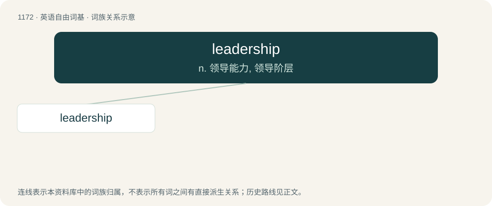

# 1249 · leadership — n. 领导能力, 领导阶层

[总目录](../00_总目录_按常用程度.md)

**类型**：英语自由词基　｜　**来源语言**：见词源记录

## 核心含义与来源

- 核心含义：n. 领导能力, 领导阶层
- 英文含义：The capacity of someone to lead others.
- 词形：leadership

**来源记录 1**（名词；The capacity of someone to lead others.）

From leader + -ship.

## 词族图

## 单词速览（常用到不常用）

| 单词 | 音标 | 释义 |
|---|---|---|
| [leadership](#w-1) | /ˈliːdə(ɹ)ʃɪp/ | n. 领导能力, 领导阶层 |

## 逐词详解

### 1. leadership

**词性**：名词　｜　**音标**：/ˈliːdə(ɹ)ʃɪp/

**中文释义**：n. 领导能力, 领导阶层

**英文义项**：The capacity of someone to lead others. / A group of leaders.

**构词拆分**：leader + -ship

**词源与演化**：

From leader + -ship.

**例句**：

> Wise, determined leadership matters most.

该用例对应义项：The capacity of someone to lead others.
