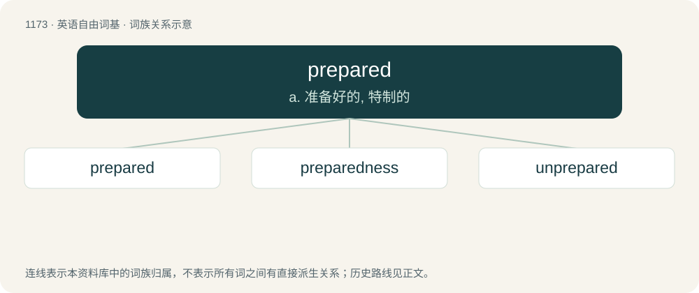

# 1250 · prepared — a. 准备好的, 特制的

[总目录](../00_总目录_按常用程度.md)

**类型**：英语自由词基　｜　**来源语言**：见词源记录

## 核心含义与来源

- 核心含义：a. 准备好的, 特制的
- 英文含义：Disposed, willing, ready (to do something).
- 词形：prepared

**来源记录 1**（形容词；Disposed, willing, ready (to do something).）

From prepare + -ed.

## 词族图

## 单词速览（常用到不常用）

| 单词 | 音标 | 释义 |
|---|---|---|
| [prepared](#w-1) | 英 /pɹɪˈpɛəd/；美 /pɹɪˈpɛɹd/ | a. 准备好的, 特制的 |
| [preparedness](#w-2) | 英 /pɹɪˈpɛə(ɹɪ)dnɪs/；美 /pɹɪˈpɛɹ(ə)dnəs/ | n. 准备状态, 战备状态 |
| [unprepared](#w-3) | /.ʌnpriˈpєəd/ | a. 无准备的, 即席的, 不期而遇的 |

## 逐词详解

### 1. prepared

**词性**：形容词　｜　**音标**：英 /pɹɪˈpɛəd/；美 /pɹɪˈpɛɹd/

**中文释义**：a. 准备好的, 特制的

**英文义项**：Disposed, willing, ready (to do something).

**构词拆分**：From prepare + -ed.

**词源与演化**：

From prepare + -ed.

**例句**：

> The journalist interviewed an eye-witness who was not prepared to disclose his identity.

该用例对应义项：Disposed, willing, ready (to do something).

### 2. preparedness

**词性**：名词　｜　**音标**：英 /pɹɪˈpɛə(ɹɪ)dnɪs/；美 /pɹɪˈpɛɹ(ə)dnəs/

**中文释义**：n. 准备状态, 战备状态

**英文义项**：The state of being prepared. / Precautionary measures in the face of potential disasters.

**构词拆分**：prepared + -ness

**词源与演化**：

From prepared + -ness.

**用法示例／搭配（非完整句）**：

> preparedness for an exam

该用例对应义项：The state of being prepared.

### 3. unprepared

**词性**：形容词　｜　**音标**：/.ʌnpriˈpєəd/

**中文释义**：a. 无准备的, 即席的, 不期而遇的

**英文义项**：Not prepared; caught by surprise.

**构词拆分**：un- + prepared

**词源与演化**：

From un- + prepared.

**例句**：

> The castle was unprepared for the assault.

该用例对应义项：Not prepared; caught by surprise.
