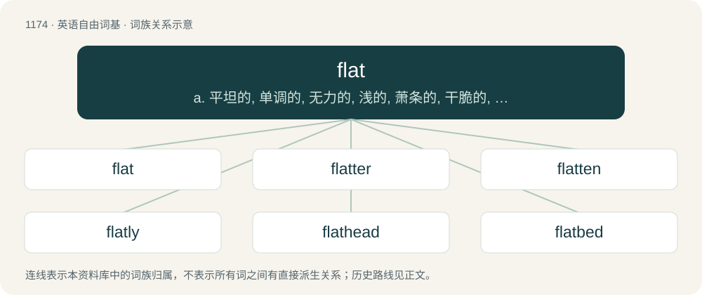

# 1251 · flat — a. 平坦的, 单调的, 无力的, 浅的, 萧条的, 干脆的, 无聊的；adv. 平直地, 断然地；n. 扁平物, 平面, 平地, 平原, 平板车

[总目录](../00_总目录_按常用程度.md)

**类型**：英语自由词基　｜　**来源语言**：见词源记录

## 核心含义与来源

- 核心含义：a. 平坦的, 单调的, 无力的, 浅的, 萧条的, 干脆的, 无聊的；adv. 平直地, 断然地；n. 扁平物, 平面, 平地, 平原, 平板车
- 英文含义：Having no variations in height.
- 词形：flat

**多个词源／构词路径**：同一拼写可能有不同来源；以下按词性和含义分别列出。

**来源记录 1**（形容词；Having no variations in height.）

From Middle English flat, a borrowing from Old Norse flatr (compare Norwegian and Swedish flat, Danish flad), from Proto-Germanic \*flataz, from Proto-Indo-European \*pleth₂- (“flat”); akin to Saterland Frisian flot (“smooth”), German Flöz (“a geological layer”), Ancient Greek πλατύς (platús), Latvian plats, Sanskrit प्रथस् (prathas, “extension”). Doublet of plat and pleyt. The noun is from Middle English flat (“level piece of ground, flat edge of a weapon”), from the adjective. The algebraic sense was coined by Serre in a 1956 paper, originally as French plat.

**来源记录 2**（名词；A complete domicile occupying only part of a building, especially one for rent）

From an alteration (due to Scots flatt (“a level part of a structure”)) of Scots flet, flett (“inner part of a house”), from Middle English flet (“dwelling”), from Old English flet, flett (“ground floor, dwelling”), from Proto-West Germanic \*flati, from Proto-Germanic \*flatją (“floor”), from Proto-Germanic \*flataz (“flat”), from Proto-Indo-European \*pleth₂- (“flat”). Akin to Old Frisian flet, flette (“dwelling, house”). More at flet, flat₁.

**来源记录 3**（动词；To dash or throw）

From Middle English flatten, from Old French flatir (“to knock or strike down, dash”), from Frankish \*flattjan (“to move the palm of the hand”), from Proto-Germanic \*flatjaną (“to make flat, flatten”).

## 词族图

## 单词速览（常用到不常用）

| 单词 | 音标 | 释义 |
|---|---|---|
| [flat](#w-1) | 英 /ˈflæt/ | a. 平坦的, 单调的, 无力的, 浅的, 萧条的, 干脆的, 无聊的；adv. 平直地, 断然地；n. 扁平物, 平面, 平地, 平原, 平板车 |
| [flatter](#w-2) | 英 /ˈflætə/；美 /ˈflætɚ/ | 【英文】A type of set tool used by blacksmiths. |
| [flatten](#w-3) | /ˈflæ.tən/ | vi. 使...不活跃, 变平；vt. 弄平, 打倒, 使失去光泽 |
| [flatly](#w-4) | /ˈflætli/ | adv. 枯燥无味地, 完全地, 直截了当地, 毅然地, 断然地 |
| [flathead](#w-5) | 美 /ˈflætˌhɛd/ | n. 扁头印第安人 |
| [flatbed](#w-6) | 美 /ˈflætˌbɛd/ | n. 有平台可装货的卡车 |
| [flatmate](#w-7) | /ˈflætmeɪt/ | n. 合住一套公寓的人 |
| [flatbread](#w-8) | /flætbˈred/ | n. 大饼, 扁面包 |
| [flatness](#w-9) | 美 /ˈflætnəs/ | n. 平坦, 平滑；\[化\] 平直度; 平整度; 平面度 |
| [flatiron](#w-10) | /ˈflæt.aiən/ | n. 熨斗 |
| [flatline](#w-11) | /ˈflætˌlaɪn/ | n. （心脑电图呈现的）平线；vi. 死亡 |
| [flatware](#w-12) | /ˈflætwєə/ | n. 扁平餐具 |
| [flatland](#w-13) | 英 /ˈflatlənd/ | 平原 |
| [flatscreen](#w-14) | /flætskˈriːn/ | n. 平板筛; 平面银幕; 超薄屏幕；a. 平板荧光屏的, 平面式电视的 |

## 逐词详解

### 1. flat

**词性**：形容词　｜　**音标**：英 /ˈflæt/

**中文释义**：a. 平坦的, 单调的, 无力的, 浅的, 萧条的, 干脆的, 无聊的；adv. 平直地, 断然地；n. 扁平物, 平面, 平地, 平原, 平板车

**英文义项**：Having no variations in height. / In a horizontal line or plane; not sloping.

**词源与演化**：

From Middle English flat, a borrowing from Old Norse flatr (compare Norwegian and Swedish flat, Danish flad), from Proto-Germanic \*flataz, from Proto-Indo-European \*pleth₂- (“flat”); akin to Saterland Frisian flot (“smooth”), German Flöz (“a geological layer”), Ancient Greek πλατύς (platús), Latvian plats, Sanskrit प्रथस् (prathas, “extension”). Doublet of plat and pleyt. The noun is from Middle English flat (“level piece of ground, flat edge of a weapon”), from the adjective. The algebraic sense was coined by Serre in a 1956 paper, originally as French plat.

**例句**：

> The dialogue in your screenplay is flat — you need to make it more exciting.

该用例对应义项：Lacking liveliness or action; depressed; uninteresting; dull and boring.

### 2. flatter

**词性**：名词　｜　**音标**：英 /ˈflætə/；美 /ˈflætɚ/

**英文义项**：A type of set tool used by blacksmiths. / A flat-faced fulling hammer.

**构词拆分**：flat + -er

**词源与演化**：

From flat (“to make flat, flatten”) + -er (agent suffix).

### 3. flatten

**词性**：动词　｜　**音标**：/ˈflæ.tən/

**中文释义**：vi. 使...不活跃, 变平；vt. 弄平, 打倒, 使失去光泽

**英文义项**：To make something flat or flatter. / To press one's body tightly against a surface, such as a wall or floor, especially in order to avoid being seen or harmed.

**构词拆分**：flat + -en

**词源与演化**：

From flat + -en.

**例句**：

> As there was a lot of damage, we chose the heavy roller to flatten the pitch.

该用例对应义项：To make something flat or flatter.

### 4. flatly

**词性**：副词　｜　**音标**：/ˈflætli/

**中文释义**：adv. 枯燥无味地, 完全地, 直截了当地, 毅然地, 断然地

**英文义项**：In a physically flat or level manner. / In a definite manner; in a manner showing complete certainty.

**构词拆分**：flat + -ly

**词源与演化**：

From flat + -ly.

**例句**：

> He replied flatly to the policeman's questions.

该用例对应义项：In a manner that shows no emotion.

### 5. flathead

**词性**：名词　｜　**音标**：美 /ˈflætˌhɛd/

**中文释义**：n. 扁头印第安人

**英文义项**：Any fish in the family Platycephalidae. / A type of screw or bolt designed to fit in a countersink so that it sits flush with a surface.

**构词拆分**：flat + head

**词源与演化**：

From flat + head.

### 6. flatbed

**词性**：形容词　｜　**音标**：美 /ˈflætˌbɛd/

**中文释义**：n. 有平台可装货的卡车

**英文义项**：Having a flat bed.

**构词拆分**：flat + bed

**词源与演化**：

From flat + bed.

**例句**：

> The accident left the contents of a flatbed trailer scattered across all three lanes.

该用例对应义项：Having a flat bed.

### 7. flatmate

**词性**：名词　｜　**音标**：/ˈflætmeɪt/

**中文释义**：n. 合住一套公寓的人

**英文义项**：A person with whom one shares a flat. / A person with whom one shares any rental dwelling, not necessarily a flat.

**构词拆分**：flat + -mate

**词源与演化**：

From flat + -mate.

**例句**：

> One particular flatmate always leaves the bathroom in a mess.

### 8. flatbread

**词性**：名词　｜　**音标**：/flætbˈred/

**中文释义**：n. 大饼, 扁面包

**英文义项**：A thin, flat bread, often made from unleavened dough.

**构词拆分**：flat + bread

**词源与演化**：

From flat + bread.

### 9. flatness

**词性**：名词　｜　**音标**：美 /ˈflætnəs/

**中文释义**：n. 平坦, 平滑；\[化\] 平直度; 平整度; 平面度

**英文义项**：The state of being flat / The state of being two-dimensional; planar : planarity

**构词拆分**：flat + -ness

**词源与演化**：

From Middle English flatnesse, equivalent to flat + -ness.

**例句**：

> The flatness of her voice warned me that something was wrong.

### 10. flatiron

**词性**：名词　｜　**音标**：/ˈflæt.aiən/

**中文释义**：n. 熨斗

**英文义项**：A simple iron (for pressing laundry) which is heated on a stove. / A pair of metal tongs with heated ceramic plates used for straightening hair.

**构词拆分**：flat + iron

**词源与演化**：

From flat + iron.

**例句**：

> Layla burned Salima on the scalp with a flatiron.

### 11. flatline

**词性**：动词　｜　**音标**：/ˈflætˌlaɪn/

**中文释义**：n. （心脑电图呈现的）平线；vi. 死亡

**英文义项**：To stop beating. / To die.

**构词拆分**：flat + line

**词源与演化**：

From flat + line. Refers to a continuous straight line (asystole) on an ECG (EKG) or EEG, indicating death.

### 12. flatware

**词性**：名词　｜　**音标**：/ˈflætwєə/

**中文释义**：n. 扁平餐具

**英文义项**：Eating utensils; cutlery, such as forks, knives and spoons. / Plates, dishes and other relatively flat crockery.

**构词拆分**：flat + -ware

**词源与演化**：

From flat + -ware.

**例句**：

> My in-laws insisted on buying us stainless steel flatware for our wedding.

### 13. flatland

**词性**：名词　｜　**音标**：英 /ˈflatlənd/

**中文释义**：平原

**英文义项**：Synonym of plain (“land of relatively constant altitude”). / An urban region with many flats or apartments to rent.

**构词拆分**：flat + land

**词源与演化**：

From flat + land.

**例句**：

> Ziri's commute consisted mostly in driving through flatland.

### 14. flatscreen

**词性**：形容词　｜　**音标**：/flætskˈriːn/

**中文释义**：n. 平板筛; 平面银幕; 超薄屏幕；a. 平板荧光屏的, 平面式电视的

**英文义项**：Being slim from front to back, as opposed to earlier bulky, CRT-based models.

**构词拆分**：flat + screen

**词源与演化**：

From flat + screen.

**例句**：

> Ziri was trying to steal Rima's flatscreen TV.
