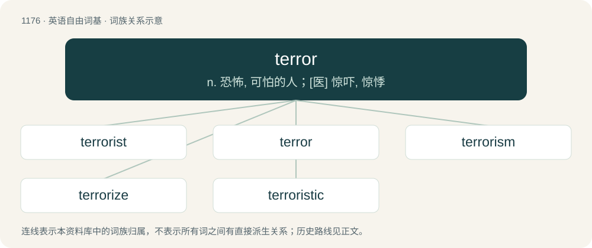

# 1252 · terror — n. 恐怖, 可怕的人；\[医\] 惊吓, 惊悸

[总目录](../00_总目录_按常用程度.md)

**类型**：英语自由词基　｜　**来源语言**：见词源记录

## 核心含义与来源

- 核心含义：n. 恐怖, 可怕的人；\[医\] 惊吓, 惊悸
- 英文含义：Intense dread, fright, or fear.
- 词形：terror

**来源记录 1**（名词；Intense dread, fright, or fear.）

From late Middle English terrour, from Old French terreur f (“terror, fear, dread”), from Latin terror (“fright, fear, terror”), from terrēre (“to frighten, terrify”), from Old Latin tr̥reō, from Proto-Italic \*trozeō, from Proto-Indo-European \*tre- (“to shake”), \*tres- (“to tremble”).

## 词族图

## 单词速览（常用到不常用）

| 单词 | 音标 | 释义 |
|---|---|---|
| [terrorist](#w-1) | /ˈtɛɹəɹɪst/ | n. 恐怖分子；\[法\] 恐怖份子, 恐怖主义 |
| [terror](#w-2) | 英 /ˈtɛɹə/；美 /ˈtɛɹɚ/ | n. 恐怖, 可怕的人；\[医\] 惊吓, 惊悸 |
| [terrorism](#w-3) | /ˈtɛɹəɹɪzəm/ | n. 恐怖主义, 恐怖统治, 恐怖状态；\[法\] 胁迫, 暴政, 恐怖政治 |
| [terrorize](#w-4) | /ˈtɛɹəɹaɪz/ | vt. 使惊恐, 恐吓；vi. 实施恐怖统治 |
| [terroristic](#w-5) | /.terəˈristik/ | a. 恐怖主义的；\[法\] 恐怖行为的, 恐怖主义的 |

## 逐词详解

### 1. terrorist

**词性**：名词　｜　**音标**：/ˈtɛɹəɹɪst/

**中文释义**：n. 恐怖分子；\[法\] 恐怖份子, 恐怖主义

**英文义项**：A person, group, or organization that uses violent action, or the threat of violent action, to further political goals.

**构词拆分**：terror + -ist

**词源与演化**：

From terror + -ist. In the historical sense, after French terroriste. First used in 1794 in the Courier and Evening Gazette.

**例句**：

> Mr. President, my name is Khan and I am not a terrorist.

### 2. terror

**词性**：名词　｜　**音标**：英 /ˈtɛɹə/；美 /ˈtɛɹɚ/

**中文释义**：n. 恐怖, 可怕的人；\[医\] 惊吓, 惊悸

**英文义项**：Intense dread, fright, or fear. / The action or quality of causing dread; terribleness, especially such qualities in narrative fiction.

**词源与演化**：

From late Middle English terrour, from Old French terreur f (“terror, fear, dread”), from Latin terror (“fright, fear, terror”), from terrēre (“to frighten, terrify”), from Old Latin tr̥reō, from Proto-Italic \*trozeō, from Proto-Indo-European \*tre- (“to shake”), \*tres- (“to tremble”).

**用法示例／搭配（非完整句）**：

> the War on Terror

该用例对应义项：Terrorism.

### 3. terrorism

**词性**：名词　｜　**音标**：/ˈtɛɹəɹɪzəm/

**中文释义**：n. 恐怖主义, 恐怖统治, 恐怖状态；\[法\] 胁迫, 暴政, 恐怖政治

**英文义项**：The use of unlawful violence against people or property to achieve political objectives. / The use of intimidation or bullying tactics.

**构词拆分**：By surface analysis, terror + -ism

**词源与演化**：

From French terrorisme, from terreur + -isme. By surface analysis, terror + -ism. The word first appears in English in 1795 in reference to the Jacobin radicals of France, who ruled during the Reign of Terror.

**例句**：

> We consider cyber terrorism to pose a serious threat to international security.

### 4. terrorize

**词性**：动词　｜　**音标**：/ˈtɛɹəɹaɪz/

**中文释义**：vt. 使惊恐, 恐吓；vi. 实施恐怖统治

**英文义项**：To fill (someone) with terror; to terrify. / To coerce (someone) by using threats or violence.

**构词拆分**：terror + -ize

**词源与演化**：

From terror + -ize.

**例句**：

> The gang continued to terrorize the neighborhood.

该用例对应义项：To fill (someone) with terror; to terrify.

### 5. terroristic

**词性**：形容词　｜　**音标**：/.terəˈristik/

**中文释义**：a. 恐怖主义的；\[法\] 恐怖行为的, 恐怖主义的

**英文义项**：Of or pertaining to a terrorist, terrorism, or terror.

**构词拆分**：terrorist + -ic；terror + -istic

**词源与演化**：

From terrorist + -ic or terror + -istic.
