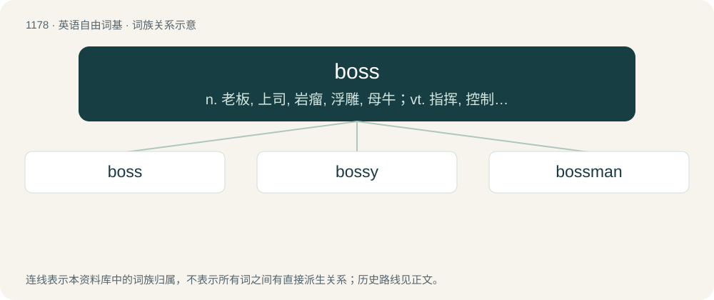

# 1254 · boss — n. 老板, 上司, 岩瘤, 浮雕, 母牛；vt. 指挥, 控制, 浮雕

[总目录](../00_总目录_按常用程度.md)

**类型**：英语自由词基　｜　**来源语言**：见词源记录

## 核心含义与来源

- 核心含义：n. 老板, 上司, 岩瘤, 浮雕, 母牛；vt. 指挥, 控制, 浮雕
- 英文含义：One who oversees and directs the work of others; a supervisor.
- 词形：boss

**多个词源／构词路径**：同一拼写可能有不同来源；以下按词性和含义分别列出。

**来源记录 1**（名词；One who oversees and directs the work of others; a supervisor.）

Borrowed from Dutch baas, from Middle Dutch baes (“master of a household, friend”), from Old Dutch \*baso (“uncle, kinsman”), from Proto-West Germanic \*baswō, from Proto-Germanic \*baswô (“uncle”), perhaps from Proto-Germanic \*ba-, \*bō- (“father, older male relative”), source also of the English terms babe, boy, bub, bully. Cognate with Middle Low German bās (“supervisor, foreman”), Old Frisian bas (“master”), hence Saterland Frisian Boas (“boss”), Old High German basa (“father's sister, cousin”), hence German Base (“aunt, cousin”). Originally a term of respect used to address an older relative. Later, in New Amsterdam, it began to mean a person in charge who is not a master. The video game sense is borrowed from Japanese ボス (bosu), borrowed from English boss.

**来源记录 2**（名词；A lump-like mass of rock, especially one projecting through a stratum of different rock.）

From Middle English bos, bose, boce, from Old French boce (“lump, bulge, protuberance, knot”), from Frankish \*bottja, from Proto-Germanic \*bautaną (“to hit, strike, beat”). Doublet of beat; see there for more.

## 词族图

## 单词速览（常用到不常用）

| 单词 | 音标 | 释义 |
|---|---|---|
| [boss](#w-1) | 英 /bɒs/；/bɔs/ | n. 老板, 上司, 岩瘤, 浮雕, 母牛；vt. 指挥, 控制, 浮雕 |
| [bossy](#w-2) | 英 /ˈbɒsi/；美 /ˈbɔsi/ | a. 专横的, 浮雕装饰的 |
| [bossman](#w-3) | 英 /ˈbɒsmæn/；美 /ˈbɔsmæn/ | n. \[美国口语\]；老板 |

## 逐词详解

### 1. boss

**词性**：名词　｜　**音标**：英 /bɒs/；/bɔs/

**中文释义**：n. 老板, 上司, 岩瘤, 浮雕, 母牛；vt. 指挥, 控制, 浮雕

**英文义项**：One who oversees and directs the work of others; a supervisor. / A person in charge of a business or company.

**词源与演化**：

Borrowed from Dutch baas, from Middle Dutch baes (“master of a household, friend”), from Old Dutch \*baso (“uncle, kinsman”), from Proto-West Germanic \*baswō, from Proto-Germanic \*baswô (“uncle”), perhaps from Proto-Germanic \*ba-, \*bō- (“father, older male relative”), source also of the English terms babe, boy, bub, bully. Cognate with Middle Low German bās (“supervisor, foreman”), Old Frisian bas (“master”), hence Saterland Frisian Boas (“boss”), Old High German basa (“father's sister, cousin”), hence German Base (“aunt, cousin”). Originally a term of respect used to address an older relative. Later, in New Amsterdam, it began to mean a person in charge who is not a master. The video game sense is borrowed from Japanese ボス (bosu), borrowed from English boss.

**例句**：

> There's no olive oil; will sunflower oil do? — I'll have to run that by the boss.

该用例对应义项：One's wife.

### 2. bossy

**词性**：形容词　｜　**音标**：英 /ˈbɒsi/；美 /ˈbɔsi/

**中文释义**：a. 专横的, 浮雕装饰的

**英文义项**：Tending to give orders to others, especially when unwarranted; domineering.

**构词拆分**：boss + -y

**词源与演化**：

From boss + -y.

**例句**：

> A bossy way of ordering others around.

该用例对应义项：offensively self-assured or given to exercising usually unwarranted power

### 3. bossman

**词性**：名词　｜　**音标**：英 /ˈbɒsmæn/；美 /ˈbɔsmæn/

**中文释义**：n. \[美国口语\]；老板

**英文义项**：A male boss or employer. / Used as a term of address for an unfamiliar, possibly distrusted man: bud, buddy, friend.

**构词拆分**：boss + man

**词源与演化**：

From boss + man.

**例句**：

> You really showed them, bossman. What’s your name?

该用例对应义项：Used as a term of address for a man who appears courageous: boss.
