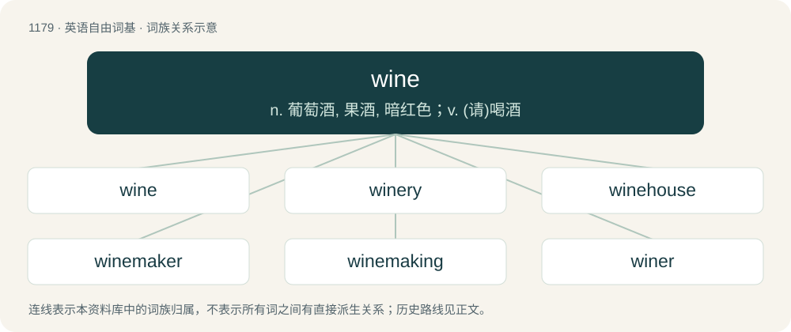

# 1255 · wine — n. 葡萄酒, 果酒, 暗红色；v. (请)喝酒

[总目录](../00_总目录_按常用程度.md)

**类型**：英语自由词基　｜　**来源语言**：见词源记录

## 核心含义与来源

- 核心含义：n. 葡萄酒, 果酒, 暗红色；v. (请)喝酒
- 英文含义：An alcoholic beverage made by fermenting grape juice, with an ABV ranging from 5.5–16%.
- 词形：wine

**多个词源／构词路径**：同一拼写可能有不同来源；以下按词性和含义分别列出。

**来源记录 1**（名词；An alcoholic beverage made by fermenting grape juice, with an ABV ranging from 5.5–16%.）

From Middle English wyn, win, from Old English wīn, from Proto-West Germanic \*wīn, from Proto-Germanic \*wīną, either directly or via Latin vīnum (from Proto-Italic \*wīnom) from Proto-Indo-European \*wóyh₁nom (“wine”). Doublet of vine and vino. Cognate with Saterland Frisian Wien, West Frisian wyn, Dutch wijn, German Wein, Danish, Norwegian Bokmål, Norwegian Nynorsk, and Swedish vin, Faroese and Icelandic vín.

**来源记录 2**（名词；Wind.）

A variant of wind with simplification of the final consonant cluster; for the vowel quality, compare find, mind, rind. The same variation of the root wind- → win- is also found in dialectal North Germanic: vind- → vin-. Also compare English whine, Swedish vina.

**来源记录 3**（动词；To perform a Jamaican dance, such as the Dutty Wine.）

From Jamaican Creole \[Term?\], related to wind (verb).

## 词族图

## 单词速览（常用到不常用）

| 单词 | 音标 | 释义 |
|---|---|---|
| [wine](#w-1) | /ˈwaɪ̯n/ | n. 葡萄酒, 果酒, 暗红色；v. (请)喝酒 |
| [winery](#w-2) | /ˈwaɪnəɹi/ | n. 葡萄酒厂 |
| [winehouse](#w-3) | /ˈwainhajs/ | n. 酒馆,酒店 |
| [winemaker](#w-4) | 英 /ˈwaɪnˌmeɪkə/；美 /ˈwaɪnˌmeɪkɚ/ | 葡萄酒酿造者；葡萄酒生产者 |
| [winemaking](#w-5) | /ˈwaɪnmeɪkɪŋ/ | n. 葡萄酒酿制；\[网络\] 葡萄酒酿造；酿酒；酿造方式 |
| [winer](#w-6) |  | n. 维纳（姓氏） |
| [wino](#w-7) | /ˈwaɪnəʊ/ | n. 醉鬼, 酒鬼 |

## 逐词详解

### 1. wine

**词性**：名词　｜　**音标**：/ˈwaɪ̯n/

**中文释义**：n. 葡萄酒, 果酒, 暗红色；v. (请)喝酒

**英文义项**：An alcoholic beverage made by fermenting grape juice, with an ABV ranging from 5.5–16%. / An alcoholic beverage made by fermenting other substances, producing a similar ABV.

**词源与演化**：

From Middle English wyn, win, from Old English wīn, from Proto-West Germanic \*wīn, from Proto-Germanic \*wīną, either directly or via Latin vīnum (from Proto-Italic \*wīnom) from Proto-Indo-European \*wóyh₁nom (“wine”). Doublet of vine and vino. Cognate with Saterland Frisian Wien, West Frisian wyn, Dutch wijn, German Wein, Danish, Norwegian Bokmål, Norwegian Nynorsk, and Swedish vin, Faroese and Icelandic vín.

**例句**：

> "Wine improves with age but I improve with wine," she slurred as she slid gracefully beneath the table.

该用例对应义项：An alcoholic beverage made by fermenting grape juice, with an ABV ranging from 5.5–16%.

### 2. winery

**词性**：名词　｜　**音标**：/ˈwaɪnəɹi/

**中文释义**：n. 葡萄酒厂

**英文义项**：A place where wine is made. / A company that makes wine.

**构词拆分**：wine + -ry

**词源与演化**：

From wine + -ry.

**例句**：

> Their Napa Valley winery was built in 1958 on the site of a former vegetable farm.

该用例对应义项：A place where wine is made.

### 3. winehouse

**词性**：名词　｜　**音标**：/ˈwainhajs/

**中文释义**：n. 酒馆,酒店

**英文义项**：The building on a vineyard in which the winepress is located. / A tavern or restaurant at which the primary drink served is wine.

**构词拆分**：wine + house

**词源与演化**：

From wine + house. Does not continue Old English wīnhūs. First attested in 1607.

**例句**：

> Does Amy Winehouse live further as Lady Gaga?

### 4. winemaker

**词性**：名词　｜　**音标**：英 /ˈwaɪnˌmeɪkə/；美 /ˈwaɪnˌmeɪkɚ/

**中文释义**：葡萄酒酿造者；葡萄酒生产者

**英文义项**：A person who makes wine. / A company that makes wine.

**构词拆分**：wine + maker

**词源与演化**：

From Middle English wynmaker; equivalent to wine + maker.

**例句**：

> The winemaker says sustainable viticulture is more than a set of farming practices.

### 5. winemaking

**词性**：名词　｜　**音标**：/ˈwaɪnmeɪkɪŋ/

**中文释义**：n. 葡萄酒酿制；\[网络\] 葡萄酒酿造；酿酒；酿造方式

**英文义项**：The process of making wine.

**构词拆分**：wine + making

**词源与演化**：

From wine + making.

**例句**：

> Adriano appreciates the art of winemaking.

### 6. winer

**词性**：名词

**中文释义**：n. 维纳（姓氏）

**英文义项**：A person who habitually drinks wine.

**构词拆分**：wine + -er

**词源与演化**：

From wine + -er.

### 7. wino

**词性**：名词　｜　**音标**：/ˈwaɪnəʊ/

**中文释义**：n. 醉鬼, 酒鬼

**英文义项**：A chronic or heavy drinker of cheap wine or other alcohol; especially, a drunkard. / Such a drunkard who is homeless.

**构词拆分**：wine + -o

**词源与演化**：

From wine + -o (“person with characteristic”).

**例句**：

> Clovis, the constantly jumping wino, has prominent quadriceps and fantastic glutes.
