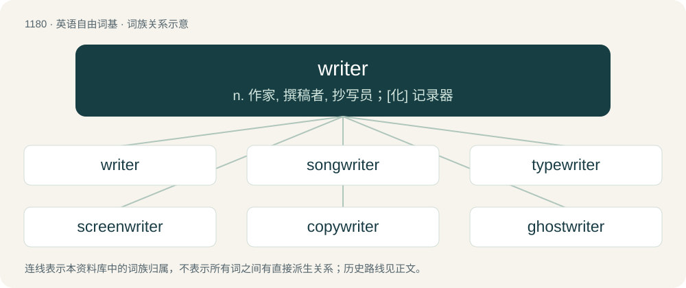

# 1256 · writer — n. 作家, 撰稿者, 抄写员；\[化\] 记录器

[总目录](../00_总目录_按常用程度.md)

**类型**：英语自由词基　｜　**来源语言**：见词源记录

## 核心含义与来源

- 核心含义：n. 作家, 撰稿者, 抄写员；\[化\] 记录器
- 英文含义：A person who writes, or produces literary work; an author can refer to themselves as "the writer".
- 词形：writer

**来源记录 1**（名词；A person who writes, or produces literary work; an author can refer to themselves as "the writer".）

From Middle English writer, writere, from Old English wrītere (“draughtsman; painter; writer; scribe; copyist”) and ġewritere (“writer; composer”), equivalent to write + -er and writ + -er. Cognate with Icelandic ritari (“clerk, secretary”), Faroese ritari (“clerk, secretary”).

## 词族图

## 单词速览（常用到不常用）

| 单词 | 音标 | 释义 |
|---|---|---|
| [writer](#w-1) | 英 /ˈɹaɪ.tə(ɹ)/；美 /ˈɹaɪ.təɹ/ | n. 作家, 撰稿者, 抄写员；\[化\] 记录器 |
| [songwriter](#w-2) |  | n. 流行歌曲的作者 |
| [typewriter](#w-3) | /ˈtaip.raitə/ | n. 打字机 |
| [screenwriter](#w-4) | /ˈskriːnraitə/ | n. 电影剧本作家, 编剧家 |
| [copywriter](#w-5) | 英 /ˈkɒpiˌɹaɪtə/；美 /ˈkɑːpiˌɹaɪtɚ/ | n. 广告文编写人 |
| [ghostwriter](#w-6) |  | n. 受雇而代为作文/作画的人, 捉刀人 |
| [speechwriter](#w-7) | /ˈspiːtʃ,raitə(r)/ | n. 演讲稿撰写人 |
| [scriptwriter](#w-8) | /ˈskript.raitə/ | n. 编剧 |

## 逐词详解

### 1. writer

**词性**：名词　｜　**音标**：英 /ˈɹaɪ.tə(ɹ)/；美 /ˈɹaɪ.təɹ/

**中文释义**：n. 作家, 撰稿者, 抄写员；\[化\] 记录器

**英文义项**：A person who writes, or produces literary work; an author can refer to themselves as "the writer". / Anything that writes or produces output.

**构词拆分**：write + -er；writ + -er

**词源与演化**：

From Middle English writer, writere, from Old English wrītere (“draughtsman; painter; writer; scribe; copyist”) and ġewritere (“writer; composer”), equivalent to write + -er and writ + -er. Cognate with Icelandic ritari (“clerk, secretary”), Faroese ritari (“clerk, secretary”).

**例句**：

> Has your girlfriend written you another letter already? She’s quite a writer!

该用例对应义项：A person who writes, or produces literary work; an author can refer to themselves as "the writer".

### 2. songwriter

**词性**：名词

**中文释义**：n. 流行歌曲的作者

**英文义项**：A musician who composes songs; especially writing the song's lyrics and/or creating a melody or a tune for the song.

**构词拆分**：song + writer

**词源与演化**：

From song + writer.

**例句**：

> We are now collaborating with a famous songwriter.

该用例对应义项：A musician who composes songs; especially writing the song's lyrics and/or creating a melody or a tune for the song.

### 3. typewriter

**词性**：名词　｜　**音标**：/ˈtaip.raitə/

**中文释义**：n. 打字机

**英文义项**：A device, at least partially mechanical, used to print text by pressing keys that cause type to be impressed through an inked ribbon onto paper. / A machine gun or submachine gun (from the noise it makes when firing).

**构词拆分**：type + writer

**词源与演化**：

From type + writer.

**例句**：

> "I can't think with that noise," she said, staring at the typewriter.

### 4. screenwriter

**词性**：名词　｜　**音标**：/ˈskriːnraitə/

**中文释义**：n. 电影剧本作家, 编剧家

**英文义项**：One who writes for the screen, who writes drama for film or television; especially a professional who knows the conventions appropriate to such work.

**构词拆分**：screen + writer

**词源与演化**：

From screen + writer.

**例句**：

> I think that Tom used to be a screenwriter.

### 5. copywriter

**词性**：名词　｜　**音标**：英 /ˈkɒpiˌɹaɪtə/；美 /ˈkɑːpiˌɹaɪtɚ/

**中文释义**：n. 广告文编写人

**英文义项**：A person who writes advertising copy (the text used in advertisements).

**构词拆分**：copy + writer

**词源与演化**：

From copy + writer.

**例句**：

> He used to work as a copywriter.

### 6. ghostwriter

**词性**：名词

**中文释义**：n. 受雇而代为作文/作画的人, 捉刀人

**英文义项**：A professional writer who is paid to write material that is officially credited to another person; one who writes on behalf of someone else, often for a celebrity.

**构词拆分**：ghost + writer

**词源与演化**：

From ghost + writer.

**例句**：

> Smith was listed as the author of his autobiography, but a ghostwriter did most of the work.

该用例对应义项：A professional writer who is paid to write material that is officially credited to another person; one who writes on behalf of someone else, often for a celebrity.

### 7. speechwriter

**词性**：名词　｜　**音标**：/ˈspiːtʃ,raitə(r)/

**中文释义**：n. 演讲稿撰写人

**英文义项**：Someone who writes speeches for others, especially as a profession.

**构词拆分**：speech + writer

**词源与演化**：

From speech + writer.

### 8. scriptwriter

**词性**：名词　｜　**音标**：/ˈskript.raitə/

**中文释义**：n. 编剧

**英文义项**：A person who writes scripts.

**构词拆分**：script + writer

**词源与演化**：

From script + writer.

**例句**：

> I thought I might become a scriptwriter.
