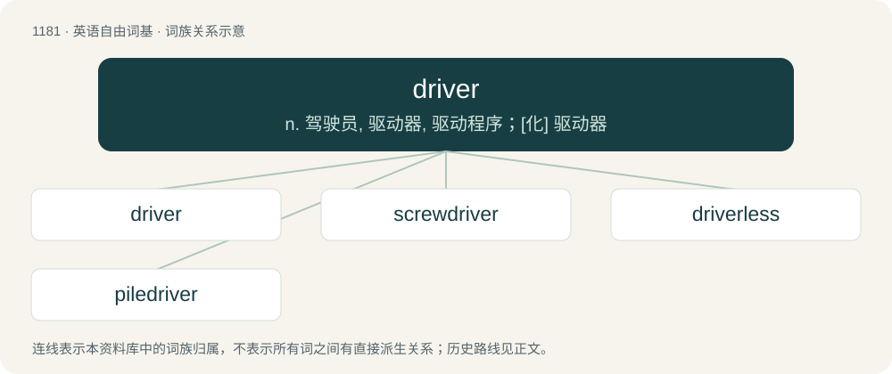

# 1258 · driver — n. 驾驶员, 驱动器, 驱动程序；\[化\] 驱动器

[总目录](../00_总目录_按常用程度.md)

**类型**：英语自由词基　｜　**来源语言**：见词源记录

## 核心含义与来源

- 核心含义：n. 驾驶员, 驱动器, 驱动程序；\[化\] 驱动器
- 英文含义：One who drives something.
- 词形：driver

**来源记录 1**（名词；One who drives something.）

From Middle English drivere, dryvere, dryvare, equivalent to drive + -er. Cognate with Saterland Frisian Drieuwer (“driver”), Dutch drijver (“driver”), German Low German Driever (“driver”), German Treiber (“driver”), Swedish drivare (“driver”).

## 词族图

## 单词速览（常用到不常用）

| 单词 | 音标 | 释义 |
|---|---|---|
| [driver](#w-1) | 英 /ˈdɹaɪ.və/；美 /ˈdɹaɪvɚ/ | n. 驾驶员, 驱动器, 驱动程序；\[化\] 驱动器 |
| [screwdriver](#w-2) | 美 /ˈskɹuˌdɹaɪvɚ/ | n. 螺丝起子；\[机\] 活动扳手 |
| [driverless](#w-3) | /dˈraɪvərles/ | 无人驾驶的 |
| [piledriver](#w-4) |  | 打桩机, 大力士 |

## 逐词详解

### 1. driver

**词性**：名词　｜　**音标**：英 /ˈdɹaɪ.və/；美 /ˈdɹaɪvɚ/

**中文释义**：n. 驾驶员, 驱动器, 驱动程序；\[化\] 驱动器

**英文义项**：One who drives something. / A person who drives a motorized vehicle such as a car, truck, bus, train, forklift, etc.

**构词拆分**：drive + -er

**词源与演化**：

From Middle English drivere, dryvere, dryvare, equivalent to drive + -er. Cognate with Saterland Frisian Drieuwer (“driver”), Dutch drijver (“driver”), German Low German Driever (“driver”), German Treiber (“driver”), Swedish drivare (“driver”).

**例句**：

> The driver will make an announcement when the trip is nearing its completion.

该用例对应义项：A person who drives a motorized vehicle such as a car, truck, bus, train, forklift, etc.

### 2. screwdriver

**词性**：名词　｜　**音标**：美 /ˈskɹuˌdɹaɪvɚ/

**中文释义**：n. 螺丝起子；\[机\] 活动扳手

**英文义项**：A hand tool or power tool which engages with the head of a screw and allows torque to be applied to turn the screw, thus driving it in or loosening it. / A cocktail made of vodka and orange juice.

**构词拆分**：screw + driver

**词源与演化**：

Compound of screw + driver.

**例句**：

> If you want to unscrew these screws, you should use a screwdriver.

### 3. driverless

**词性**：形容词　｜　**音标**：/dˈraɪvərles/

**中文释义**：无人驾驶的

**英文义项**：Without a driver (of a vehicle). / Without a driver (software to control hardware).

**构词拆分**：driver + -less

**词源与演化**：

From driver + -less.

**用法示例／搭配（非完整句）**：

> a driverless vehicle

该用例对应义项：Without a driver (of a vehicle).

### 4. piledriver

**词性**：名词

**中文释义**：打桩机, 大力士

**英文义项**：A very hard shot. / A move in which the wrestler applies a front waist lock, then drives the opponent's head into the mat by falling to his knees or backside.

**构词拆分**：pile + driver

**词源与演化**：

From pile + driver.

**例句**：

> Rachel's left-footed piledriver smacked the goalpost and rebounded away to safety to a chorus of agonised groans from the terraces.
