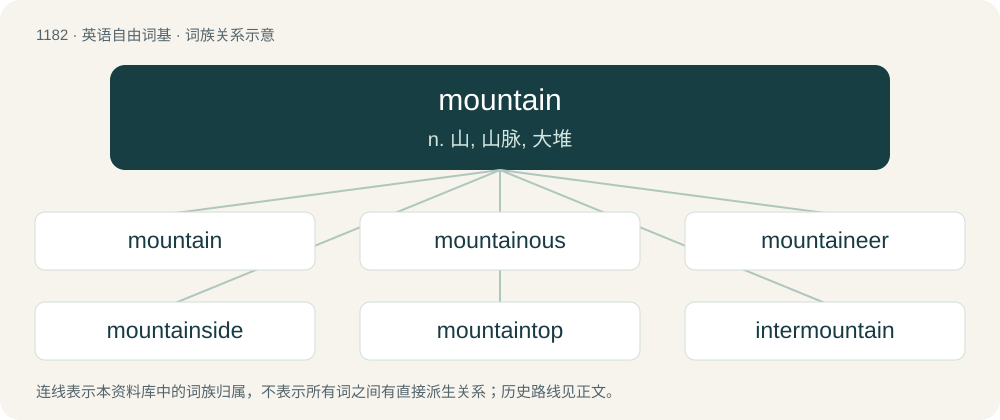

# 1259 · mountain — n. 山, 山脉, 大堆

[总目录](../00_总目录_按常用程度.md)

**类型**：英语自由词基　｜　**来源语言**：见词源记录

## 核心含义与来源

- 核心含义：n. 山, 山脉, 大堆
- 英文含义：An elevation of land of considerable dimensions rising more or less abruptly, forming a conspicuous figure in the landscape, usually having a small extent of surface at its summit.
- 词形：mountain

**来源记录 1**（名词；An elevation of land of considerable dimensions rising more or less abruptly, forming a conspicuous figure in the landscape, usually having a small extent of surface at its summit.）

From Middle English mountayne, mountain, montaigne, from Anglo-Norman muntaine, muntaigne, from Early Medieval Latin montānia, a collective based on Latin montem (“mountain”), from Proto-Indo-European \*monti (compare Welsh mynydd (“mountain”), Albanian mat (“bank, shore”), Avestan 𐬨𐬀𐬙𐬌 (mati, “promontory”)), from \*men- (“to project, stick out”). Displaced native English barrow (from Old English beorg) and down (from Old English dūn), and partially displaced non-native Old English munt, from Latin mōns (whence English mount).

## 词族图

## 单词速览（常用到不常用）

| 单词 | 音标 | 释义 |
|---|---|---|
| [mountain](#w-1) | 英 /ˈmaʊn.tɪn/；美 /ˈmaʊn.t(ə)n/ | n. 山, 山脉, 大堆 |
| [mountainous](#w-2) | 英 /ˈmaʊn.tɪ.nəs/；美 /ˈmaʊn.tɪ.nəs/ | a. 多山的, 如山的, 巨大的 |
| [mountaineer](#w-3) | 英 /ˌmaʊn.tɪnˈɪə̯(ɹ)/；美 /ˌmaʊn.tɪnˈɪɹ/ | n. 登山家, 山地人；vi. 登山 |
| [mountainside](#w-4) | /ˈmauntinsaid/ | n. 山腹, 山腰 |
| [mountaintop](#w-5) | 美 /ˈmaʊnt(ɪ)nˌtɑp/ | n. 山顶 |
| [intermountain](#w-6) | /ɪntɜːrˈmaʊntɪn/ | 山间 |

## 逐词详解

### 1. mountain

**词性**：名词　｜　**音标**：英 /ˈmaʊn.tɪn/；美 /ˈmaʊn.t(ə)n/

**中文释义**：n. 山, 山脉, 大堆

**英文义项**：An elevation of land of considerable dimensions rising more or less abruptly, forming a conspicuous figure in the landscape, usually having a small extent of surface at its summit. / Something very large in size or quantity; a huge amount; a great heap.

**词源与演化**：

From Middle English mountayne, mountain, montaigne, from Anglo-Norman muntaine, muntaigne, from Early Medieval Latin montānia, a collective based on Latin montem (“mountain”), from Proto-Indo-European \*monti (compare Welsh mynydd (“mountain”), Albanian mat (“bank, shore”), Avestan 𐬨𐬀𐬙𐬌 (mati, “promontory”)), from \*men- (“to project, stick out”). Displaced native English barrow (from Old English beorg) and down (from Old English dūn), and partially displaced non-native Old English munt, from Latin mōns (whence English mount).

**例句**：

> We collected plant specimens from mountain meadows above 2000 meters.

该用例对应义项：An elevation of land of considerable dimensions rising more or less abruptly, forming a conspicuous figure in the landscape, usually having a small extent of surface at its summit.

### 2. mountainous

**词性**：形容词　｜　**音标**：英 /ˈmaʊn.tɪ.nəs/；美 /ˈmaʊn.tɪ.nəs/

**中文释义**：a. 多山的, 如山的, 巨大的

**英文义项**：Having many mountains; characterized by mountains; of the nature of a mountain; rough (terrain); rocky. / Resembling a mountain, especially in size; huge; towering.

**构词拆分**：mountain + -ous

**词源与演化**：

From mountain + -ous after Middle French montagneux, from Late Latin montāniōsus, from montānia, from Latin montem (“mountain”).

**例句**：

> A mountainous dark man.

该用例对应义项：like a mountain in size and impressiveness

### 3. mountaineer

**词性**：名词　｜　**音标**：英 /ˌmaʊn.tɪnˈɪə̯(ɹ)/；美 /ˌmaʊn.tɪnˈɪɹ/

**中文释义**：n. 登山家, 山地人；vi. 登山

**英文义项**：A person who lives in a mountainous area (often with the connotation that such people are outlaws or uncivilized). / A person who climbs mountains for sport or pleasure.

**构词拆分**：mountain + -eer

**词源与演化**：

From mountain + -eer.

**例句**：

> Many tried to carry out the deed of the intrepid mountaineer.

### 4. mountainside

**词性**：名词　｜　**音标**：/ˈmauntinsaid/

**中文释义**：n. 山腹, 山腰

**英文义项**：The sloping side of a mountain.

**构词拆分**：mountain + side

**词源与演化**：

From mountain + side.

**例句**：

> The melted snowpack seeps down to fill mountainside indentations to form glacial lakes.

### 5. mountaintop

**词性**：形容词　｜　**音标**：美 /ˈmaʊnt(ɪ)nˌtɑp/

**中文释义**：n. 山顶

**英文义项**：Situated or occurring on the summit of a mountain.

**构词拆分**：From mountain + top.

**词源与演化**：

From mountain + top.

**例句**：

> You can get a fine view of the sea from the mountaintop.

### 6. intermountain

**词性**：形容词　｜　**音标**：/ɪntɜːrˈmaʊntɪn/

**中文释义**：山间

**英文义项**：Between mountains.

**构词拆分**：inter- + mountain

**词源与演化**：

From inter- + mountain.
