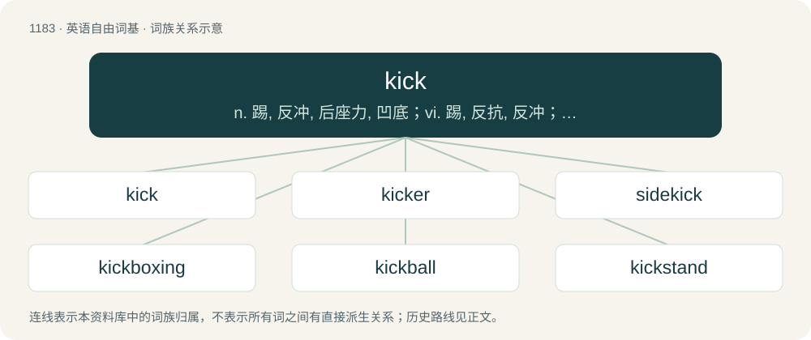

# 1261 · kick — n. 踢, 反冲, 后座力, 凹底；vi. 踢, 反抗, 反冲；vt. 踢, 反冲

[总目录](../00_总目录_按常用程度.md)

**类型**：英语自由词基　｜　**来源语言**：见词源记录

## 核心含义与来源

- 核心含义：n. 踢, 反冲, 后座力, 凹底；vi. 踢, 反抗, 反冲；vt. 踢, 反冲
- 英文含义：To strike or hit with the foot or other extremity of the leg.
- 词形：kick

**多个词源／构词路径**：同一拼写可能有不同来源；以下按词性和含义分别列出。

**来源记录 1**（动词；To strike or hit with the foot or other extremity of the leg.）

From Middle English kyken (“to strike out with the foot”), from Old Norse kikna (“to sink at the knees”) and keikja (“to bend backwards”) (compare Old Norse keikr (“bent backwards, the belly jutting forward”)), from Proto-Germanic \*kaikaz (“bent backwards”), of uncertain origin. Perhaps from Proto-Germanic \*kī-, \*kij- (“to split, dodge, swerve sidewards”), from Proto-Indo-European \*ǵeyH- (“to sprout, shoot”). Compare also Dutch kijken (“to look”), Middle Low German kīken (“to look, watch”). See keek.

**来源记录 2**（动词；To die.）

Shortening of kick the bucket.

**来源记录 3**（动词；To be emphatically excellent.）

Shortening of kick ass

## 词族图

## 单词速览（常用到不常用）

| 单词 | 音标 | 释义 |
|---|---|---|
| [kick](#w-1) | /kɪk/ | n. 踢, 反冲, 后座力, 凹底；vi. 踢, 反抗, 反冲；vt. 踢, 反冲 |
| [kicker](#w-2) | 英 /ˈkɪkə/；美 /ˈkɪkɚ/ | n. 踢者, 善踢的人, 爱踢的马；\[化\] 抖动器 |
| [sidekick](#w-3) | /ˈsaɪdkɪk/ | n. 伙伴, 插袋 |
| [kickboxing](#w-4) | /ˈkɪk.bɒk.sɪŋ/ | n. \[体\]跆拳道 |
| [kickball](#w-5) | /ˈkikbɒːl/ | n. 踢球 |
| [kickstand](#w-6) | 美 /ˈkɪkˌstænd/ | n. 撑脚架 |

## 逐词详解

### 1. kick

**词性**：动词　｜　**音标**：/kɪk/

**中文释义**：n. 踢, 反冲, 后座力, 凹底；vi. 踢, 反抗, 反冲；vt. 踢, 反冲

**英文义项**：To strike or hit with the foot or other extremity of the leg. / To make a sharp jerking movement of the leg, as to strike something.

**词源与演化**：

From Middle English kyken (“to strike out with the foot”), from Old Norse kikna (“to sink at the knees”) and keikja (“to bend backwards”) (compare Old Norse keikr (“bent backwards, the belly jutting forward”)), from Proto-Germanic \*kaikaz (“bent backwards”), of uncertain origin. Perhaps from Proto-Germanic \*kī-, \*kij- (“to split, dodge, swerve sidewards”), from Proto-Indo-European \*ǵeyH- (“to sprout, shoot”). Compare also Dutch kijken (“to look”), Middle Low German kīken (“to look, watch”). See keek.

**例句**：

> He enjoyed the simple pleasure of watching the kickline kick.

该用例对应义项：To make a sharp jerking movement of the leg, as to strike something.

### 2. kicker

**词性**：名词　｜　**音标**：英 /ˈkɪkə/；美 /ˈkɪkɚ/

**中文释义**：n. 踢者, 善踢的人, 爱踢的马；\[化\] 抖动器

**英文义项**：One who kicks. / One who takes kicks.

**构词拆分**：kick + -er

**词源与演化**：

From kick + -er.

**例句**：

> Tuition is free; the kicker is that mandatory room and board costs twice as much as at other colleges.

该用例对应义项：An unexpected situation, detail or circumstance, often unpleasant, serving as a punchline or clincher.

### 3. sidekick

**词性**：名词　｜　**音标**：/ˈsaɪdkɪk/

**中文释义**：n. 伙伴, 插袋

**英文义项**：An assistant to another person, especially to a superior or more important person. / In literature, theatre, etc., a good foil of the protagonist, a character who helps emphasize the traits of the main character.

**构词拆分**：side + kick

**词源与演化**：

From side + kick, which in the late 19th and early 20th century was a slang term for the front side pocket of a pair of trousers, known as the pocket safest from theft. Thus, by analogy, a "side-kick" was a person's closest companion.

**例句**：

> Tom has a sidekick named John.

### 4. kickboxing

**词性**：名词　｜　**音标**：/ˈkɪk.bɒk.sɪŋ/

**中文释义**：n. \[体\]跆拳道

**英文义项**：A hybrid martial art derived from Muay Thai, karate, and especially boxing during the 1960s to 1970s; more generally, any stand-up combat sport that combines kicks and punches.

**构词拆分**：kick + boxing

**词源与演化**：

Borrowed from Japanese キックボクシング (kikkubokushingu), from English kick + boxing. Possibly coined by Japanese businessman Osamu Noguchi in 1964.

**例句**：

> All in all, the game of leapfrog is very easy compared to kickboxing.

### 5. kickball

**词性**：名词　｜　**音标**：/ˈkikbɒːl/

**中文释义**：n. 踢球

**英文义项**：A sport similar to baseball, where a ball similar to a soccer ball, is pitched at a kicker, and is kicked rather than hit. / The ball used in the above sport.

**构词拆分**：kick + ball

**词源与演化**：

From kick + ball.

**例句**：

> That day, Edmundo and his friends were going to play kickball.

### 6. kickstand

**词性**：名词　｜　**音标**：美 /ˈkɪkˌstænd/

**中文释义**：n. 撑脚架

**英文义项**：A levered bar that can be folded down from the frame of a bicycle or motorcycle to prop it upright when not being ridden. / A folding bar to prop up a mobile phone, tablet or similar device when it is being used on a surface.

**构词拆分**：kick + stand

**词源与演化**：

From kick + stand (the bar is typically kicked into place with the foot, and enables the vehicle to stand).
