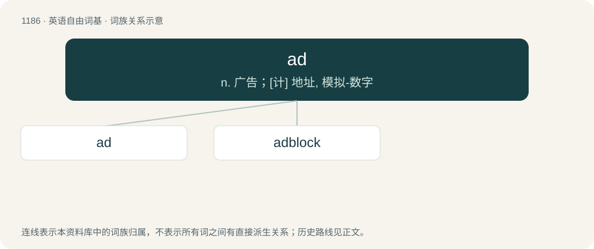

# 1264 · ad — n. 广告；\[计\] 地址, 模拟-数字

[总目录](../00_总目录_按常用程度.md)

**类型**：英语自由词基　｜　**来源语言**：见词源记录

## 核心含义与来源

- 核心含义：n. 广告；\[计\] 地址, 模拟-数字
- 英文含义：Advantage; also, designating the left-hand side, from the player's point of view, of their half of the court, where the advantage point following a deuce is always played.
- 词形：ad

**多个词源／构词路径**：同一拼写可能有不同来源；以下按词性和含义分别列出。

**来源记录 1**（名词；Advantage; also, designating the left-hand side, from the player's point of view, of their half of the court, where the advantage point following a deuce is always played.）

Clipping of advantage.

**来源记录 2**（介词；to, toward）

Borrowed from Latin ad (“to, on”).

## 词族图

## 单词速览（常用到不常用）

| 单词 | 音标 | 释义 |
|---|---|---|
| [ad](#w-1) | /æd/ | n. 广告；\[计\] 地址, 模拟-数字 |
| [adblock](#w-2) |  | 【英文】Synonym of adblocker. |

## 逐词详解

### 1. ad

**词性**：名词　｜　**音标**：/æd/

**中文释义**：n. 广告；\[计\] 地址, 模拟-数字

**英文义项**：Advantage; also, designating the left-hand side, from the player's point of view, of their half of the court, where the advantage point following a deuce is always played. / Advantage

**词源与演化**：

Clipping of advantage.

**用法示例／搭配（非完整句）**：

> ads and disads

该用例对应义项：Advantage

### 2. adblock

**词性**：名词

**英文义项**：Synonym of adblocker.

**构词拆分**：ad (“advertisement”) + block

**词源与演化**：

From ad (“advertisement”) + block, a genericized name from AdBlock or Adblock Plus.
