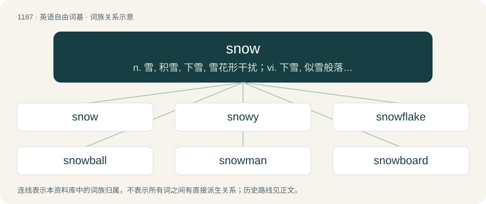

# 1265 · snow — n. 雪, 积雪, 下雪, 雪花形干扰；vi. 下雪, 似雪般落下；vt. 使雪白, 用雪覆盖, 使像雪般落下

[总目录](../00_总目录_按常用程度.md)

**类型**：英语自由词基　｜　**来源语言**：见词源记录

## 核心含义与来源

- 核心含义：n. 雪, 积雪, 下雪, 雪花形干扰；vi. 下雪, 似雪般落下；vt. 使雪白, 用雪覆盖, 使像雪般落下
- 英文含义：The partly frozen, crystalline state of water that falls from the atmosphere as precipitation in flakes; also, the falling of such flakes; and the accumulation of them on the ground or on objects as a white layer.
- 词形：snow

**来源记录 1**（名词；The partly frozen, crystalline state of water that falls from the atmosphere as precipitation in flakes; also, the falling of such flakes; and the accumulation of them on the ground or on objects as a white layer.）

The noun is derived from Middle English snaw, snou, snow (“snow; accumulation of snow; snowfall; snowstorm; whiteness”), from Old English snāw (“snow”), from Proto-West Germanic \*snaiw (“snow”), from Proto-Germanic \*snaiwaz (“snow”), from Proto-Indo-European \*snóygʷʰos (“snow”), from \*sneygʷʰ- (“to snow”). The verb is derived from Middle English snouen (“to snow; (figurative) to shower”), from snou, snow (noun) (see above) + -en (suffix forming the infinitive of verbs). Displaced Old English snīwan, whence English snew (obsolete). Verb etymology 1, verb sense 2.3.2 (“to convince or hoodwink (someone)”) probably refers to a person being blinded or confused by a snowstorm. The adjective comes from the phrase a snowball's chance in hell, also see snowball clause at Wikipedia. Cognates \* Scots snaw (“snow”) \* Yola sneew, sneow, snow, snowe (“snow”) \* North Frisian Sne, sni, snii, snii'e, snä, snäi (“snow”) \* Saterland Frisian Snee (“snow”) \* West Frisian snie (“snow”) \* Alemannic German schnee, schnei, schnia, schné, schnìj (“snow”) \* Bavarian schnea, sghneab (“snow”) \* Cimbrian snea, snèa (“snow”) \* Dutch snee, sneeuw (“snow”) \* German Schnee (“snow”) \* Limburgish Schnië, snieë (“snow”) \* Luxembourgish Schnéi (“snow”) \* Mòcheno schnea (“snow”) \* Vilamovian śnej, šnej, śnyi (“snow”) \* Yiddish שניי (shney, “snow”) \* Danish sne (“snow”) \* Elfdalian sniųo (“snow”) \* Faroese snjógvur (“snow”) \* Icelandic snjár, snjór, snær (“snow”) \* Norwegian Bokmål sne, snø (“snow”) \* Norwegian Nynorsk snjo, snø (“snow”) \* Swedish snö (“snow”) \* Gothic 𐍃𐌽𐌰𐌹𐍅𐍃 (snaiws, “snow”) \* Irish sneachta (“snow”) \* Manx sniaghtey (“snow”) \* Scottish Gaelic sneachd, sneachda (“snow”) \* Welsh nyf (“snow”) \* Latin nix (“snow”) \* Ancient Greek νίψ (níps, “snow”) \* Latvian snìegs (“snow”) \* Lithuanian sniẽgas (“snow”) \* Belarusian, Russian, and Macedonian снег (sneg, “snow”) \* Bulgarian сняг (snjag, “snow”) \* Czech sníh (“snow”) \* Polish śnieg, śmiég (“snow”) \* Serbo-Croatian сне̑г, сније̑г, snȇg, snig, snijȇg (“snow”) \* Slovak sneh (“snow”) \* Slovene sneg (“snow”) \* Ukrainian сніг (snih, “snow”) \* Shughni жиниҷ (žiniǰ, “snow”) \* Avestan 𐬯𐬥𐬀𐬉𐬲𐬀𐬌𐬙𐬌 (snaēžaⁱti, “to snow”) \* Sanskrit स्नेह (snéha, “grease, oil”)

## 词族图

## 单词速览（常用到不常用）

| 单词 | 音标 | 释义 |
|---|---|---|
| [snow](#w-1) | 英 /snəʊ̯/；美 /snoʊ̯/ | n. 雪, 积雪, 下雪, 雪花形干扰；vi. 下雪, 似雪般落下；vt. 使雪白, 用雪覆盖, 使像雪般落下 |
| [snowy](#w-2) | 英 /ˈsnəʊi/；美 /ˈsnoʊi/ | a. 多雪的, 雪的, 被雪所覆盖着的, 下雪的 |
| [snowflake](#w-3) | 英 /ˈsnəʊ.fleɪk/；美 /ˈsnoʊ.fleɪk/ | n. 雪片, 雪花, 雪片莲 |
| [snowball](#w-4) | 英 /ˈsnəʊbɔːl/；美 /ˈsnoʊbɔl/ | n. 雪球, 果味冰霜卷, 滚雪球式的募捐法；vt. 向...丢雪球, 使滚雪球般增长；vi. 打雪仗, 滚雪球般增长 |
| [snowman](#w-5) | 英 /ˈsnəʊ.mæn/；美 /ˈsnoʊ.mæn/ | n. 雪人 |
| [snowboard](#w-6) | 英 /ˈsnəʊˌbɔːd/；美 /ˈsnoʊˌbɔɹd/ | n. 滑雪板 |
| [snows](#w-7) | 英 /snəʊz/；美 /snoʊz/ | n. 雪( snow的名词复数 ); 下雪; \[用复数\] 积雪; （某地或某时的）降雪量；v. （用花言巧语）蒙( snow的第三人称单数 ); 使雪片般地落下; 用雪覆盖; 用雪阻困(over, under) |
| [snowstorm](#w-8) | /ˈsnəʊstɔːm/ | n. 暴风雪；\[化\] 雪暴 |
| [snowmobile](#w-9) | /ˈsnəuməubiːl/ | n. 雪上机动车 |
| [snowshoe](#w-10) | 美 /ˈsnoʊʃu/ | n. 雪鞋；vi. 穿雪鞋走路 |
| [snowpack](#w-11) | /ˈsnəupæk/ | n. 积雪场 |
| [snowdrop](#w-12) | 英 /ˈsnəʊ.dɹɒp/；美 /ˈsnoʊ.dɹɑp/ | n. 雪花莲, (美)(非正式)宪兵 |
| [snowmelt](#w-13) | 美 /ˈsnoʊˌmɛlt/ | n. 融雪水 |
| [snowbird](#w-14) | 英 /ˈsnəʊbɜːd/；美 /ˈsnoʊbɝːd/ | n. 雀科小鸟 |
| [snowplow](#w-15) | /ˈsnəjplaj/ | n. 雪犁, 扫雪机, 犁雪机 |
| [snowbound](#w-16) | 美 /ˈsnoʊˌbaʊnd/ | a. 被雪困住的, 被雪困在室内的, 被雪封住的 |

## 逐词详解

### 1. snow

**词性**：名词　｜　**音标**：英 /snəʊ̯/；美 /snoʊ̯/

**中文释义**：n. 雪, 积雪, 下雪, 雪花形干扰；vi. 下雪, 似雪般落下；vt. 使雪白, 用雪覆盖, 使像雪般落下

**英文义项**：The partly frozen, crystalline state of water that falls from the atmosphere as precipitation in flakes; also, the falling of such flakes; and the accumulation of them on the ground or on objects as a white layer. / An instance of the falling of snow (etymology 1, noun sense 1); a snowfall; also, a snowstorm.

**词源与演化**：

The noun is derived from Middle English snaw, snou, snow (“snow; accumulation of snow; snowfall; snowstorm; whiteness”), from Old English snāw (“snow”), from Proto-West Germanic \*snaiw (“snow”), from Proto-Germanic \*snaiwaz (“snow”), from Proto-Indo-European \*snóygʷʰos (“snow”), from \*sneygʷʰ- (“to snow”). The verb is derived from Middle English snouen (“to snow; (figurative) to shower”), from snou, snow (noun) (see above) + -en (suffix forming the infinitive of verbs). Displaced Old English snīwan, whence English snew (obsolete). Verb etymology 1, verb sense 2.3.2 (“to convince or hoodwink (someone)”) probably refers to a person being blinded or confused by a snowstorm. The adjective comes from the phrase a snowball's chance in hell, also see snowball clause at Wikipedia. Cognates \* Scots snaw (“snow”) \* Yola sneew, sneow, snow, snowe (“snow”) \* North Frisian Sne, sni, snii, snii'e, snä, snäi (“snow”) \* Saterland Frisian Snee (“snow”) \* West Frisian snie (“snow”) \* Alemannic German schnee, schnei, schnia, schné, schnìj (“snow”) \* Bavarian schnea, sghneab (“snow”) \* Cimbrian snea, snèa (“snow”) \* Dutch snee, sneeuw (“snow”) \* German Schnee (“snow”) \* Limburgish Schnië, snieë (“snow”) \* Luxembourgish Schnéi (“snow”) \* Mòcheno schnea (“snow”) \* Vilamovian śnej, šnej, śnyi (“snow”) \* Yiddish שניי (shney, “snow”) \* Danish sne (“snow”) \* Elfdalian sniųo (“snow”) \* Faroese snjógvur (“snow”) \* Icelandic snjár, snjór, snær (“snow”) \* Norwegian Bokmål sne, snø (“snow”) \* Norwegian Nynorsk snjo, snø (“snow”) \* Swedish snö (“snow”) \* Gothic 𐍃𐌽𐌰𐌹𐍅𐍃 (snaiws, “snow”) \* Irish sneachta (“snow”) \* Manx sniaghtey (“snow”) \* Scottish Gaelic sneachd, sneachda (“snow”) \* Welsh nyf (“snow”) \* Latin nix (“snow”) \* Ancient Greek νίψ (níps, “snow”) \* Latvian snìegs (“snow”) \* Lithuanian sniẽgas (“snow”) \* Belarusian, Russian, and Macedonian снег (sneg, “snow”) \* Bulgarian сняг (snjag, “snow”) \* Czech sníh (“snow”) \* Polish śnieg, śmiég (“snow”) \* Serbo-Croatian сне̑г, сније̑г, snȇg, snig, snijȇg (“snow”) \* Slovak sneh (“snow”) \* Slovene sneg (“snow”) \* Ukrainian сніг (snih, “snow”) \* Shughni жиниҷ (žiniǰ, “snow”) \* Avestan 𐬯𐬥𐬀𐬉𐬲𐬀𐬌𐬙𐬌 (snaēžaⁱti, “to snow”) \* Sanskrit स्नेह (snéha, “grease, oil”)

**例句**：

> We have had several heavy snows this year.

该用例对应义项：An instance of the falling of snow (etymology 1, noun sense 1); a snowfall; also, a snowstorm.

### 2. snowy

**词性**：形容词　｜　**音标**：英 /ˈsnəʊi/；美 /ˈsnoʊi/

**中文释义**：a. 多雪的, 雪的, 被雪所覆盖着的, 下雪的

**英文义项**：Marked by snow; characterized by snow. / Covered with snow; snow-covered; besnowed.

**构词拆分**：By surface analysis, snow + -y

**词源与演化**：

From Middle English snowy, snawy; from Old English snāwiġ. By surface analysis, snow + -y.

**用法示例／搭配（非完整句）**：

> snowy hillside

该用例对应义项：Covered with snow; snow-covered; besnowed.

### 3. snowflake

**词性**：名词　｜　**音标**：英 /ˈsnəʊ.fleɪk/；美 /ˈsnoʊ.fleɪk/

**中文释义**：n. 雪片, 雪花, 雪片莲

**英文义项**：A crystal of snow, having approximate hexagonal symmetry. / Any of several bulbous European plants, of the genus Leucojum, having white flowers.

**构词拆分**：snow + flake

**词源与演化**：

From snow + flake. Compare Saterland Frisian Sneeflokke (“snowflake”), Dutch sneeuwvlok, Luxembourgish Schnéiflack, German Schneeflocke.

**例句**：

> I must be a snowflake because I've fallen for you.

### 4. snowball

**词性**：名词　｜　**音标**：英 /ˈsnəʊbɔːl/；美 /ˈsnoʊbɔl/

**中文释义**：n. 雪球, 果味冰霜卷, 滚雪球式的募捐法；vt. 向...丢雪球, 使滚雪球般增长；vi. 打雪仗, 滚雪球般增长

**英文义项**：A ball of snow, usually one made in the hand and thrown for amusement in a snowball fight; also a larger ball of snow made by rolling a snowball around in snow that sticks to it and increases its diameter. / A cocktail made from lemonade and advocaat.

**构词拆分**：snow + ball

**词源与演化**：

From Middle English snoweball, snoweballe, snaweballe, snayballe, equivalent to snow + ball. Cognate with Scots snawbaw, German Schneeball, Luxembourgish Schnéiball, Dutch sneeuwbal, Afrikaans sneeubal, Limburgish snieëbal, West Frisian sniebal, Saterland Frisian Sneebaal, Sneebal, Swedish snöboll, Elfdalian sniųoboll, Danish snebold, Norwegian Bokmål snøball, Norwegian Nynorsk snøball and Icelandic snjóbolti.

**例句**：

> It didn't take long to eat a packetful of snowballs — they are simply delicious.

该用例对应义项：A small cake, typically cream-filled and covered in chocolate icing and desiccated coconut.

### 5. snowman

**词性**：名词　｜　**音标**：英 /ˈsnəʊ.mæn/；美 /ˈsnoʊ.mæn/

**中文释义**：n. 雪人

**英文义项**：A humanoid figure made with large snowballs stacked on each other. Human traits like a face and arms may be fashioned with sticks (arms), a carrot (nose), and stones or coal (eyes, mouth). / A score of eight, especially within one inning (in baseball) or on one hole (in golf, where it is also known as dogballs).

**构词拆分**：snow + -man

**词源与演化**：

\* snow + -man. \* (score of eight; card ranked eight): A typical snowman, built from two balls of snow, resembles a figure eight.

**例句**：

> All I need to know about life, I learned from a snowman.

### 6. snowboard

**词性**：动词　｜　**音标**：英 /ˈsnəʊˌbɔːd/；美 /ˈsnoʊˌbɔɹd/

**中文释义**：n. 滑雪板

**英文义项**：To ride a snowboard. / To travel over (a slope etc.) on a snowboard.

**构词拆分**：snow + board

**词源与演化**：

From snow + board.

**例句**：

> I have snowboarded this slope a dozen times.

该用例对应义项：To travel over (a slope etc.) on a snowboard.

### 7. snows

**词性**：名词　｜　**音标**：英 /snəʊz/；美 /snoʊz/

**中文释义**：n. 雪( snow的名词复数 ); 下雪; \[用复数\] 积雪; （某地或某时的）降雪量；v. （用花言巧语）蒙( snow的第三人称单数 ); 使雪片般地落下; 用雪覆盖; 用雪阻困(over, under)

**英文义项**：One or both regions of the Earth where it snows the year round; the Arctic and/or Antarctic. / A woman's pale-coloured breasts.

**构词拆分**：snow + -s (suffix forming pluralia tantum and regular plurals of nouns; and the third-person singular indicative present tense of verbs)

**词源与演化**：

From snow + -s (suffix forming pluralia tantum and regular plurals of nouns; and the third-person singular indicative present tense of verbs).

**例句**：

> In places where it snows a lot, kerosene is an indispensable item.

### 8. snowstorm

**词性**：名词　｜　**音标**：/ˈsnəʊstɔːm/

**中文释义**：n. 暴风雪；\[化\] 雪暴

**英文义项**：Bad weather involving blowing winds and snow, or blowing winds and heavy snowfall amount. / A snow globe.

**构词拆分**：snow + storm

**词源与演化**：

From earlier snow-storm, snow storm, equivalent to snow + storm. Compare Scots snawstorm (“snowstorm”), Saterland Frisian Sneestoarm (“snowstorm”), West Frisian sniestoarm (“snowstorm”), Dutch sneeuwstorm (“snowstorm”), German Low German Sneestorm (“snowstorm”), German Schneesturm (“snowstorm”), Danish snestorm (“snowstorm”), Swedish snöstorm (“snowstorm”), Icelandic snjóstormur (“snowstorm”). Compare also Middle English storm of snow (“snowstorm”).

**例句**：

> The snowstorm left more than 30 inches of snow on the ground.

### 9. snowmobile

**词性**：名词　｜　**音标**：/ˈsnəuməubiːl/

**中文释义**：n. 雪上机动车

**英文义项**：A vehicle with skis at the front and a caterpillar track at the rear, used for travelling over snow, sometimes as sport.

**构词拆分**：snow + -mobile

**词源与演化**：

From snow + -mobile.

**例句**：

> Get his glove off carefully. He's smashed his fingers between the snowmobile and a tree.

### 10. snowshoe

**词性**：名词　｜　**音标**：美 /ˈsnoʊʃu/

**中文释义**：n. 雪鞋；vi. 穿雪鞋走路

**英文义项**：A flat item of footwear worn to facilitate walking in deep snow. / Synonym of mukluk

**构词拆分**：snow + shoe

**词源与演化**：

From snow + shoe.

**例句**：

> Kim Asmussen is a 62-year-old Canadian who makes snowshoe art.

### 11. snowpack

**词性**：名词　｜　**音标**：/ˈsnəupæk/

**中文释义**：n. 积雪场

**英文义项**：An accumulation of packed snow, usually the seasonal amount.

**构词拆分**：snow + pack

**词源与演化**：

From snow + pack.

**例句**：

> The melted snowpack seeps down to fill mountainside indentations to form glacial lakes.

### 12. snowdrop

**词性**：名词　｜　**音标**：英 /ˈsnəʊ.dɹɒp/；美 /ˈsnoʊ.dɹɑp/

**中文释义**：n. 雪花莲, (美)(非正式)宪兵

**英文义项**：Any of the 20 species of the genus Galanthus of the Amaryllidaceae, bulbous flowering plants, bearing a solitary, pendulous, white, bell-shaped flower that appears, depending on species, between autumn and late winter or early spring, all native to temperate Eurasia.

**构词拆分**：snow + drop

**词源与演化**：

From snow + drop.

**例句**：

> I saw my first snowdrop of the year today!

### 13. snowmelt

**词性**：名词　｜　**音标**：美 /ˈsnoʊˌmɛlt/

**中文释义**：n. 融雪水

**英文义项**：Runoff from melting snow.

**构词拆分**：snow + melt

**词源与演化**：

From snow + melt.

**例句**：

> The snowmelt causes the river to flood.

该用例对应义项：Runoff from melting snow.

### 14. snowbird

**词性**：名词　｜　**音标**：英 /ˈsnəʊbɜːd/；美 /ˈsnoʊbɝːd/

**中文释义**：n. 雀科小鸟

**英文义项**：A bird, Junco hyemalis, the dark-eyed junco. / A migratory bird seen primarily in the winter time.

**构词拆分**：snow + bird

**词源与演化**：

From snow + bird.

### 15. snowplow

**词性**：名词　｜　**音标**：/ˈsnəjplaj/

**中文释义**：n. 雪犁, 扫雪机, 犁雪机

**英文义项**：A motorized vehicle that is used to push snow off flat surfaces such as roads and parking lots. / A blade-like pushing device attached to a vehicle to enable it to be used for removing snow.

**构词拆分**：snow + plow

**词源与演化**：

From snow + plow.

**例句**：

> A snowplow tried to keep the highway near Oslo free of snow on Thursday morning.

### 16. snowbound

**词性**：形容词　｜　**音标**：美 /ˈsnoʊˌbaʊnd/

**中文释义**：a. 被雪困住的, 被雪困在室内的, 被雪封住的

**英文义项**：Prevented from moving or traveling due to snow or snowy weather. / Of a location or other destination, inaccessible due to being covered in snow.

**构词拆分**：snow + -bound

**词源与演化**：

From snow + -bound.
