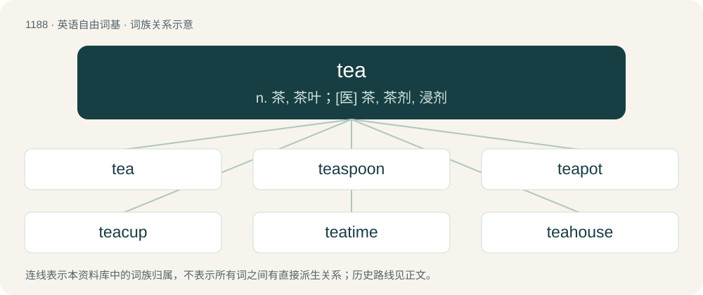

# 1266 · tea — n. 茶, 茶叶；\[医\] 茶, 茶剂, 浸剂

[总目录](../00_总目录_按常用程度.md)

**类型**：英语自由词基　｜　**来源语言**：见词源记录

## 核心含义与来源

- 核心含义：n. 茶, 茶叶；\[医\] 茶, 茶剂, 浸剂
- 英文含义：The tea plant (Camellia sinensis); (countable) a variety of this plant.
- 词形：tea

**多个词源／构词路径**：同一拼写可能有不同来源；以下按词性和含义分别列出。

**来源记录 1**（名词；The tea plant (Camellia sinensis); (countable) a variety of this plant.）

First appears c. 1655, in the English translation Álvaro Semedo’s writings. From Dutch thee, from Hokkien 茶 (tê) (Amoy dialect), from Old Chinese, ultimately from Proto-Sino-Tibetan \*s-la (“leaf, tea”). Introduced to English and other Western European languages by the Dutch East India Company, who sourced their tea in Amoy; compare Malay teh along the same trade route. Doublet of chai and cha (and, distantly, the first element of lahpet), from same Proto-Sino-Tibetan root; see discussion of cognates. Cognates The word for “tea” in many languages is of Sinitic origin (due to China being the origin of the plant), and thus there are many cognates; see translations. These are from one of two proximate sources, reflected in the phonological shape: forms with a stop (e.g. /t/) are derived from Min Nan tê, while forms with an affricate (e.g. /tʃ/) are derived from other Sinitic languages, like Mandarin chá or Cantonese caa4 (all written as 茶). Different languages borrowed one or the other form (specific language and point in time varied), reflecting trade ties, generally Min Nan tê if by ocean trade from Fujian, Cantonese caa4 if by ocean trade from Guangdong, or northern Chinese chá if by overland trade or by ocean trade from India. Thus Western and Northern European languages borrowed tê (with the exception of Portuguese, which uses chá; despite being by ocean trade, their source was in Macao, not Amoy), while chá borrowings are used over a very large geographical area of Eurasia and Africa: Southern and Eastern Europe, and on through Turkish, Arabic, North and East Africa, Persian, Central Asian, and Indic languages. In Europe the tê/chá line is Italian/Slovene, Hungarian/Romanian, German/Czech, Polish/Ukrainian, Baltics/Russian, Finnish/Karelian, Northern Sami/Inari Sami. tê was also borrowed in European trade stops in Southern India and coastal Africa, though chá borrowings are otherwise more prevalent in these regions, via Arabic or Indic, due to earlier trade. The situation in Southeast Asia is complex due to multiple influences, and some languages borrowed both forms, such as Malay teh and ca. Etymology 1, noun sense 12 (“information, especially gossip”) may be originally from T standing for truth, which evolved into tea. An alternative explanation dates back to gay African-American culture in the 1970s and alludes to women gossiping over afternoon tea.

**来源记录 2**（名词；A moment, a historical unit of time from China, about the amount of time needed to quickly drink a traditional cup of tea.）

Semantic loan from Chinese 茶 (chá, “tea”).

## 词族图

## 单词速览（常用到不常用）

| 单词 | 音标 | 释义 |
|---|---|---|
| [tea](#w-1) | 英 /tiː/；美 /ti/ | n. 茶, 茶叶；\[医\] 茶, 茶剂, 浸剂 |
| [teaspoon](#w-2) | 英 /ˈtiːˌspuːn/；美 /ˈtiˌspun/ | n. 茶匙；\[医\] 茶匙(4毫升) |
| [teapot](#w-3) | 英 /ˈtiː.pɒt/；美 /ˈti.pɔt/ | n. 茶壶 |
| [teacup](#w-4) | /ˈtiː.kʌp/ | n. 茶杯, 满茶杯 |
| [teatime](#w-5) | /ˈtiːtaim/ | n. 下午茶时间 |
| [teahouse](#w-6) | /ˈtiˌhaʊs/ | n. 茶室 |
| [tearoom](#w-7) | 美 /ˈtiˌɹum/ | n. 茶室 |
| [teabag](#w-8) | /ˈtiː(ˌ)bæɡ/ | n. 袋装茶叶 |

## 逐词详解

### 1. tea

**词性**：名词　｜　**音标**：英 /tiː/；美 /ti/

**中文释义**：n. 茶, 茶叶；\[医\] 茶, 茶剂, 浸剂

**英文义项**：The tea plant (Camellia sinensis); (countable) a variety of this plant. / The dried leaves or buds of the tea plant; (countable) a variety of such leaves.

**词源与演化**：

First appears c. 1655, in the English translation Álvaro Semedo’s writings. From Dutch thee, from Hokkien 茶 (tê) (Amoy dialect), from Old Chinese, ultimately from Proto-Sino-Tibetan \*s-la (“leaf, tea”). Introduced to English and other Western European languages by the Dutch East India Company, who sourced their tea in Amoy; compare Malay teh along the same trade route. Doublet of chai and cha (and, distantly, the first element of lahpet), from same Proto-Sino-Tibetan root; see discussion of cognates. Cognates The word for “tea” in many languages is of Sinitic origin (due to China being the origin of the plant), and thus there are many cognates; see translations. These are from one of two proximate sources, reflected in the phonological shape: forms with a stop (e.g. /t/) are derived from Min Nan tê, while forms with an affricate (e.g. /tʃ/) are derived from other Sinitic languages, like Mandarin chá or Cantonese caa4 (all written as 茶). Different languages borrowed one or the other form (specific language and point in time varied), reflecting trade ties, generally Min Nan tê if by ocean trade from Fujian, Cantonese caa4 if by ocean trade from Guangdong, or northern Chinese chá if by overland trade or by ocean trade from India. Thus Western and Northern European languages borrowed tê (with the exception of Portuguese, which uses chá; despite being by ocean trade, their source was in Macao, not Amoy), while chá borrowings are used over a very large geographical area of Eurasia and Africa: Southern and Eastern Europe, and on through Turkish, Arabic, North and East Africa, Persian, Central Asian, and Indic languages. In Europe the tê/chá line is Italian/Slovene, Hungarian/Romanian, German/Czech, Polish/Ukrainian, Baltics/Russian, Finnish/Karelian, Northern Sami/Inari Sami. tê was also borrowed in European trade stops in Southern India and coastal Africa, though chá borrowings are otherwise more prevalent in these regions, via Arabic or Indic, due to earlier trade. The situation in Southeast Asia is complex due to multiple influences, and some languages borrowed both forms, such as Malay teh and ca. Etymology 1, noun sense 12 (“information, especially gossip”) may be originally from T standing for truth, which evolved into tea. An alternative explanation dates back to gay African-American culture in the 1970s and alludes to women gossiping over afternoon tea.

**例句**：

> I won't make it to the breakfast event, but I'll see you at the tea.

该用例对应义项：A light midafternoon meal, typically but not necessarily including tea.

### 2. teaspoon

**词性**：动词　｜　**音标**：英 /ˈtiːˌspuːn/；美 /ˈtiˌspun/

**中文释义**：n. 茶匙；\[医\] 茶匙(4毫升)

**英文义项**：To serve with a teaspoon.

**构词拆分**：tea + spoon

**词源与演化**：

From tea + spoon.

**例句**：

> I teaspooned some sugar into my cup.

该用例对应义项：To serve with a teaspoon.

### 3. teapot

**词性**：名词　｜　**音标**：英 /ˈtiː.pɒt/；美 /ˈti.pɔt/

**中文释义**：n. 茶壶

**英文义项**：A vessel for brewing and serving tea, typically with a handle and spout.

**构词拆分**：Endocentric compound of tea + pot

**词源与演化**：

Endocentric compound of tea + pot.

**例句**：

> Put the teapot on the burner, otherwise the tea will be cold.

### 4. teacup

**词性**：名词　｜　**音标**：/ˈtiː.kʌp/

**中文释义**：n. 茶杯, 满茶杯

**英文义项**：A small cup, usually with a handle, commonly used for drinking tea; normally sits in a saucer as part of a tea set. / A unit of measure; a teacupful.

**构词拆分**：tea + cup

**词源与演化**：

From tea + cup.

**例句**：

> There is a small teacup and an egg on the table.

### 5. teatime

**词性**：名词　｜　**音标**：/ˈtiːtaim/

**中文释义**：n. 下午茶时间

**英文义项**：The traditional time, in the late afternoon, for serving tea (the meal). / A social gathering or conversation centered on sharing gossip, rumors, or other personal news.

**构词拆分**：tea + time

**词源与演化**：

From tea + time. Compare Saterland Frisian Teetied (“teatime”), West Frisian teetiid (“teatime”), Dutch theetijd (“teatime”), German Teezeit (“teatime”), Danish tetid (“teatime”), Swedish tetid (“teatime”), Icelandic tetími (“teatime”).

**例句**：

> Now, get out your patchwork and have your square done before teatime.

### 6. teahouse

**词性**：名词　｜　**音标**：/ˈtiˌhaʊs/

**中文释义**：n. 茶室

**英文义项**：A cafe or restaurant that serves tea, usually with light food. / A public lavatory.

**构词拆分**：tea + house

**词源与演化**：

From tea + house.

**例句**：

> I am drinking a cup of blueberry tea in the teahouse.

### 7. tearoom

**词性**：名词　｜　**音标**：美 /ˈtiˌɹum/

**中文释义**：n. 茶室

**英文义项**：A café which serves tea, usually with light food. / A public lavatory.

**构词拆分**：tea + room

**词源与演化**：

From tea + room. In reference to a lavatory, probably as a variant of t-room (“toilet room”).

**例句**：

> Antoine and Chantal are eating rhubarb cake with mint tea in the tearoom.

### 8. teabag

**词性**：名词　｜　**音标**：/ˈtiː(ˌ)bæɡ/

**中文释义**：n. 袋装茶叶

**英文义项**：A cloth or paper sachet containing tea leaves or herbal tea, designed to act as an infuser when submerged in hot water.

**构词拆分**：tea + bag

**词源与演化**：

From tea + bag.

**例句**：

> He put the teabag on the saucer.
