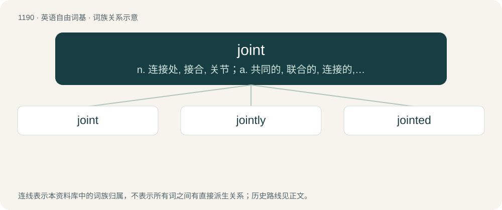

# 1267 · joint — n. 连接处, 接合, 关节；a. 共同的, 联合的, 连接的, 合办的；vt. 连接, 接合, 使有接头

[总目录](../00_总目录_按常用程度.md)

**类型**：英语自由词基　｜　**来源语言**：见词源记录

## 核心含义与来源

- 核心含义：n. 连接处, 接合, 关节；a. 共同的, 联合的, 连接的, 合办的；vt. 连接, 接合, 使有接头
- 英文含义：United, combined
- 词形：joint

**来源记录 1**（形容词；United, combined）

The noun is from Middle English joynt (attested since the late 13th century), from Old French joint (“joint of the body”) (attested since the 12th century). The adjective (attested since the 15th century) is from Old French jointiz. Both Old French words are from Latin iūnctus, the past participle of iungō. See also join, jugular, junction. Displaced Old English fōg and partially displaced English lith. The meaning of "building, establishment", especially in connection with shady activities, appeared in Anglo-Irish by 1821 and entered general American English slang by 1877, especially in the sense of "opium den". The sense "marijuana cigarette" is attested since 1935. The development to meaning "any thing" also happened to the Scots and Memphian form junt and the Mid-Atlantic/Philadelphian form jawn.

## 词族图

## 单词速览（常用到不常用）

| 单词 | 音标 | 释义 |
|---|---|---|
| [joint](#w-1) | /d͡ʒɔɪnt/ | n. 连接处, 接合, 关节；a. 共同的, 联合的, 连接的, 合办的；vt. 连接, 接合, 使有接头 |
| [jointly](#w-2) | 美 /ˈd͡ʒɔɪntli/ | adv. 共同地, 连带地 |
| [jointed](#w-3) | /ˈd͡ʒɔɪntɪd/ | a. 有接缝的, 有节的, 有接头的 |

## 逐词详解

### 1. joint

**词性**：形容词　｜　**音标**：/d͡ʒɔɪnt/

**中文释义**：n. 连接处, 接合, 关节；a. 共同的, 联合的, 连接的, 合办的；vt. 连接, 接合, 使有接头

**英文义项**：United, combined / Done by two or more people or organisations working together.

**词源与演化**：

The noun is from Middle English joynt (attested since the late 13th century), from Old French joint (“joint of the body”) (attested since the 12th century). The adjective (attested since the 15th century) is from Old French jointiz. Both Old French words are from Latin iūnctus, the past participle of iungō. See also join, jugular, junction. Displaced Old English fōg and partially displaced English lith. The meaning of "building, establishment", especially in connection with shady activities, appeared in Anglo-Irish by 1821 and entered general American English slang by 1877, especially in the sense of "opium den". The sense "marijuana cigarette" is attested since 1935. The development to meaning "any thing" also happened to the Scots and Memphian form junt and the Mid-Atlantic/Philadelphian form jawn.

**例句**：

> The play was a joint production between the two companies.

该用例对应义项：Done by two or more people or organisations working together.

### 2. jointly

**词性**：副词　｜　**音标**：美 /ˈd͡ʒɔɪntli/

**中文释义**：adv. 共同地, 连带地

**英文义项**：Together, acting as one; collectively.

**构词拆分**：joint + -ly

**词源与演化**：

From joint + -ly.

**例句**：

> They jointly raised the child, even though they were no longer married.

该用例对应义项：Together, acting as one; collectively.

### 3. jointed

**词性**：形容词　｜　**音标**：/ˈd͡ʒɔɪntɪd/

**中文释义**：a. 有接缝的, 有节的, 有接头的

**英文义项**：Having joints. / Extremely full of people, packed, chockablock.

**构词拆分**：From joint (“noun”) + -ed.

**词源与演化**：

From joint (“noun”) + -ed.

**例句**：

> Tom is double jointed and double muscled.
