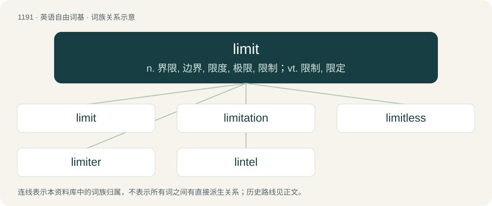

# 1268 · limit — n. 界限, 边界, 限度, 极限, 限制；vt. 限制, 限定

[总目录](../00_总目录_按常用程度.md)

**类型**：英语自由词基　｜　**来源语言**：见词源记录

## 核心含义与来源

- 核心含义：n. 界限, 边界, 限度, 极限, 限制；vt. 限制, 限定
- 英文含义：A restriction; a bound beyond which one may not go or proceed.
- 词形：limit

**多个词源／构词路径**：同一拼写可能有不同来源；以下按词性和含义分别列出。

**来源记录 1**（名词；A restriction; a bound beyond which one may not go or proceed.）

From Middle English limit, from Old French limit, from oblique stem of Latin līmes, līmit- (“a cross-path or balk between fields, hence a boundary, boundary line or wall, any path or road, border, limit”). Displaced native Old English ġemǣre. Doublet of limes.

**来源记录 2**（动词；To restrict; to circumscribe; not to allow to go beyond a certain bound, to set boundaries.）

From Middle English limiten, from Old French limiter, from Latin līmitō (“to bound, limit, fix, determine”), from līmes; see noun.

## 词族图

## 单词速览（常用到不常用）

| 单词 | 音标 | 释义 |
|---|---|---|
| [limit](#w-1) | /ˈlɪm.ɪt/ | n. 界限, 边界, 限度, 极限, 限制；vt. 限制, 限定 |
| [limitation](#w-2) | /lɪmɪˈteɪʃən/ | n. 限制, 缺陷, 限额；\[医\] 限界, 限制, 限度 |
| [limitless](#w-3) | /ˈlimitlis/ | a. 无限的, 无界限的 |
| [limiter](#w-4) | /ˈlimitə/ | n. 限制物, 限幅器；\[计\] 限幅器 |
| [lintel](#w-5) | /ˈlɪn.təl/ | n. 过梁 |

## 逐词详解

### 1. limit

**词性**：名词　｜　**音标**：/ˈlɪm.ɪt/

**中文释义**：n. 界限, 边界, 限度, 极限, 限制；vt. 限制, 限定

**英文义项**：A restriction; a bound beyond which one may not go or proceed. / A value to which a sequence converges. Equivalently, the common value of the upper limit and the lower limit of a sequence: if the upper and lower limits are different, then the sequence has no limit (i.e., does not converge).

**词源与演化**：

From Middle English limit, from Old French limit, from oblique stem of Latin līmes, līmit- (“a cross-path or balk between fields, hence a boundary, boundary line or wall, any path or road, border, limit”). Displaced native Old English ġemǣre. Doublet of limes.

**例句**：

> Category theory defines a very general concept of limit.

该用例对应义项：Any of several abstractions of this concept of limit.

### 2. limitation

**词性**：名词　｜　**音标**：/lɪmɪˈteɪʃən/

**中文释义**：n. 限制, 缺陷, 限额；\[医\] 限界, 限制, 限度

**英文义项**：The act of limiting or the state of being limited. / A restriction; a boundary, real or metaphorical, caused by some thing or some circumstance.

**构词拆分**：limit + -ation

**词源与演化**：

Borrowed from Latin limitatio. Morphologically limit + -ation.

**例句**：

> Getting into his wheelchair after his amputation, it felt like a limitation you could roll in.

该用例对应义项：A restriction; a boundary, real or metaphorical, caused by some thing or some circumstance.

### 3. limitless

**词性**：形容词　｜　**音标**：/ˈlimitlis/

**中文释义**：a. 无限的, 无界限的

**英文义项**：Without limits in extent, size, or quantity.

**构词拆分**：limit + -less

**词源与演化**：

From limit + -less.

**例句**：

> Limitless vastness of our solar system.

该用例对应义项：without limits in extent or size or quantity

### 4. limiter

**词性**：名词　｜　**音标**：/ˈlimitə/

**中文释义**：n. 限制物, 限幅器；\[计\] 限幅器

**英文义项**：That which limits or confines. / A circuit that allows signals below a specified input threshold to pass unaffected while attenuating the peaks of stronger signals.

**构词拆分**：limit + -er

**词源与演化**：

From limit + -er.

**例句**：

> The limiter automatically put on the brakes to keep the machine from going too fast.

该用例对应义项：That which limits or confines.

### 5. lintel

**词性**：名词　｜　**音标**：/ˈlɪn.təl/

**中文释义**：n. 过梁

**英文义项**：A horizontal structural beam spanning an opening, such as between the uprights of a door or a window, and which supports the wall above.

**构词拆分**：limit + -el

**词源与演化**：

From Middle English lyntel, from Old French lintel, from Vulgar Latin \*līntellus, for \*līmitellus, diminutive noun from līmes. Equivalent to limit + -el.

**例句**：

> In older buildings, a wooden lintel can sometimes sag or rot, requiring replacement.
