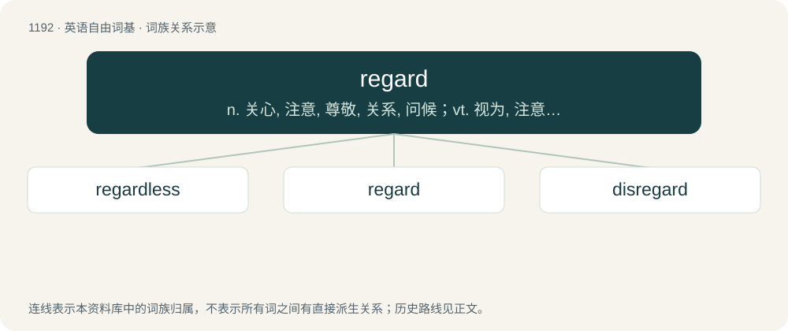

# 1269 · regard — n. 关心, 注意, 尊敬, 关系, 问候；vt. 视为, 注意, 考虑, 和...有关, 看待；vi. 注视, 注意

[总目录](../00_总目录_按常用程度.md)

**类型**：英语自由词基　｜　**来源语言**：见词源记录

## 核心含义与来源

- 核心含义：n. 关心, 注意, 尊敬, 关系, 问候；vt. 视为, 注意, 考虑, 和...有关, 看待；vi. 注视, 注意
- 英文含义：A steady look, a gaze.
- 词形：regard

**多个词源／构词路径**：同一拼写可能有不同来源；以下按词性和含义分别列出。

**来源记录 1**（名词；A steady look, a gaze.）

From Middle English regard, regarde, reguard, from Anglo-Norman reguard, from regarder, reguarder. Attested in Middle English starting around the mid 14th century. Piecewise doublet of reward; compare also guard, ward, guardian, and so on.

**来源记录 2**（动词；To look at; to observe.）

From Middle English regarden, from Old French regarder, reguarder. First attested in late Middle English, circa the early 15th century.

**来源记录 3**（名词；Filter-avoidance spelling of retard.）

Popularized about 2022 along with regarded.

## 词族图

## 单词速览（常用到不常用）

| 单词 | 音标 | 释义 |
|---|---|---|
| [regardless](#w-1) | 英 /ɹɪˈɡɑːd.lɪs/；美 /ɹɪˈɡɑɹd.lɪs/ | a. 不管, 不注意, 不顾 |
| [regard](#w-2) | 英 /ɹɪˈɡɑːd/；美 /ɹɪˈɡɑɹd/ | n. 关心, 注意, 尊敬, 关系, 问候；vt. 视为, 注意, 考虑, 和...有关, 看待；vi. 注视, 注意 |
| [disregard](#w-3) | 英 /dɪsɹɪˈɡɑːd/；美 /dɪsɹɪˈɡɑɹd/ | n. 忽视, 漠视；vt. 忽视, 不顾 |

## 逐词详解

### 1. regardless

**词性**：副词　｜　**音标**：英 /ɹɪˈɡɑːd.lɪs/；美 /ɹɪˈɡɑɹd.lɪs/

**中文释义**：a. 不管, 不注意, 不顾

**英文义项**：Without attention to warnings or indications of bad consequences. / Anyway; irrespective of what has just been said.

**构词拆分**：regard + -less

**词源与演化**：

From regard + -less.

**例句**：

> The proposal may become law, or it may not. Regardless, we will adopt it as a club rule.

该用例对应义项：Anyway; irrespective of what has just been said.

### 2. regard

**词性**：名词　｜　**音标**：英 /ɹɪˈɡɑːd/；美 /ɹɪˈɡɑɹd/

**中文释义**：n. 关心, 注意, 尊敬, 关系, 问候；vt. 视为, 注意, 考虑, 和...有关, 看待；vi. 注视, 注意

**英文义项**：A steady look, a gaze. / One's concern for another; esteem; relation, reference.

**词源与演化**：

From Middle English regard, regarde, reguard, from Anglo-Norman reguard, from regarder, reguarder. Attested in Middle English starting around the mid 14th century. Piecewise doublet of reward; compare also guard, ward, guardian, and so on.

**例句**：

> He is held in great regard in Whitehall.

该用例对应义项：The worth or estimation in which something or someone is held.

### 3. disregard

**词性**：名词　｜　**音标**：英 /dɪsɹɪˈɡɑːd/；美 /dɪsɹɪˈɡɑɹd/

**中文释义**：n. 忽视, 漠视；vt. 忽视, 不顾

**英文义项**：The act or state of deliberately not paying attention or caring about something.

**构词拆分**：dis- + regard

**词源与演化**：

From dis- + regard. Compare misregard.

**例句**：

> The government's blithe disregard for the needs of disabled people is outrageous.

该用例对应义项：The act or state of deliberately not paying attention or caring about something.
