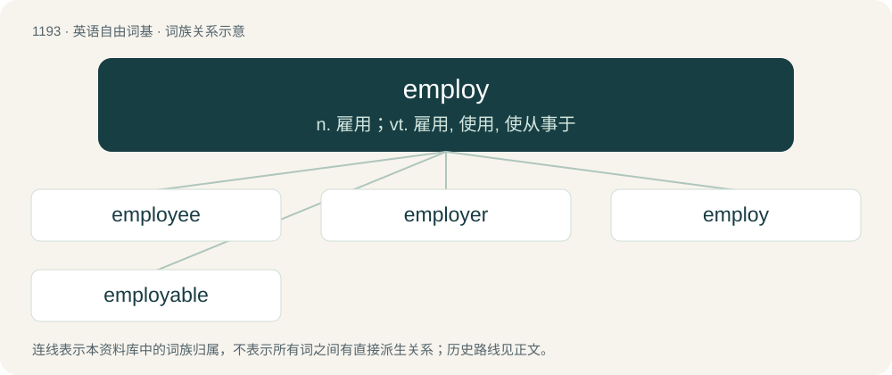

# 1270 · employ — n. 雇用；vt. 雇用, 使用, 使从事于

[总目录](../00_总目录_按常用程度.md)

**类型**：英语自由词基　｜　**来源语言**：见词源记录

## 核心含义与来源

- 核心含义：n. 雇用；vt. 雇用, 使用, 使从事于
- 英文含义：To retain (someone) as an employee.
- 词形：employ

**多个词源／构词路径**：同一拼写可能有不同来源；以下按词性和含义分别列出。

**来源记录 1**（动词；To retain (someone) as an employee.）

From late Middle English emploien, imploien, emplien (“to apply to a specific purpose”), from Anglo-Norman emploier, Old French emploiier (“to entangle, fabricate, to make use of”), ultimately from Latin implicāre (“to infold, entangle, involve, engage”), from in- (“in”) + plicāre (“to fold”). Doublet of imply and implicate.

**来源记录 2**（名词；The state of being an employee; employment.）

Borrowed from French emploi (“job, employment”), the deverbal from employer (“to put to use, to employ”), first attested in the late 17th century.

## 词族图

## 单词速览（常用到不常用）

| 单词 | 音标 | 释义 |
|---|---|---|
| [employee](#w-1) | /ˌɛm.plɔɪˈiː/ | n. 职员, 员工, 受雇人员；\[化\] 职工; 雇员 |
| [employer](#w-2) | 英 /ɪmˈplɔɪə/；美 /ɪmˈplɔɪ.ɚ/ | n. 雇主, 老板；\[经\] 雇主, 业主 |
| [employ](#w-3) | /ɪmˈplɔɪ/ | n. 雇用；vt. 雇用, 使用, 使从事于 |
| [employable](#w-4) | 英 /ɪmˈplɔɪəbəl/ | a. 适宜雇用的, 有资格任职的, 可利用的 |

## 逐词详解

### 1. employee

**词性**：名词　｜　**音标**：/ˌɛm.plɔɪˈiː/

**中文释义**：n. 职员, 员工, 受雇人员；\[化\] 职工; 雇员

**英文义项**：A person who provides labor to a company or another person.

**构词拆分**：employ + -ee

**词源与演化**：

From employ + -ee. First attested in the early 19th century, possibly modeled after French employé.

**例句**：

> One way to encourage your employees to work harder is by giving them incentives.

该用例对应义项：A person who provides labor to a company or another person.

### 2. employer

**词性**：名词　｜　**音标**：英 /ɪmˈplɔɪə/；美 /ɪmˈplɔɪ.ɚ/

**中文释义**：n. 雇主, 老板；\[经\] 雇主, 业主

**英文义项**：A person, firm or other entity which pays for or hires the services of another person.

**构词拆分**：employ + -er

**词源与演化**：

From employ + -er, first attested in the late 16th century. Compare French employeur.

**例句**：

> Do I have to tell the employer that I'm unable to work?

### 3. employ

**词性**：动词　｜　**音标**：/ɪmˈplɔɪ/

**中文释义**：n. 雇用；vt. 雇用, 使用, 使从事于

**英文义项**：To retain (someone) as an employee. / To provide (someone) with a new job; to hire.

**词源与演化**：

From late Middle English emploien, imploien, emplien (“to apply to a specific purpose”), from Anglo-Norman emploier, Old French emploiier (“to entangle, fabricate, to make use of”), ultimately from Latin implicāre (“to infold, entangle, involve, engage”), from in- (“in”) + plicāre (“to fold”). Doublet of imply and implicate.

**例句**：

> Yesterday our local garage employed a new mechanic.

该用例对应义项：To provide (someone) with a new job; to hire.

### 4. employable

**词性**：形容词　｜　**音标**：英 /ɪmˈplɔɪəbəl/

**中文释义**：a. 适宜雇用的, 有资格任职的, 可利用的

**英文义项**：Able to be employed.

**构词拆分**：employ + -able

**词源与演化**：

From employ + -able.

**例句**：

> Experience in volunteering can make you more employable.
