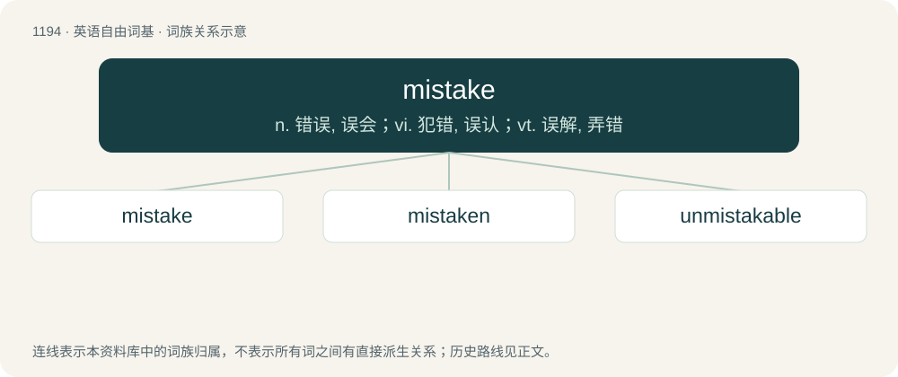

# 1271 · mistake — n. 错误, 误会；vi. 犯错, 误认；vt. 误解, 弄错

[总目录](../00_总目录_按常用程度.md)

**类型**：英语自由词基　｜　**来源语言**：见词源记录

## 核心含义与来源

- 核心含义：n. 错误, 误会；vi. 犯错, 误认；vt. 误解, 弄错
- 英文含义：To understand wrongly, taking one thing or person for another.
- 词形：mistake

**来源记录 1**（动词；To understand wrongly, taking one thing or person for another.）

From Middle English mistaken, from Old Norse mistaka (“to take in error, to miscarry”); equivalent to mis- + take. Cognate with Icelandic mistaka (“to mistake”), Swedish missta (“to mistake”) (before apocope misstaga). The noun, which replaced earlier mistaking, is derived from the verb. Compare Swedish misstag (“mistake”, noun), Faroese mistak (“mitake”, noun), Icelandic mistak (“mistake”, noun).

## 词族图

## 单词速览（常用到不常用）

| 单词 | 音标 | 释义 |
|---|---|---|
| [mistake](#w-1) | /mɪˈsteɪk/ | n. 错误, 误会；vi. 犯错, 误认；vt. 误解, 弄错 |
| [mistaken](#w-2) | /mɪˈsteɪkn̩/ | a. 犯错的, 错误的；mistake的过去分词 |
| [unmistakable](#w-3) | /ˈʌnmisˈteikəbl/ | a. 不会弄错的, 不会被误解的, 不会搞错的, 明白无误的, 清楚明白的 |

## 逐词详解

### 1. mistake

**词性**：动词　｜　**音标**：/mɪˈsteɪk/

**中文释义**：n. 错误, 误会；vi. 犯错, 误认；vt. 误解, 弄错

**英文义项**：To understand wrongly, taking one thing or person for another.

**构词拆分**：mis- + take

**词源与演化**：

From Middle English mistaken, from Old Norse mistaka (“to take in error, to miscarry”); equivalent to mis- + take. Cognate with Icelandic mistaka (“to mistake”), Swedish missta (“to mistake”) (before apocope misstaga). The noun, which replaced earlier mistaking, is derived from the verb. Compare Swedish misstag (“mistake”, noun), Faroese mistak (“mitake”, noun), Icelandic mistak (“mistake”, noun).

**例句**：

> Don't mistake my kindness for weakness.

该用例对应义项：To understand wrongly, taking one thing or person for another.

### 2. mistaken

**词性**：形容词　｜　**音标**：/mɪˈsteɪkn̩/

**中文释义**：a. 犯错的, 错误的；mistake的过去分词

**英文义项**：Erroneous. / Having an incorrect belief.

**构词拆分**：mistake + -n

**词源与演化**：

Morphologically mistake + -n.

**例句**：

> He admitted he was mistaken about the budget numbers.

该用例对应义项：Having an incorrect belief.

### 3. unmistakable

**词性**：形容词　｜　**音标**：/ˈʌnmisˈteikəbl/

**中文释义**：a. 不会弄错的, 不会被误解的, 不会搞错的, 明白无误的, 清楚明白的

**英文义项**：Unique, such that it cannot be mistaken for something else.

**构词拆分**：un- + mistake + -able

**词源与演化**：

From un- + mistake + -able.

**例句**：

> He bore an unmistakable reference to his father. It made his mother cry.
