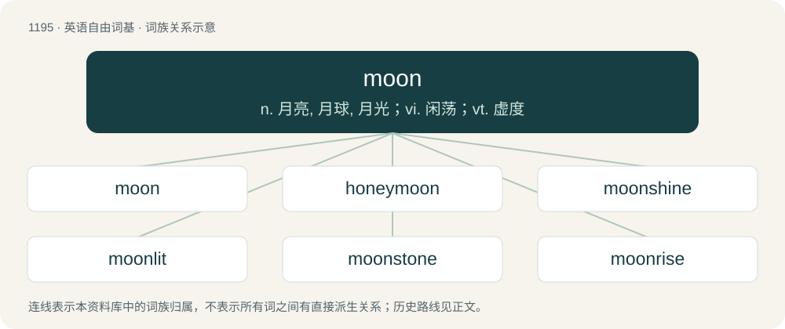

# 1272 · moon — n. 月亮, 月球, 月光；vi. 闲荡；vt. 虚度

[总目录](../00_总目录_按常用程度.md)

**类型**：英语自由词基　｜　**来源语言**：见词源记录

## 核心含义与来源

- 核心含义：n. 月亮, 月球, 月光；vi. 闲荡；vt. 虚度
- 英文含义：Any natural satellite of a planet.
- 词形：moon

**来源记录 1**（名词；Any natural satellite of a planet.）

From Middle English mone, from Old English mōna (“moon”), from Proto-West Germanic \*mānō, from Proto-Germanic \*mēnô (“moon”), from Proto-Indo-European \*mḗh₁n̥s (“moon; month”), probably from \*meh₁- (“to measure”). Cognates Cognate with Scots muin, mune (“moon”), Yola mona, moone (“moon”), North Frisian moune, muun (“moon”), Saterland Frisian Moune (“moon”), West Frisian moanne (“moon”), Alemannic German Maan, manä, manòd, mànund, meini, moanu, Mond (“moon”), Bavarian mone (“moon”), Central Franconian Mond (“moon”), Cimbrian ma, maano, må (“moon”), Dutch maan, maen (“moon”), German Mond (“moon”), Limburgish maon, maond, moan, mond, Moën, Mǫnt, Mǫe̩nt, Mǫǫnt (“moon”), Luxembourgish Mound (“moon”), Mòcheno mu' (“moon”), Vilamovian mönd, mönt (“moon”), West Flemish moane (“moon”), Yiddish מאָנט (mont, “moon”), Danish, Norwegian Bokmål, Norwegian Nynorsk, and Swedish måne (“moon”), Faroese and Icelandic máni (“moon”), Norn måni (“moon”), Crimean Gothic mine (“moon”), Gothic 𐌼𐌴𐌽𐌰 (mēna, “the Moon”); also Cornish and Welsh mis (“month”), Irish mí (“month”), Manx mee (“month”), Scottish Gaelic mìos (“moon; month”), Latin mēnsis (“month”), Umbrian 𐌌𐌄𐌍𐌆𐌍𐌄 (menzne, “Moon”), Greek μήνας (mínas, “month”), Albanian muaj (“month”), Latvian mēnesis (“month”), mēness (“moon”), Lithuanian mėnuo (“moon; month”), Belarusian and Russian ме́сяц (mésjac, “moon; month”), Bulgarian and Macedonian ме́сец (mésec, “moon; month”), Czech měsíc (“moon; month”), Polish miesiąc, mięsiąc, mniesiąc, niesiąc (“moon; month”), Serbo-Croatian ме̏се̄ц, мје̏се̄ц, mȅsēc, mjȅsēc (“moon; month”), Slovak mesiac (“moon; month”), Slovene mesec (“moon; month”), Ukrainian мі́сяць (mísjacʹ, “moon; month”), Armenian ամիս (amis, “month”), Avestan 𐬨𐬃𐬢𐬵 (mā̊ŋh, “month”), 𐬨𐬂𐬢𐬵𐬀 (måŋha, “moon”), Bactrian μαο (mao), μαυο (mauo, “month”), Central Kurdish and Southern Kurdish مانگ (mang, “moon; month”), Northern Kurdish meh (“month”), Ossetian мӕй (mæj, “moon; month”), Pashto مياشت (myâšt, “month”), Persian مه (mah), ماه (māh / mâh, “moon; month”), Tajik моҳ (moh, “moon; month”), Tocharian A mañ (“moon; month”), Tocharian B meñe (“moon; month”), Sanskrit मस् (mas), मास् (mās, “moon; month”). See also month, a related term within Indo-European. The usage of "moon" to refer to the act reflected its use as a metaphor for the buttocks since 1743. It was popularised from American student slang in the 1960s.

## 词族图

## 单词速览（常用到不常用）

| 单词 | 音标 | 释义 |
|---|---|---|
| [moon](#w-1) | 英 /muːn/；美 /mun/ | n. 月亮, 月球, 月光；vi. 闲荡；vt. 虚度 |
| [honeymoon](#w-2) | /ˈhʌn.iˌmuːn/ | n. 蜜月, 蜜月假期；vi. 渡蜜月 |
| [moonshine](#w-3) | /ˈmuːnʃaɪn/ | n. 月光, 大话, 非法酿制的酒 |
| [moonlit](#w-4) | /ˈmuːnˌlɪt/ | a. 月光照耀的 |
| [moonstone](#w-5) | 美 /ˈmunˌstoʊn/ | n. 月长石 |
| [moonrise](#w-6) | 美 /ˈmunˌɹaɪz/ | n. 月光, 月出时分 |
| [moonbeam](#w-7) | 美 /ˈmun.bim/ | n. 月光 |
| [moonraker](#w-8) | 英 /ˈmuːn.ɹeɪ.kə/；美 /ˈmuːn.ɹeɪ.kɚ/ | n. 傻瓜；笨人（等于moonsail） |
| [moonless](#w-9) | /ˈmuːnlis/ | n. 无月亮的 |

## 逐词详解

### 1. moon

**词性**：名词　｜　**音标**：英 /muːn/；美 /mun/

**中文释义**：n. 月亮, 月球, 月光；vi. 闲荡；vt. 虚度

**英文义项**：Any natural satellite of a planet. / A month, particularly a lunar month.

**词源与演化**：

From Middle English mone, from Old English mōna (“moon”), from Proto-West Germanic \*mānō, from Proto-Germanic \*mēnô (“moon”), from Proto-Indo-European \*mḗh₁n̥s (“moon; month”), probably from \*meh₁- (“to measure”). Cognates Cognate with Scots muin, mune (“moon”), Yola mona, moone (“moon”), North Frisian moune, muun (“moon”), Saterland Frisian Moune (“moon”), West Frisian moanne (“moon”), Alemannic German Maan, manä, manòd, mànund, meini, moanu, Mond (“moon”), Bavarian mone (“moon”), Central Franconian Mond (“moon”), Cimbrian ma, maano, må (“moon”), Dutch maan, maen (“moon”), German Mond (“moon”), Limburgish maon, maond, moan, mond, Moën, Mǫnt, Mǫe̩nt, Mǫǫnt (“moon”), Luxembourgish Mound (“moon”), Mòcheno mu' (“moon”), Vilamovian mönd, mönt (“moon”), West Flemish moane (“moon”), Yiddish מאָנט (mont, “moon”), Danish, Norwegian Bokmål, Norwegian Nynorsk, and Swedish måne (“moon”), Faroese and Icelandic máni (“moon”), Norn måni (“moon”), Crimean Gothic mine (“moon”), Gothic 𐌼𐌴𐌽𐌰 (mēna, “the Moon”); also Cornish and Welsh mis (“month”), Irish mí (“month”), Manx mee (“month”), Scottish Gaelic mìos (“moon; month”), Latin mēnsis (“month”), Umbrian 𐌌𐌄𐌍𐌆𐌍𐌄 (menzne, “Moon”), Greek μήνας (mínas, “month”), Albanian muaj (“month”), Latvian mēnesis (“month”), mēness (“moon”), Lithuanian mėnuo (“moon; month”), Belarusian and Russian ме́сяц (mésjac, “moon; month”), Bulgarian and Macedonian ме́сец (mésec, “moon; month”), Czech měsíc (“moon; month”), Polish miesiąc, mięsiąc, mniesiąc, niesiąc (“moon; month”), Serbo-Croatian ме̏се̄ц, мје̏се̄ц, mȅsēc, mjȅsēc (“moon; month”), Slovak mesiac (“moon; month”), Slovene mesec (“moon; month”), Ukrainian мі́сяць (mísjacʹ, “moon; month”), Armenian ամիս (amis, “month”), Avestan 𐬨𐬃𐬢𐬵 (mā̊ŋh, “month”), 𐬨𐬂𐬢𐬵𐬀 (måŋha, “moon”), Bactrian μαο (mao), μαυο (mauo, “month”), Central Kurdish and Southern Kurdish مانگ (mang, “moon; month”), Northern Kurdish meh (“month”), Ossetian мӕй (mæj, “moon; month”), Pashto مياشت (myâšt, “month”), Persian مه (mah), ماه (māh / mâh, “moon; month”), Tajik моҳ (moh, “moon; month”), Tocharian A mañ (“moon; month”), Tocharian B meñe (“moon; month”), Sanskrit मस् (mas), मास् (mās, “moon; month”). See also month, a related term within Indo-European. The usage of "moon" to refer to the act reflected its use as a metaphor for the buttocks since 1743. It was popularised from American student slang in the 1960s.

**例句**：

> The moons surrounding the city walls were built in the sixteenth century.

该用例对应义项：A crescent-like outwork in a fortification.

### 2. honeymoon

**词性**：名词　｜　**音标**：/ˈhʌn.iˌmuːn/

**中文释义**：n. 蜜月, 蜜月假期；vi. 渡蜜月

**英文义项**：The period of time immediately following a marriage. / A trip taken by a newly married couple during this period.

**构词拆分**：honey + moon

**词源与演化**：

From earlier hony moone, originally denoting the period of time following a wedding, equivalent to honey + moon. The original reference was to affection waning like the moon, but later the sense became "the first month, or moon after marriage", which tends to be the sweetest. Compare Middle Low German suckermânt (“honeymoon”, literally “sugar-month”), German Low German Hönnigweken (“honeymoon”, literally “honey-weeks”). The German Honigmond (literally “honey-moon”) is a calque of French lune de miel, itself a calque of the English term.

**例句**：

> Now that the honeymoon is over, it’s time for us to get down to the business at hand.

该用例对应义项：A period of goodwill at the beginning of a new term or relationship (e.g. towards a newly elected politician or in respect of a new business arrangement).

### 3. moonshine

**词性**：名词　｜　**音标**：/ˈmuːnʃaɪn/

**中文释义**：n. 月光, 大话, 非法酿制的酒

**英文义项**：The light of the moon. / The light reflected off Earth's Moon.

**构词拆分**：moon + shine

**词源与演化**：

From Middle English mone schyne, mone-schyne, moone shone; equivalent to moon + shine. Illegally distilled liquor is so named because its manufacture may be conducted without artificial light at night. The verb sense is a back-formation from moonshiner.

**例句**：

> They watered down the moonshine.

该用例对应义项：High-proof alcohol (especially whiskey) that is often, but not always, produced illegally.

### 4. moonlit

**词性**：形容词　｜　**音标**：/ˈmuːnˌlɪt/

**中文释义**：a. 月光照耀的

**英文义项**：Lit by moonlight.

**构词拆分**：moon + lit

**词源与演化**：

From moon + lit. Compare Saterland Frisian mouneljoacht (“moonlit”), West Frisian moanneljocht (“moonlit”), Dutch maanverlicht (“moonlit”), Danish månelys (“moonlit”), Swedish månljus (“moonlit”).

**例句**：

> Mary loves gazing at the moonlit clouds floating across the night sky.

### 5. moonstone

**词性**：名词　｜　**音标**：美 /ˈmunˌstoʊn/

**中文释义**：n. 月长石

**英文义项**：A translucent gemstone, an orthoclase feldspar, that has a pearly lustre.

**构词拆分**：moon + stone

**词源与演化**：

From moon + stone.

**例句**：

> Do they sell moonstone at their crystal shop?

### 6. moonrise

**词性**：名词　｜　**音标**：美 /ˈmunˌɹaɪz/

**中文释义**：n. 月光, 月出时分

**英文义项**：The time of day or night when the moon begins to rise over the horizon.

**构词拆分**：moon + rise

**词源与演化**：

From moon + rise.

### 7. moonbeam

**词性**：名词　｜　**音标**：美 /ˈmun.bim/

**中文释义**：n. 月光

**英文义项**：A ray or shaft of moonlight. / Any of various Australasian lycaenid butterflies of the genus Philiris.

**构词拆分**：moon + beam

**词源与演化**：

Compound of moon + beam.

### 8. moonraker

**词性**：名词　｜　**音标**：英 /ˈmuːn.ɹeɪ.kə/；美 /ˈmuːn.ɹeɪ.kɚ/

**中文释义**：n. 傻瓜；笨人（等于moonsail）

**英文义项**：Someone from Wiltshire. / A small, light sail located high on a mast (above the skysail) and used for speed.

**构词拆分**：moon + raker

**词源与演化**：

From moon + raker. (someone from Wiltshire): After a story in which some Wiltshire peasants, seeing the reflection of the moon in a shallow pool, tried to rake it out.

### 9. moonless

**词性**：形容词　｜　**音标**：/ˈmuːnlis/

**中文释义**：n. 无月亮的

**英文义项**：During which no phase of the Moon is visible to provide light, whether because of cloud cover or because of a new moon. / Having no natural satellite.

**构词拆分**：moon + -less

**词源与演化**：

From moon + -less.

**例句**：

> The dark moonless night.

该用例对应义项：without a moon or a visible moon
