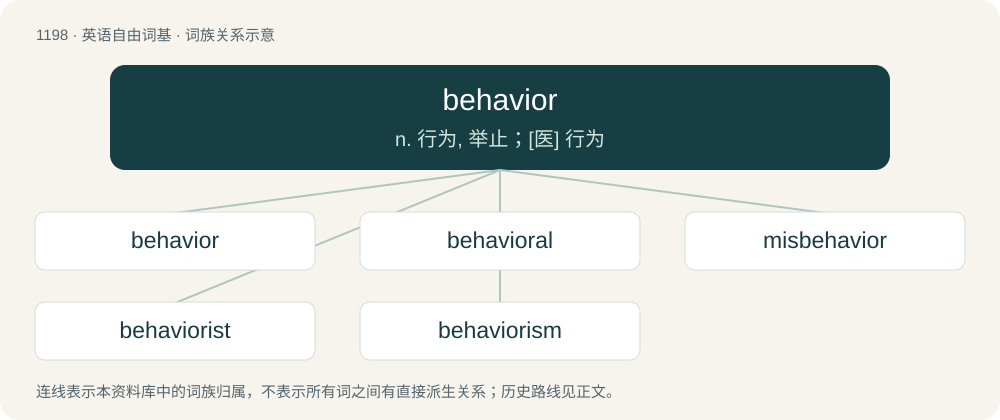

# 1277 · behavior — n. 行为, 举止；\[医\] 行为

[总目录](../00_总目录_按常用程度.md)

**类型**：英语自由词基　｜　**来源语言**：见词源记录

## 核心含义与来源

- 核心含义：n. 行为, 举止；\[医\] 行为
- 英文含义：Human conduct relative to social norms.
- 词形：behavior

**来源记录 1**（名词；Human conduct relative to social norms.）

From Middle English behavoure, behaver, from behaven (modern behave), morphologically equivalent to behave + -ior. The suffix was adopted in imitation of havour (modern haviour, havior), an etymologically unrelated word that was corrupted from Anglo‐Norman Anglo-Norman aveir and Old French Old French avoir (“property, wealth”) through false association with the native English verb have. The French term derives ultimately from Latin Latin habēre (“to have, hold”). Compare Scots havings (“behavior”), from have (“to behave”). Replaced Old English ġebǣru.

## 词族图

## 单词速览（常用到不常用）

| 单词 | 音标 | 释义 |
|---|---|---|
| [behavior](#w-1) | 英 /bɪˈheɪ.vjə/；美 /bɪˈheɪ.vjəɹ/ | n. 行为, 举止；\[医\] 行为 |
| [behavioral](#w-2) | 英 /bɪˈheɪvjəɹəl/；美 /bɪˈheɪvjəɹəl/ | a. 行为的 |
| [misbehavior](#w-3) | 英 /ˌmɪsbɪˈheɪvjə(ɹ)/；美 /ˌmɪsbɪˈheɪvjɚ/ | n. 不正当的举止, 不规矩的行为；\[法\] 行为不端, 品行不良, 不正当的举止 |
| [behaviorist](#w-4) |  | n. 行为主义者；\[医\] 行为主义者 |
| [behaviorism](#w-5) | /biˈheiviəriz(ə)m/ | n. 行为主义 |

## 逐词详解

### 1. behavior

**词性**：名词　｜　**音标**：英 /bɪˈheɪ.vjə/；美 /bɪˈheɪ.vjəɹ/

**中文释义**：n. 行为, 举止；\[医\] 行为

**英文义项**：Human conduct relative to social norms. / An inappropriate or forbidden action.

**构词拆分**：behave + -ior

**词源与演化**：

From Middle English behavoure, behaver, from behaven (modern behave), morphologically equivalent to behave + -ior. The suffix was adopted in imitation of havour (modern haviour, havior), an etymologically unrelated word that was corrupted from Anglo‐Norman Anglo-Norman aveir and Old French Old French avoir (“property, wealth”) through false association with the native English verb have. The French term derives ultimately from Latin Latin habēre (“to have, hold”). Compare Scots havings (“behavior”), from have (“to behave”). Replaced Old English ġebǣru.

**例句**：

> When a patient has a behavior, document it in their records.

该用例对应义项：An inappropriate or forbidden action.

### 2. behavioral

**词性**：形容词　｜　**音标**：英 /bɪˈheɪvjəɹəl/；美 /bɪˈheɪvjəɹəl/

**中文释义**：a. 行为的

**英文义项**：Of or relating to behavior.

**构词拆分**：behavior + -al

**词源与演化**：

From behavior + -al.

**例句**：

> Yanni had his daughter committed to a facility for children with behavioral problems.

### 3. misbehavior

**词性**：名词　｜　**音标**：英 /ˌmɪsbɪˈheɪvjə(ɹ)/；美 /ˌmɪsbɪˈheɪvjɚ/

**中文释义**：n. 不正当的举止, 不规矩的行为；\[法\] 行为不端, 品行不良, 不正当的举止

**英文义项**：Action or conduct that is inappropriate, improper, incorrect, or unexpected.

**构词拆分**：mis- + behavior

**词源与演化**：

From mis- + behavior.

**例句**：

> The teacher did not tolerate misbehavior in his classroom.

该用例对应义项：Action or conduct that is inappropriate, improper, incorrect, or unexpected.

### 4. behaviorist

**词性**：名词

**中文释义**：n. 行为主义者；\[医\] 行为主义者

**英文义项**：One who studies behavior of humans or animals. / A supporter of behaviorism.

**构词拆分**：behavior + -ist

**词源与演化**：

From behavior + -ist.

### 5. behaviorism

**词性**：名词　｜　**音标**：/biˈheiviəriz(ə)m/

**中文释义**：n. 行为主义

**英文义项**：An approach focusing on observable behavior which, generally assuming that behavior is determined by the environment and denying any independent significance for mind, largely ignores any pathophysiological processes which may, or may not, underlie subjective, behavioral phenomena. / The theory that a mental state is identical to the disposition or tendency to behave in accordance with the physical causes; statements about the mind are reducible to statements of physical behavior.

**构词拆分**：behavior + -ism

**词源与演化**：

From behavior + -ism.

**例句**：

> Supporters of behaviorism claim that to be "in pain" is nothing more than the tendency to wince, yelp, scream "ouch!" and so on.

该用例对应义项：The theory that a mental state is identical to the disposition or tendency to behave in accordance with the physical causes; statements about the mind are reducible to statements of physical behavior.
