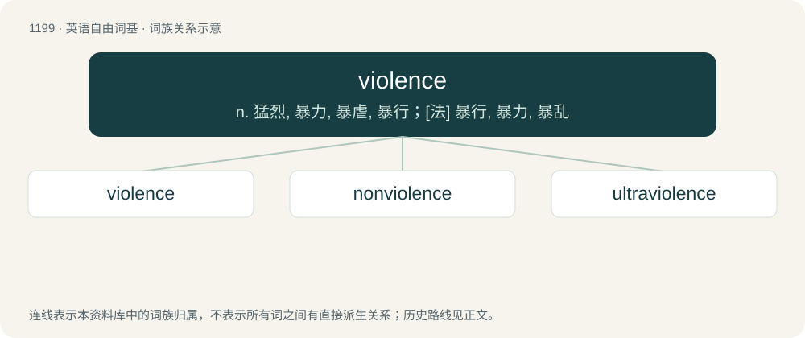

# 1278 · violence — n. 猛烈, 暴力, 暴虐, 暴行；\[法\] 暴行, 暴力, 暴乱

[总目录](../00_总目录_按常用程度.md)

**类型**：英语自由词基　｜　**来源语言**：见词源记录

## 核心含义与来源

- 核心含义：n. 猛烈, 暴力, 暴虐, 暴行；\[法\] 暴行, 暴力, 暴乱
- 英文含义：Extreme force.
- 词形：violence

**来源记录 1**（名词；Extreme force.）

Inherited from Middle English violence, borrowed from Old French violence, borrowed from Latin violentia, from violēns /violentus (“violent”) + -ia. See violent. Displaced native Old English stræc.

## 词族图

## 单词速览（常用到不常用）

| 单词 | 音标 | 释义 |
|---|---|---|
| [violence](#w-1) | /ˈvaɪ(ə)lən(t)s/ | n. 猛烈, 暴力, 暴虐, 暴行；\[法\] 暴行, 暴力, 暴乱 |
| [nonviolence](#w-2) | /nɒnˈvaiələns/ | n. 非暴力；\[法\] 不诉诸武力的主张, 政策, 无暴力存在 |
| [ultraviolence](#w-3) | /,ʌltrəˈvaiələns/ | n. 超暴力,极端暴力 |

## 逐词详解

### 1. violence

**词性**：名词　｜　**音标**：/ˈvaɪ(ə)lən(t)s/

**中文释义**：n. 猛烈, 暴力, 暴虐, 暴行；\[法\] 暴行, 暴力, 暴乱

**英文义项**：Extreme force. / Physical action which causes destruction, harm, pain, or suffering.

**词源与演化**：

Inherited from Middle English violence, borrowed from Old French violence, borrowed from Latin violentia, from violēns /violentus (“violent”) + -ia. See violent. Displaced native Old English stræc.

**例句**：

> The violence of the storm, fortunately, was more awesome than destructive.

该用例对应义项：Extreme force.

### 2. nonviolence

**词性**：名词　｜　**音标**：/nɒnˈvaiələns/

**中文释义**：n. 非暴力；\[法\] 不诉诸武力的主张, 政策, 无暴力存在

**英文义项**：A philosophy that rejects the use of violence, and instead seeks to bring about change through peaceful responses even to violent acts.

**构词拆分**：non- + violence

**词源与演化**：

From non- + violence.

**例句**：

> Martin Luther King Jr. fought for civil rights for African-Americans by teaching nonviolence.

### 3. ultraviolence

**词性**：名词　｜　**音标**：/,ʌltrəˈvaiələns/

**中文释义**：n. 超暴力,极端暴力

**英文义项**：Unnecessary, unprovoked (usually brutal) violence; violent acts simply for the thrill and entertainment of it.

**构词拆分**：ultra- + violence

**词源与演化**：

From ultra- + violence.
