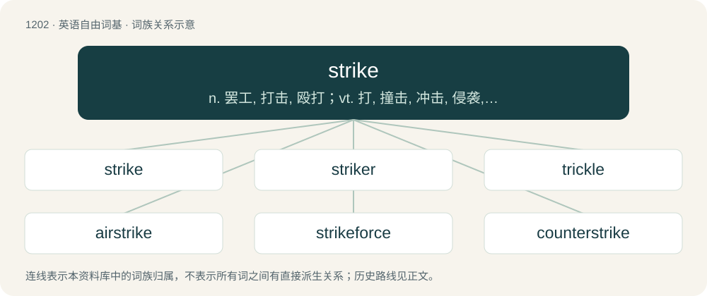

# 1282 · strike — n. 罢工, 打击, 殴打；vt. 打, 撞击, 冲击, 侵袭, 取消, 结算, 打掉, 罢工, 刺透, 使生根, 遇见；vi. 打, 打击, 抓, 罢工, 搏动, 触礁, 敲, 响, 穿透, 打动

[总目录](../00_总目录_按常用程度.md)

**类型**：英语自由词基　｜　**来源语言**：见词源记录

## 核心含义与来源

- 核心含义：n. 罢工, 打击, 殴打；vt. 打, 撞击, 冲击, 侵袭, 取消, 结算, 打掉, 罢工, 刺透, 使生根, 遇见；vi. 打, 打击, 抓, 罢工, 搏动, 触礁, 敲, 响, 穿透, 打动
- 英文含义：To delete or cross out; to scratch or eliminate.
- 词形：strike

**来源记录 1**（动词；To delete or cross out; to scratch or eliminate.）

From Middle English stryken, from Old English strīcan, from Proto-West Germanic \*strīkan, from Proto-Germanic \*strīkaną, from Proto-Indo-European \*streyg- (“to stroke, rub, press”). Cognate with Dutch strijken, German streichen, Danish stryge, Icelandic strýkja, strýkva.

## 词族图

## 单词速览（常用到不常用）

| 单词 | 音标 | 释义 |
|---|---|---|
| [strike](#w-1) | 英 /stɹaɪk/；/stiː.ɹaɪk/ | n. 罢工, 打击, 殴打；vt. 打, 撞击, 冲击, 侵袭, 取消, 结算, 打掉, 罢工, 刺透, 使生根, 遇见；vi. 打, 打击, 抓, 罢工, 搏动, 触礁, 敲, 响, 穿透, 打动 |
| [striker](#w-2) | /ˈstɹaɪkɚ/ | n. 打击者, 罢工者；\[经\] 罢工者 |
| [trickle](#w-3) | /ˈtɹɪkəl/ | n. 滴, 细流；vi. 滴, 细细地流；vt. 使滴, 使小量流动 |
| [airstrike](#w-4) | /ˈer,straik/ | n. 空袭；空中打击 |
| [strikeforce](#w-5) |  | 【英文】A group in an organization such as the police or the army that has been trained especially for dealing with serious and urgent threats. |
| [counterstrike](#w-6) |  | \[法\] 反击 |

## 逐词详解

### 1. strike

**词性**：动词　｜　**音标**：英 /stɹaɪk/；/stiː.ɹaɪk/

**中文释义**：n. 罢工, 打击, 殴打；vt. 打, 撞击, 冲击, 侵袭, 取消, 结算, 打掉, 罢工, 刺透, 使生根, 遇见；vi. 打, 打击, 抓, 罢工, 搏动, 触礁, 敲, 响, 穿透, 打动

**英文义项**：To delete or cross out; to scratch or eliminate. / To hit.

**词源与演化**：

From Middle English stryken, from Old English strīcan, from Proto-West Germanic \*strīkan, from Proto-Germanic \*strīkaną, from Proto-Indo-European \*streyg- (“to stroke, rub, press”). Cognate with Dutch strijken, German streichen, Danish stryge, Icelandic strýkja, strýkva.

**例句**：

> Strike the door sharply with your foot and see if it comes loose. A bullet struck him. The ship struck a reef.

该用例对应义项：To hit.

### 2. striker

**词性**：名词　｜　**音标**：/ˈstɹaɪkɚ/

**中文释义**：n. 打击者, 罢工者；\[经\] 罢工者

**英文义项**：A person who is on strike, someone who has stopped working as a protest. / A blacksmith's assistant who wields the sledgehammer.

**构词拆分**：strike + -er

**词源与演化**：

From strike + -er.

**例句**：

> A fine striker of the ball.

该用例对应义项：someone who hits

### 3. trickle

**词性**：名词　｜　**音标**：/ˈtɹɪkəl/

**中文释义**：n. 滴, 细流；vi. 滴, 细细地流；vt. 使滴, 使小量流动

**英文义项**：A very thin river. / A very thin flow; the sound of such a flow.

**构词拆分**：strike + -le

**词源与演化**：

From Middle English triklen, likely a rebracketing (e.g. teres strikled &gt; teerys trikled (“tears trickled”)) of Middle English striklen (“to trickle”), equivalent to strike + -le. For other similar cases of incorrect division, see also apron, daffodil, newt, nickname, orange, umpire.

**例句**：

> The tap of the washbasin in my bedroom is leaking and the trickle drives me mad at night.

该用例对应义项：A very thin flow; the sound of such a flow.

### 4. airstrike

**词性**：动词　｜　**音标**：/ˈer,straik/

**中文释义**：n. 空袭；空中打击

**英文义项**：To attack a ground target through the use of aircraft or missiles.

**构词拆分**：air + strike

**词源与演化**：

From air + strike.

**例句**：

> Outnumbered and outgunned, the squad was forced to call in an airstrike.

### 5. strikeforce

**词性**：名词

**英文义项**：A group in an organization such as the police or the army that has been trained especially for dealing with serious and urgent threats. / Collectively, the strikers in a team.

**构词拆分**：strike + force

**词源与演化**：

From strike + force.

### 6. counterstrike

**词性**：名词

**中文释义**：\[法\] 反击

**英文义项**：The tactic of counterattacking.

**构词拆分**：counter- + strike

**词源与演化**：

From counter- + strike. Compare counterstroke.
