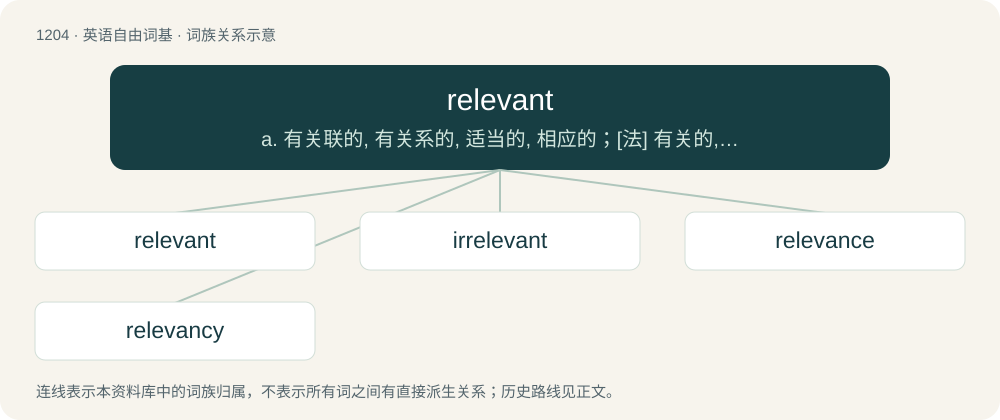

# 1283 · relevant — a. 有关联的, 有关系的, 适当的, 相应的；\[法\] 有关的, 相关的

[总目录](../00_总目录_按常用程度.md)

**类型**：英语自由词基　｜　**来源语言**：见词源记录

## 核心含义与来源

- 核心含义：a. 有关联的, 有关系的, 适当的, 相应的；\[法\] 有关的, 相关的
- 英文含义：Related, connected, or pertinent to a topic.
- 词形：relevant

**来源记录 1**（形容词；Related, connected, or pertinent to a topic.）

From Scots relevant meaning "legally pertinent," used in Scottish legal circles starting in the early 1500s, and first used in English in the 1700s. Borrowed from Latin relevāns, relevāntem, present active participle of relevō (“lift up again, lighten, relieve”), from re- (“again”) + levō (“lift”).

## 词族图

## 单词速览（常用到不常用）

| 单词 | 音标 | 释义 |
|---|---|---|
| [relevant](#w-1) | /ˈɹɛləvənt/ | a. 有关联的, 有关系的, 适当的, 相应的；\[法\] 有关的, 相关的 |
| [irrelevant](#w-2) | /ɪˈɹɛləvənt/ | a. 不恰当的, 无关系的, 不相干的；\[法\] 无关的, 不相干的, 离题的 |
| [relevance](#w-3) | /ˈɹɛl.ɪ.vən(t)s/ | n. 中肯；关联；相关性 |
| [relevancy](#w-4) | /ˈɹɛlɪvənsi/ | n. 关联, 恰当, 中肯, 贴切；\[法\] 关职性, 中肯, 恰当 |

## 逐词详解

### 1. relevant

**词性**：形容词　｜　**音标**：/ˈɹɛləvənt/

**中文释义**：a. 有关联的, 有关系的, 适当的, 相应的；\[法\] 有关的, 相关的

**英文义项**：Related, connected, or pertinent to a topic. / Directly related, connected, or pertinent, with important ramifications or implications.

**词源与演化**：

From Scots relevant meaning "legally pertinent," used in Scottish legal circles starting in the early 1500s, and first used in English in the 1700s. Borrowed from Latin relevāns, relevāntem, present active participle of relevō (“lift up again, lighten, relieve”), from re- (“again”) + levō (“lift”).

**例句**：

> His mother provided some relevant background information concerning his medical condition.

该用例对应义项：Directly related, connected, or pertinent, with important ramifications or implications.

### 2. irrelevant

**词性**：形容词　｜　**音标**：/ɪˈɹɛləvənt/

**中文释义**：a. 不恰当的, 无关系的, 不相干的；\[法\] 无关的, 不相干的, 离题的

**英文义项**：Not relevant, as / Not at all related: totally unrelated, wholly unconnected, completely inapplicable.

**构词拆分**：ir- + relevant

**词源与演化**：

From ir- + relevant.

**例句**：

> We need to focus on the main topic and ignore irrelevant details.

该用例对应义项：Not relevant, as

### 3. relevance

**词性**：名词　｜　**音标**：/ˈɹɛl.ɪ.vən(t)s/

**中文释义**：n. 中肯；关联；相关性

**英文义项**：The property or state of being relevant or pertinent.

**构词拆分**：relevant + -ance

**词源与演化**：

From relevant + -ance.

**例句**：

> In her speech, she emphasized the issues that had direct relevance to practice.

### 4. relevancy

**词性**：名词　｜　**音标**：/ˈɹɛlɪvənsi/

**中文释义**：n. 关联, 恰当, 中肯, 贴切；\[法\] 关职性, 中肯, 恰当

**英文义项**：Sufficiency (of a statement, claim etc.) to carry weight in law; legal pertinence. / The degree to which a thing is relevant; relevance, applicability.

**构词拆分**：From relevant + -cy.

**词源与演化**：

From relevant + -cy.
