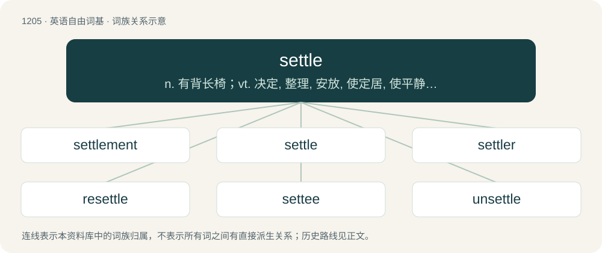

# 1284 · settle — n. 有背长椅；vt. 决定, 整理, 安放, 使定居, 使平静, 支付, 安排, 解决, 结算；vi. 停留, 下陷, 沉淀, 澄清, 安下心来, 结清, 定居, 安家

[总目录](../00_总目录_按常用程度.md)

**类型**：英语自由词基　｜　**来源语言**：见词源记录

## 核心含义与来源

- 核心含义：n. 有背长椅；vt. 决定, 整理, 安放, 使定居, 使平静, 支付, 安排, 解决, 结算；vi. 停留, 下陷, 沉淀, 澄清, 安下心来, 结清, 定居, 安家
- 英文含义：To determine (something which was exposed to doubt or question); to resolve conclusively; to set or fix (a time, an order of succession, etc).
- 词形：settle

**来源记录 1**（动词；To determine (something which was exposed to doubt or question); to resolve conclusively; to set or fix (a time, an order of succession, etc).）

From a merger of two verbs: \* Middle English setlen, from Old English setlan (“to settle, seat, put to rest”), from Old English setl (“seat”) (compare Dutch zetelen (“to be established, settle”)) and \* Middle English sahtlen, seihtlen (“to reconcile, calm, subside”), from Old English sahtlian, ġesehtlian (“to reconcile”), from Old English saht, seht (“settlement, agreement, reconciliation, peace”) (see saught, -le). German siedeln (“to settle”) is related to the former of the two verbs, but is not an immediate cognate of either of them.

## 词族图

## 单词速览（常用到不常用）

| 单词 | 音标 | 释义 |
|---|---|---|
| [settlement](#w-1) | /ˈsɛ.təl.mənt/ | n. 安顿, 解决, 处理, 结算, 殖民, 殖民地, 沉降；\[医\] 居住区; 沉渣 |
| [settle](#w-2) | 英 /ˈsɛ.təl/；美 /ˈsɛtəl/ | n. 有背长椅；vt. 决定, 整理, 安放, 使定居, 使平静, 支付, 安排, 解决, 结算；vi. 停留, 下陷, 沉淀, 澄清, 安下心来, 结清, 定居, 安家 |
| [settler](#w-3) | 英 /ˈsɛt.lə/；美 /ˈsɛt.lɚ/ | n. 移民者, 解决者, 结算员；\[化\] 沉淀池; 沉降器; 澄清槽 |
| [resettle](#w-4) | /riːˈsetl/ | v. (使)重新定居 |
| [settee](#w-5) | /sɛˈtiː/ | n. 长靠背椅 |
| [unsettle](#w-6) | /ʌnˈsɛtəl/ | vt. 使移动, 搅乱, 使动摇, 使不安宁；vi. 动荡不定, 离开固定位置 |

## 逐词详解

### 1. settlement

**词性**：名词　｜　**音标**：/ˈsɛ.təl.mənt/

**中文释义**：n. 安顿, 解决, 处理, 结算, 殖民, 殖民地, 沉降；\[医\] 居住区; 沉渣

**英文义项**：The act of settling. / The state of being settled.

**构词拆分**：settle + -ment

**词源与演化**：

From settle + -ment.

**用法示例／搭配（非完整句）**：

> settlement of debt

该用例对应义项：The act of settling.

### 2. settle

**词性**：动词　｜　**音标**：英 /ˈsɛ.təl/；美 /ˈsɛtəl/

**中文释义**：n. 有背长椅；vt. 决定, 整理, 安放, 使定居, 使平静, 支付, 安排, 解决, 结算；vi. 停留, 下陷, 沉淀, 澄清, 安下心来, 结清, 定居, 安家

**英文义项**：To determine (something which was exposed to doubt or question); to resolve conclusively; to set or fix (a time, an order of succession, etc). / To conclude, to cause (a dispute) to finish.

**词源与演化**：

From a merger of two verbs: \* Middle English setlen, from Old English setlan (“to settle, seat, put to rest”), from Old English setl (“seat”) (compare Dutch zetelen (“to be established, settle”)) and \* Middle English sahtlen, seihtlen (“to reconcile, calm, subside”), from Old English sahtlian, ġesehtlian (“to reconcile”), from Old English saht, seht (“settlement, agreement, reconciliation, peace”) (see saught, -le). German siedeln (“to settle”) is related to the former of the two verbs, but is not an immediate cognate of either of them.

**例句**：

> She hopes to settle any questions about the plans.

该用例对应义项：To determine (something which was exposed to doubt or question); to resolve conclusively; to set or fix (a time, an order of succession, etc).

### 3. settler

**词性**：名词　｜　**音标**：英 /ˈsɛt.lə/；美 /ˈsɛt.lɚ/

**中文释义**：n. 移民者, 解决者, 结算员；\[化\] 沉淀池; 沉降器; 澄清槽

**英文义项**：Someone who settles in a new location; especially one who takes up residence in a previously uninhabited place. / Someone who decides or settles something, such as a dispute.

**构词拆分**：settle + -er

**词源与演化**：

From settle + -er.

**用法示例／搭配（非完整句）**：

> the first settlers of New England

该用例对应义项：Someone who settles in a new location; especially one who takes up residence in a previously uninhabited place.

### 4. resettle

**词性**：动词　｜　**音标**：/riːˈsetl/

**中文释义**：v. (使)重新定居

**英文义项**：To settle in a different place. / To force someone to settle in a different place.

**构词拆分**：re- + settle

**词源与演化**：

From re- + settle.

**例句**：

> The immigrants had to resettle.

该用例对应义项：settle in a new place

### 5. settee

**词性**：名词　｜　**音标**：/sɛˈtiː/

**中文释义**：n. 长靠背椅

**英文义项**：A long seat with a back, made to accommodate several persons at once; a sofa.

**构词拆分**：settle (“seat, long bench”) + -ee (diminutive suffix)

**词源与演化**：

Unclear, possibly from settle (“seat, long bench”) + -ee (diminutive suffix).

**例句**：

> She lay ill on the settee all day, drinking Lucozade and watching telly.

### 6. unsettle

**词性**：动词　｜　**音标**：/ʌnˈsɛtəl/

**中文释义**：vt. 使移动, 搅乱, 使动摇, 使不安宁；vi. 动荡不定, 离开固定位置

**英文义项**：To make upset or uncomfortable / To bring into disorder or disarray

**构词拆分**：un- + settle

**词源与演化**：

From un- + settle.

**例句**：

> Don't unsettle the horses or they'll bolt.

该用例对应义项：To make upset or uncomfortable
