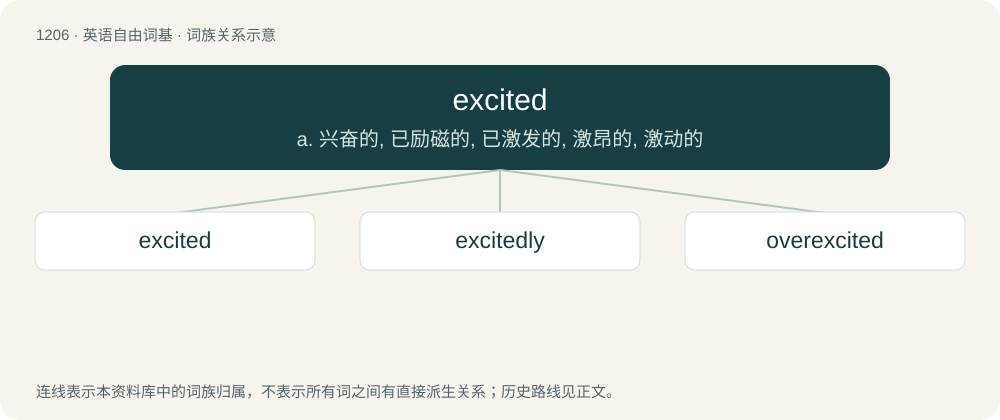

# 1285 · excited — a. 兴奋的, 已励磁的, 已激发的, 激昂的, 激动的

[总目录](../00_总目录_按常用程度.md)

**类型**：英语自由词基　｜　**来源语言**：见词源记录

## 核心含义与来源

- 核心含义：a. 兴奋的, 已励磁的, 已激发的, 激昂的, 激动的
- 英文含义：Having great enthusiasm, passion and energy.
- 词形：excited

**来源记录 1**（形容词；Having great enthusiasm, passion and energy.）

From excite + -ed.

## 词族图

## 单词速览（常用到不常用）

| 单词 | 音标 | 释义 |
|---|---|---|
| [excited](#w-1) | /ɪkˈsaɪ.tɪd/ | a. 兴奋的, 已励磁的, 已激发的, 激昂的, 激动的 |
| [excitedly](#w-2) | /ikˈsaitidli/ | adv. 兴奋地 |
| [overexcited](#w-3) | /ˌəʊvərɪkˈsaɪtɪd/ | v. 使过于激动（或兴奋）, 过度刺激( overexcite的过去式和过去分词 ) |

## 逐词详解

### 1. excited

**词性**：形容词　｜　**音标**：/ɪkˈsaɪ.tɪd/

**中文释义**：a. 兴奋的, 已励磁的, 已激发的, 激昂的, 激动的

**英文义项**：Having great enthusiasm, passion and energy. / Being in a state of higher energy.

**构词拆分**：From excite + -ed.

**词源与演化**：

From excite + -ed.

**例句**：

> The excited electrons give off light when they drop to a lower energy state.

该用例对应义项：Being in a state of higher energy.

### 2. excitedly

**词性**：副词　｜　**音标**：/ikˈsaitidli/

**中文释义**：adv. 兴奋地

**英文义项**：In an excited manner.

**构词拆分**：excited + -ly

**词源与演化**：

From excited + -ly.

**例句**：

> She shook his hand excitedly.

该用例对应义项：with excitement; in an excited manner

### 3. overexcited

**词性**：形容词　｜　**音标**：/ˌəʊvərɪkˈsaɪtɪd/

**中文释义**：v. 使过于激动（或兴奋）, 过度刺激( overexcite的过去式和过去分词 )

**英文义项**：Excessively excited

**构词拆分**：over- + excited

**词源与演化**：

From over- + excited.
