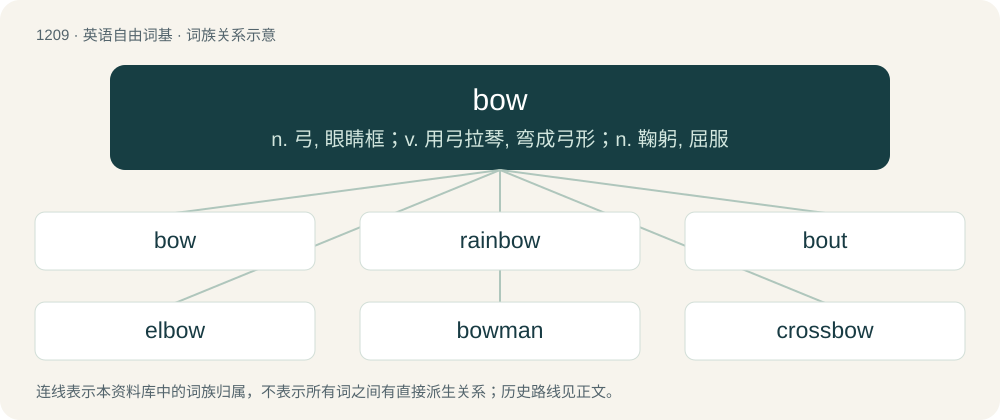

# 1289 · bow — n. 弓, 眼睛框；v. 用弓拉琴, 弯成弓形；n. 鞠躬, 屈服

[总目录](../00_总目录_按常用程度.md)

**类型**：英语自由词基　｜　**来源语言**：见词源记录

## 核心含义与来源

- 核心含义：n. 弓, 眼睛框；v. 用弓拉琴, 弯成弓形；n. 鞠躬, 屈服
- 英文含义：A weapon made of a curved piece of wood or other flexible material whose ends are connected by a string, used for shooting arrows.
- 词形：bow

**多个词源／构词路径**：同一拼写可能有不同来源；以下按词性和含义分别列出。

**来源记录 1**（名词；A weapon made of a curved piece of wood or other flexible material whose ends are connected by a string, used for shooting arrows.）

From Middle English bowe, from Old English boga, Proto-West Germanic \*bogō, from Proto-Germanic \*bugô. Cognates Cognate with Saterland Frisian Booge (“arch, bow, curve”), West Frisian bôge (“arc, arch, bow”), Dutch boog (“arc, arch, bow”), German Bogen (“arc, arch, bow, curve”), Luxembourgish Bou (“arc, arch, bow, curve”), Vilamovian böga (“arc, arch, bend, bow, curve”), Yiddish בויגן (boygn, “arc, arch, bow, curve”), Danish bue (“arc, arch, bow, curve”), Faroese and Icelandic bogi (“arch, bow, vault”), Jamtish buga (“bow”), Norwegian Bokmål bue (“arc, arch, bow”), Norwegian Nynorsk boge (“arc, arch, bow”), Swedish båge (“bow”), Crimean Gothic boga (“bow”).

**来源记录 2**（动词；To bend oneself as a gesture of respect or deference.）

From Middle English bowen, buwen, buȝen, from Old English būgan, from Proto-West Germanic \*beugan, from Proto-Germanic \*beuganą, from Proto-Indo-European \*bʰewgʰ- (“to bend”). Cognates Cognate with Scots boo, bou (“to bend, bow”), Dutch buigen (“to bow”), German biegen (“to bow”), Low German bugen (“to bow”), Luxembourgish béien (“to bow”), Danish bue (“to curve, arch”), Swedish buga (“to bow”), Gothic 𐌱𐌹𐌿𐌲𐌰𐌽 (biugan, “to bend, bow”).

**来源记录 3**（名词；The front of a boat or ship.）

From Middle English bowe, bowgh, a borrowing from Middle Low German bôch and/or Middle Dutch boech, from Proto-Germanic \*bōguz, from Proto-Indo-European \*bʰeh₂ǵʰus (“arm”). Doublet of bough. Cognates Cognate with Dutch boeg (“bow”), German Bug (“bow, prow (of a ship); shoulder joint (of an animal)”), Luxembourgish Buch, Bou (“shoulder joint (of an animal)”), Danish bov (“bow”), Icelandic bógur (“bow”), Norwegian Bokmål baug (“bow”), Norwegian Bokmål, Norwegian Nynorsk and Swedish bog (“bow; shoulder (of an animal)”).

**来源记录 4**（动词；about to）

Clipping of boutta, itself a contraction of about to.

## 词族图

## 单词速览（常用到不常用）

| 单词 | 音标 | 释义 |
|---|---|---|
| [bow](#w-1) | 英 /ˈbəʊ̯/；美 /ˈboʊ̯/ | n. 弓, 眼睛框；v. 用弓拉琴, 弯成弓形；n. 鞠躬, 屈服 |
| [rainbow](#w-2) | 英 /ˈɹeɪnbəʊ/；美 /ˈɹeɪnboʊ/ | n. 彩虹；a. 五彩缤纷的 |
| [bout](#w-3) | /ˈbaʊt/ | n. 一回, 回合, 较量；\[医\] 发作 |
| [elbow](#w-4) | 英 /ˈɛlbəʊ̯/；美 /ˈɛlboʊ̯/ | n. 手肘, 弯头, 扶手；v. 用手肘推开, 推挤 |
| [bowman](#w-5) | 英 /ˈbəʊmən/；美 /ˈboʊmən/ | n. 弓射手, 持弓的兵, 船首的划手 |
| [crossbow](#w-6) | 英 /ˈkɹɒsbəʊ/ | n. 石弓, 弩 |
| [bower](#w-7) | /ˈbauə/ | 【英文】One who bows or bends. |
| [bowyer](#w-8) | 英 /ˈbəʊ.jə(ɹ)/；美 /ˈbɔɪ.ɚ/ | n. 制弓匠, 弓商 |
| [bowtie](#w-9) | 英 /bəʊˈtaɪ/；美 /ˈboʊˌtaɪ/ | n. 领结 |
| [buxom](#w-10) | /ˈbʌksəm/ | a. (妇女)丰满的, 健美的 |
| [longbow](#w-11) | 英 /ˈlɒŋbəʊ/ | n. 大弓, 长弓 |
| [oxbow](#w-12) | 英 /ˈɒksbəʊ/ | n. 牛轭U字形部分, U字形弯曲；a. 呈U字形弯曲的 |

## 逐词详解

### 1. bow

**词性**：动词　｜　**音标**：英 /ˈbəʊ̯/；美 /ˈboʊ̯/

**中文释义**：n. 弓, 眼睛框；v. 用弓拉琴, 弯成弓形；n. 鞠躬, 屈服

**英文义项**：To play music on (a stringed) instrument using a bow. / To bend or curve, particularly downward.

**词源与演化**：

From Middle English bowe, from Old English boga, Proto-West Germanic \*bogō, from Proto-Germanic \*bugô. Cognates Cognate with Saterland Frisian Booge (“arch, bow, curve”), West Frisian bôge (“arc, arch, bow”), Dutch boog (“arc, arch, bow”), German Bogen (“arc, arch, bow, curve”), Luxembourgish Bou (“arc, arch, bow, curve”), Vilamovian böga (“arc, arch, bend, bow, curve”), Yiddish בויגן (boygn, “arc, arch, bow, curve”), Danish bue (“arc, arch, bow, curve”), Faroese and Icelandic bogi (“arch, bow, vault”), Jamtish buga (“bow”), Norwegian Bokmål bue (“arc, arch, bow”), Norwegian Nynorsk boge (“arc, arch, bow”), Swedish båge (“bow”), Crimean Gothic boga (“bow”).

**例句**：

> The shelf bowed under the weight of the books.

该用例对应义项：To bend or curve, particularly downward.

### 2. rainbow

**词性**：名词　｜　**音标**：英 /ˈɹeɪnbəʊ/；美 /ˈɹeɪnboʊ/

**中文释义**：n. 彩虹；a. 五彩缤纷的

**英文义项**：A multicoloured arch in the sky, produced by prismatic refraction of light within droplets of rain in the air. / Any prismatic refraction of light showing a spectrum of colours.

**构词拆分**：rain + bow (“arch”)

**词源与演化**：

From Middle English reynbowe, raynbowe, from Old English reġnboga (“rainbow”), from Proto-West Germanic \*regnabogō, from Proto-Germanic \*regnabugô (“rainbow”), equivalent to rain + bow (“arch”). Cognate with West Frisian reinbôge (“rainbow”), Dutch regenboog (“rainbow”), German Regenbogen (“rainbow”), Danish regnbue (“rainbow”), Swedish regnbåge (“rainbow”), Icelandic regnbogi (“rainbow”).

**例句**：

> Many electoral promises are rainbows, vanishing soon after poll day.

该用例对应义项：An illusion; a mirage.

### 3. bout

**词性**：名词　｜　**音标**：/ˈbaʊt/

**中文释义**：n. 一回, 回合, 较量；\[医\] 发作

**英文义项**：A period of something, especially one painful or unpleasant, like an illness. / A boxing match.

**构词拆分**：bow + -t

**词源与演化**：

From Middle English bout, bowt, bught (whence also modern English bought (“bend, curve”)), probably from Old English \*buht (“bend, turn”), an unrecorded variant of Old English byht (“a bend, curve”), from Proto-West Germanic \*buhti, from Proto-Germanic \*buhtiz (“a bend”). Equivalent to bow + -t. Doublet of bight and bought. Compare Dutch bocht and German Bucht. For the sense development compare bender.

**例句**：

> I've boxed in exhibition bouts to entertain the crowds.

该用例对应义项：A period of something, especially one painful or unpleasant, like an illness.

### 4. elbow

**词性**：名词　｜　**音标**：英 /ˈɛlbəʊ̯/；美 /ˈɛlboʊ̯/

**中文释义**：n. 手肘, 弯头, 扶手；v. 用手肘推开, 推挤

**英文义项**：The joint between the upper arm and the forearm. / Any turn or bend like that of the elbow, in a wall, building, coastline, etc.; an angular or jointed part of any structure, such as the raised arm of a chair or sofa, or a short pipe fitting, turning at an angle or bent.

**构词拆分**：ell + bow

**词源与演化**：

From Middle English elbowe (“elbow”), from Old English elboga, elnboga (“elbow”), from Proto-Germanic \*alinabugô (“elbow”), equivalent to ell + bow. Cognate with Scots elbuck (“elbow”), Saterland Frisian Älbooge (“elbow”), Dutch elleboog (“elbow”), Low German Ellebage (“elbow”), German Ellbogen, Ellenbogen (“elbow”), Danish and Norwegian Bokmål albue (“elbow”), Norwegian Nynorsk olboge (“elbow”), Faroese albogi, Icelandic olbogi, olnbogi (“elbow”), Swedish armbåge (“elbow”).

**用法示例／搭配（非完整句）**：

> the sides of windows, where the jamb makes an elbow with the window back

该用例对应义项：Any turn or bend like that of the elbow, in a wall, building, coastline, etc.; an angular or jointed part of any structure, such as the raised arm of a chair or sofa, or a short pipe fitting, turning at an angle or bent.

### 5. bowman

**词性**：名词　｜　**音标**：英 /ˈbəʊmən/；美 /ˈboʊmən/

**中文释义**：n. 弓射手, 持弓的兵, 船首的划手

**英文义项**：A man who uses a bow; an archer.

**构词拆分**：bow + -man

**词源与演化**：

From Middle English boweman, bouman, boughman, equivalent to bow + -man.

### 6. crossbow

**词性**：名词　｜　**音标**：英 /ˈkɹɒsbəʊ/

**中文释义**：n. 石弓, 弩

**英文义项**：A mechanised weapon, based on the bow and arrow, that shoots bolts. / A portable ballista that can be held in the hand.

**构词拆分**：cross + bow

**词源与演化**：

From Middle English crosbowe, crossebowe, equivalent to cross + bow.

**例句**：

> Tom was shot through the heart with an arrow from a crossbow.

### 7. bower

**词性**：名词　｜　**音标**：/ˈbauə/

**英文义项**：One who bows or bends. / A muscle that bends a limb, especially the arm.

**构词拆分**：bow (verb) + -er

**词源与演化**：

From bow (verb) + -er.

### 8. bowyer

**词性**：名词　｜　**音标**：英 /ˈbəʊ.jə(ɹ)/；美 /ˈbɔɪ.ɚ/

**中文释义**：n. 制弓匠, 弓商

**英文义项**：A person who makes or sells bows (for use with arrows).

**构词拆分**：bow + -yer

**词源与演化**：

From Middle English bowyere, bowȝere, variant forms of bowere (“bowyer”), equivalent to bow + -yer.

### 9. bowtie

**词性**：形容词　｜　**音标**：英 /bəʊˈtaɪ/；美 /ˈboʊˌtaɪ/

**中文释义**：n. 领结

**英文义项**：Having the shape that the displayed part of a bowtie does when the latter is tied.

**构词拆分**：bow + tie

**词源与演化**：

From bow + tie.

**例句**：

> The corkscrew pasta holds the cheese sauce better, but all I had in the cupboard was bowtie pasta.

该用例对应义项：Having the shape that the displayed part of a bowtie does when the latter is tied.

### 10. buxom

**词性**：形容词　｜　**音标**：/ˈbʌksəm/

**中文释义**：a. (妇女)丰满的, 健美的

**英文义项**：Having a full, voluptuous figure, especially possessing large breasts. / Full of health, vigour, and good temper.

**构词拆分**：bow (“to bend, bow at the waist”) + -some；buck (“to bend, buckle, kick”) + -some

**词源与演化**：

From Middle English buxom, also ibucsum, ibuhsum (“bendsome, flexible, pliant, obedient”), from Old English bōcsum, \*būhsum, \*ġebūhsum (“bendsome, pliant, obedient”), from Proto-West Germanic \*beuhsam, \*beugsam, equivalent to bow (“to bend, bow at the waist”) + -some or buck (“to bend, buckle, kick”) + -some. Cognate with Scots bowsome (“compliant”), West Frisian bûgsum (“flexible, bendy”), Dutch buigzaam (“flexible, pliant”), German biegsam (“flexible, pliant”).

**例句**：

> Skura was quite buxom and Yanni liked that about her.

### 11. longbow

**词性**：名词　｜　**音标**：英 /ˈlɒŋbəʊ/

**中文释义**：n. 大弓, 长弓

**英文义项**：A large bow that has a strong tension, and is usually more than 3 feet tall. The most famous longbows in history were the English longbows, which were crafted of yew.

**构词拆分**：long + bow

**词源与演化**：

From long + bow.

### 12. oxbow

**词性**：名词　｜　**音标**：英 /ˈɒksbəʊ/

**中文释义**：n. 牛轭U字形部分, U字形弯曲；a. 呈U字形弯曲的

**英文义项**：A U-shaped piece of wood used as a collar for an ox, the upper parts of which are fastened to its yoke. / A meander in a river; the land enclosed by such a loop.

**构词拆分**：ox + bow

**词源与演化**：

From ox + bow.
