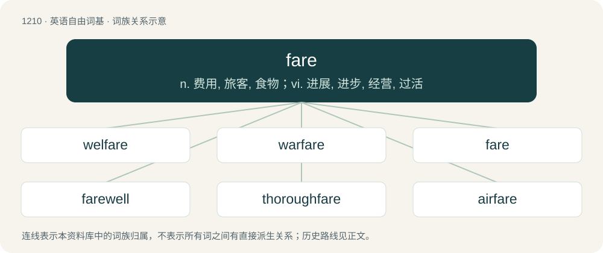

# 1290 · fare — n. 费用, 旅客, 食物；vi. 进展, 进步, 经营, 过活

[总目录](../00_总目录_按常用程度.md)

**类型**：英语自由词基　｜　**来源语言**：见词源记录

## 核心含义与来源

- 核心含义：n. 费用, 旅客, 食物；vi. 进展, 进步, 经营, 过活
- 英文含义：Money paid for a transport ticket.
- 词形：fare

**多个词源／构词路径**：同一拼写可能有不同来源；以下按词性和含义分别列出。

**来源记录 1**（名词；Money paid for a transport ticket.）

From Middle English fare, from a merger of Old English fær (“journey, road”) and faru (“journey, companions, baggage”), from Proto-Germanic \*farą and \*farō (“journey, fare”), from Proto-Indo-European \*per- (“a going, passage”).

**来源记录 2**（动词；To experience luck, fortune or treatment (of a certain kind).）

From Middle English faren, from Old English faran (“to travel, journey”), from Proto-West Germanic \*faran, from Proto-Germanic \*faraną, from Proto-Indo-European \*per- (“a going, passage”). Cognate with West Frisian farre, Dutch varen (“to sail”), German fahren (“to travel”), Danish and Norwegian Bokmål fare, Norwegian Nynorsk and Icelandic fara (“to go”) and Swedish fara (“to travel”).

## 词族图

## 单词速览（常用到不常用）

| 单词 | 音标 | 释义 |
|---|---|---|
| [welfare](#w-1) | 英 /ˈwɛlˌfɛə/；美 /ˈwɛlˌfɛɚ/ | n. 福利, 安宁, 幸福, 福利事业；a. 福利的 |
| [warfare](#w-2) | 英 /ˈwɔːfɛə/；美 /ˈwɔɹfɛɹ/ | n. 战争, 战斗, 交战, 斗争, 竞争；\[法\] 战事, 作战, 交战 |
| [fare](#w-3) | 英 /ˈfɛə/；美 /ˈfɛɚ/ | n. 费用, 旅客, 食物；vi. 进展, 进步, 经营, 过活 |
| [farewell](#w-4) | 英 /fɛəˈwɛl/；美 /fɛɹˈwɛl/ | n. 辞别, 再见, 再会；interj. 再会 |
| [thoroughfare](#w-5) | 英 /ˈθʌɹəfɛː/；/ˈθəɹ.ə.fɛɹ/ | n. 通路, 大道 |
| [airfare](#w-6) | /ˈεə.fεə/ | n. 飞机票价 |

## 逐词详解

### 1. welfare

**词性**：名词　｜　**音标**：英 /ˈwɛlˌfɛə/；美 /ˈwɛlˌfɛɚ/

**中文释义**：n. 福利, 安宁, 幸福, 福利事业；a. 福利的

**英文义项**：Health, safety, happiness and prosperity; well-being in any respect. / Shortened form of "welfare spending", "welfare payments", or "welfare assistance".

**构词拆分**：well + fare

**词源与演化**：

From Middle English welefare, probably from the Old English phrase wel faran (“to fare well, get along successfully, prosper”) (cognate with Middle Dutch welvare (“welfare”), Middle Low German wolvare (“welfare”), Middle High German wolvar, wolfar (“welfare”)). Equivalent to well + fare. Compare also West Frisian wolfeart, Dutch welvaart, German Wohlfahrt, Old Norse velferð (whence Swedish välfärd (“welfare”)). The first recorded use in the sense of "social concern for the well-being of children, the unemployed, etc." is from 1904 and in the sense of "organized effort to provide for maintenance of members of a group" from 1918.

**例句**：

> She lives on welfare.

该用例对应义项：governmental provision of economic assistance to persons in need

### 2. warfare

**词性**：名词　｜　**音标**：英 /ˈwɔːfɛə/；美 /ˈwɔɹfɛɹ/

**中文释义**：n. 战争, 战斗, 交战, 斗争, 竞争；\[法\] 战事, 作战, 交战

**英文义项**：The waging of war or armed conflict against an enemy. / Military operations of some particular kind e.g. guerrilla warfare.

**构词拆分**：war + fare

**词源与演化**：

From war + fare; perhaps a shortening of Middle English werre-faringe, werfarynge (“waging war, warfare”, literally “going to war”).

**例句**：

> They took to the field with all the panoply of modern warfare.

### 3. fare

**词性**：名词　｜　**音标**：英 /ˈfɛə/；美 /ˈfɛɚ/

**中文释义**：n. 费用, 旅客, 食物；vi. 进展, 进步, 经营, 过活

**英文义项**：Money paid for a transport ticket. / A paying passenger, especially in a taxi.

**词源与演化**：

From Middle English fare, from a merger of Old English fær (“journey, road”) and faru (“journey, companions, baggage”), from Proto-Germanic \*farą and \*farō (“journey, fare”), from Proto-Indo-European \*per- (“a going, passage”).

**例句**：

> Just another channel that offers the usual fare of makeover programs and reruns of old sitcoms.

该用例对应义项：Supplies for consumption or pleasure.

### 4. farewell

**词性**：名词　｜　**音标**：英 /fɛəˈwɛl/；美 /fɛɹˈwɛl/

**中文释义**：n. 辞别, 再见, 再会；interj. 再会

**英文义项**：A wish of happiness or safety at parting, especially a permanent departure. / A departure; the act of leaving.

**构词拆分**：fare (“to fare, travel, journey”) + well

**词源与演化**：

From Middle English farewel, from fare wel! (and the variants with the personal pronoun "fare ye well" and "fare you well" used in the Renaissance), an imperative expression, possibly further derived from Old English \*far wel!, equivalent to fare (“to fare, travel, journey”) + well. Compare Scots farewele, fairweill (“farewell”), Saterland Frisian Foarwäil (“farewell”), West Frisian farwol (“farewell”), German Fahrwol, Fahrwohl, East Frisian forwal, Dutch vaarwel (“farewell (sadly)”), Danish farvel (“farewell”), Norwegian farvel (“farewell”), Swedish farväl (“farewell”), Faroese farvæl (“goodbye”), Icelandic far vel (“farewell”). The extensive list of cognates suggests a postulated ultimate Proto-Germanic phrase of origin, possibly something akin to \*far wela.

**例句**：

> He bid farewell to all of his fans.

该用例对应义项：A wish of happiness or safety at parting, especially a permanent departure.

### 5. thoroughfare

**词性**：名词　｜　**音标**：英 /ˈθʌɹəfɛː/；/ˈθəɹ.ə.fɛɹ/

**中文释义**：n. 通路, 大道

**英文义项**：A passage; a way through. / A road open at both ends or connecting one area with another; a highway or main street.

**构词拆分**：thorough- (“through”) + fare

**词源与演化**：

From Middle English thurghfare, corresponding to thorough- (“through”) + fare. Compare Old English þurhfaran (“to go through, go over, traverse, pierce, pass through, pass beyond, transcend, penetrate”). Compare also Old English þurhfær (“inner secret place”), German Durchfahrt (“passage through, thoroughfare”).

**例句**：

> The sign leading to the other carriage reads: No thoroughfare.

该用例对应义项：The act of going through; passage; travel, transit.

### 6. airfare

**词性**：名词　｜　**音标**：/ˈεə.fεə/

**中文释义**：n. 飞机票价

**英文义项**：The cost or expense of an airplane ticket or trip.

**构词拆分**：air + fare

**词源与演化**：

From air + fare.

**例句**：

> I'd love to visit Paris, but I can't afford the airfare.

该用例对应义项：The cost or expense of an airplane ticket or trip.
