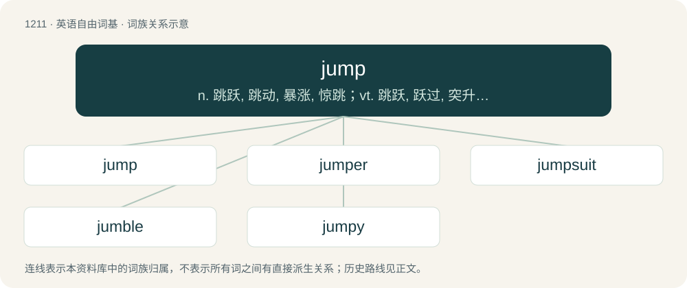

# 1291 · jump — n. 跳跃, 跳动, 暴涨, 惊跳；vt. 跳跃, 跃过, 突升, 使跳跃；vi. 跳跃, 跳, 跳动, 暴涨

[总目录](../00_总目录_按常用程度.md)

**类型**：英语自由词基　｜　**来源语言**：见词源记录

## 核心含义与来源

- 核心含义：n. 跳跃, 跳动, 暴涨, 惊跳；vt. 跳跃, 跃过, 突升, 使跳跃；vi. 跳跃, 跳, 跳动, 暴涨
- 英文含义：To propel oneself rapidly upward, downward and/or in any horizontal direction such that momentum causes the body to become airborne.
- 词形：jump

**多个词源／构词路径**：同一拼写可能有不同来源；以下按词性和含义分别列出。

**来源记录 1**（动词；To propel oneself rapidly upward, downward and/or in any horizontal direction such that momentum causes the body to become airborne.）

From Middle English jumpen (“to walk quickly, run, jump”), probably of Middle Low German or North Germanic origin, ultimately from Proto-Germanic \*gumpōną ~ \*gumbōną (“to hop, skip, bounce”), an iterative verb. The OED suggests an imitative origin. Related to jumble. In the sense “to propel oneself” it displaced leap partially and spring largely. Cognates Cognate with German Low German jumpen (“to jump”), archaic German gumpen (“to jump, hop, bounce”), dialectal German gampen (“to hop”), Alemannic German gumpe (“to leap, jump”), Walser dialect kumpu, Old Norse gopta (“to jump; make jump”) Danish gumpe (“to jolt”), Swedish gumpa (“to jump”), Danish gimpe (“to move up and down”), Middle English jumpren, jumbren (“to mix, jumble”).

**来源记录 2**（名词；A kind of loose jacket for men.）

Compare French jupe (“a long petticoat, a skirt”) and English jupon.

## 词族图

## 单词速览（常用到不常用）

| 单词 | 音标 | 释义 |
|---|---|---|
| [jump](#w-1) | /d͡ʒʌmp/ | n. 跳跃, 跳动, 暴涨, 惊跳；vt. 跳跃, 跃过, 突升, 使跳跃；vi. 跳跃, 跳, 跳动, 暴涨 |
| [jumper](#w-2) | 英 /ˈd͡ʒʌmpə/；美 /ˈd͡ʒʌmpɚ/ | n. 跳跃者, 工作服；\[计\] 跳线连接器, 跳接器 |
| [jumpsuit](#w-3) | 美 /ˈd͡ʒʌmpˌsut/ | n. 连衣裤, （尤指女式）连衣裤 |
| [jumble](#w-4) | /ˈd͡ʒʌmbəl/ | vi. 搀杂, 混杂；vt. 搞乱, 使混乱；n. 混乱, 薄饼 |
| [jumpy](#w-5) | /ˈd͡ʒʌmpi/ | a. 跳跃的, 跳动的, 神经质的 |

## 逐词详解

### 1. jump

**词性**：动词　｜　**音标**：/d͡ʒʌmp/

**中文释义**：n. 跳跃, 跳动, 暴涨, 惊跳；vt. 跳跃, 跃过, 突升, 使跳跃；vi. 跳跃, 跳, 跳动, 暴涨

**英文义项**：To propel oneself rapidly upward, downward and/or in any horizontal direction such that momentum causes the body to become airborne. / To cause oneself to leave an elevated location and fall downward.

**词源与演化**：

From Middle English jumpen (“to walk quickly, run, jump”), probably of Middle Low German or North Germanic origin, ultimately from Proto-Germanic \*gumpōną ~ \*gumbōną (“to hop, skip, bounce”), an iterative verb. The OED suggests an imitative origin. Related to jumble. In the sense “to propel oneself” it displaced leap partially and spring largely. Cognates Cognate with German Low German jumpen (“to jump”), archaic German gumpen (“to jump, hop, bounce”), dialectal German gampen (“to hop”), Alemannic German gumpe (“to leap, jump”), Walser dialect kumpu, Old Norse gopta (“to jump; make jump”) Danish gumpe (“to jolt”), Swedish gumpa (“to jump”), Danish gimpe (“to move up and down”), Middle English jumpren, jumbren (“to mix, jumble”).

**例句**：

> Share prices jumped by 10% after the company announced record profits.

该用例对应义项：To increase sharply, to rise, to shoot up.

### 2. jumper

**词性**：名词　｜　**音标**：英 /ˈd͡ʒʌmpə/；美 /ˈd͡ʒʌmpɚ/

**中文释义**：n. 跳跃者, 工作服；\[计\] 跳线连接器, 跳接器

**英文义项**：Someone or something that jumps, e.g. a participant in a jumping event in track or skiing. / A person who attempts suicide by jumping from a great height.

**构词拆分**：jump + -er

**词源与演化**：

From jump + -er.

**例句**：

> As the jumper neared the ground he lost control.

该用例对应义项：a person who jumps

### 3. jumpsuit

**词性**：名词　｜　**音标**：美 /ˈd͡ʒʌmpˌsut/

**中文释义**：n. 连衣裤, （尤指女式）连衣裤

**英文义项**：A one-piece item of clothing originally used by parachutists. / A similar item of clothing used for outdoor sports such as skiing.

**构词拆分**：jump + suit

**词源与演化**：

From jump + suit, referring to parachute jumps.

**例句**：

> The next time you see Tom, he'll be in an orange jumpsuit.

### 4. jumble

**词性**：动词　｜　**音标**：/ˈd͡ʒʌmbəl/

**中文释义**：vi. 搀杂, 混杂；vt. 搞乱, 使混乱；n. 混乱, 薄饼

**英文义项**：To mix or confuse. / To meet or unite in a confused way.

**构词拆分**：jump + -le

**词源与演化**：

From Middle English jumbelen, alteration of jumbren, jombren, a variant of jumpren, frequentative of jumpen (“to jump”), equal to jump + -le. More at jumber, jump, jumper.

**例句**：

> I tried to study, but in my half-awake state, all of the concepts seemed to jumble together.

该用例对应义项：To meet or unite in a confused way.

### 5. jumpy

**词性**：形容词　｜　**音标**：/ˈd͡ʒʌmpi/

**中文释义**：a. 跳跃的, 跳动的, 神经质的

**英文义项**：Nervous and excited. / Tending to jump; full of jumps.

**构词拆分**：jump + -y

**词源与演化**：

From jump + -y.

**例句**：

> Tom and Mary seemed a little jumpy, didn't they?
