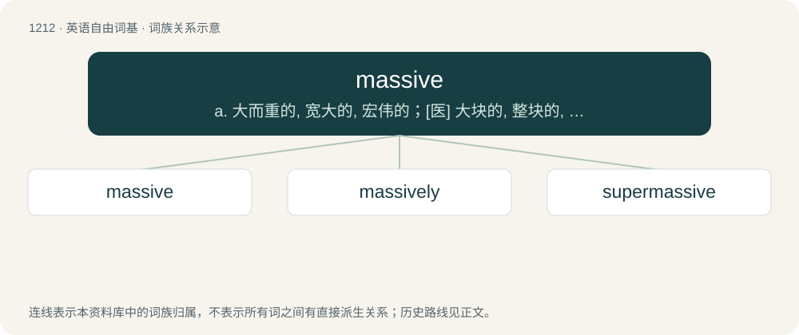

# 1292 · massive — a. 大而重的, 宽大的, 宏伟的；\[医\] 大块的, 整块的, 大量的

[总目录](../00_总目录_按常用程度.md)

**类型**：英语自由词基　｜　**来源语言**：见词源记录

## 核心含义与来源

- 核心含义：a. 大而重的, 宽大的, 宏伟的；\[医\] 大块的, 整块的, 大量的
- 英文含义：Very large in size or extent.
- 词形：massive

**来源记录 1**（形容词；Very large in size or extent.）

From Middle English massif, from Middle French massif, equivalent to mass + -ive. The Irish sense is possibly derived from Irish mas (“fine, handsome”).

## 词族图

## 单词速览（常用到不常用）

| 单词 | 音标 | 释义 |
|---|---|---|
| [massive](#w-1) | 英 /ˈmæs.ɪv/ | a. 大而重的, 宽大的, 宏伟的；\[医\] 大块的, 整块的, 大量的 |
| [massively](#w-2) | /ˈmæs.ɪv.li/ | adv. 大而重, 厚实, 粗大, 强有力, 结实, 魁伟, 大块, 大量, 大规模, 实心, 块状；\[计\] 大规模地 |
| [supermassive](#w-3) | /ˈsjuːpə,mæsiv/ | a. \[天\]特大质量的 |

## 逐词详解

### 1. massive

**词性**：形容词　｜　**音标**：英 /ˈmæs.ɪv/

**中文释义**：a. 大而重的, 宽大的, 宏伟的；\[医\] 大块的, 整块的, 大量的

**英文义项**：Very large in size or extent. / Substantial in mass; bulky, heavy and solid.

**构词拆分**：mass + -ive

**词源与演化**：

From Middle English massif, from Middle French massif, equivalent to mass + -ive. The Irish sense is possibly derived from Irish mas (“fine, handsome”).

**例句**：

> Compared to its counterparts from World War II, the Abrams main battle tank is truly massive.

该用例对应义项：Very large in size or extent.

### 2. massively

**词性**：副词　｜　**音标**：/ˈmæs.ɪv.li/

**中文释义**：adv. 大而重, 厚实, 粗大, 强有力, 结实, 魁伟, 大块, 大量, 大规模, 实心, 块状；\[计\] 大规模地

**英文义项**：In a massive manner, in a way that appears large, heavy or imposing. / Greatly.

**构词拆分**：massive + -ly

**词源与演化**：

From massive + -ly.

**例句**：

> Tonight the haddock were shoaling massively in three hundred fathoms.

该用例对应义项：to a massive degree or in a massive manner

### 3. supermassive

**词性**：形容词　｜　**音标**：/ˈsjuːpə,mæsiv/

**中文释义**：a. \[天\]特大质量的

**英文义项**：Extremely massive; of extraordinary mass.

**构词拆分**：super- + massive

**词源与演化**：

From super- + massive.

**用法示例／搭配（非完整句）**：

> supermassive SVBIED

该用例对应义项：Extremely massive; of extraordinary mass.
