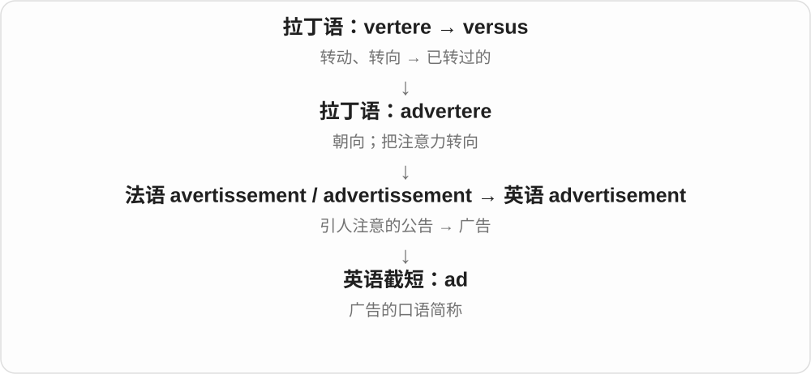

# 1293 · ad — 广告缩写及广告拦截

[逐词精讲目录](../00_逐词精讲目录.md) · [总目录](../00_总目录_按常用程度.md)

## 核心词根与来源

这个 ad 是独立的广告词，不是把单词开头 ad- 全当成同一种广告意义。an ad 说一则广告，ads 是复数。

**AD：advertisement 缩短后，成了现代复合词材料**

ad 是基础缩略词，adblock 接阻挡功能。

- **广告与功能**：ad · adblock
- **ad → ads：一则则广告**：ad · ads

## 词形与演化规律

advertisement → ad；ad + block → adblock。

ad 截短 advertisement，复数直接加 -s；完整原词接引人注意的法语、拉丁词族。独立广告名词不等于拉丁前缀 ad-。

## 单词速览（按词族由简到繁）

同一基础词的相关扩展放在一起，先读基础形式，再读扩展；各组之间优先读常用的。具体词源关系见各词讲解。

| 单词 | 音标 | 核心意思 |
|---|---|---|
| [ad](#w-1) | 英、美 /æd/ | 广告〔口语〕 |
| [ads](#w-3) | /ædz/ | 广告〔ad 的复数〕 |
| [adblock](#w-2) | 英 /ˈædblɒk/；美 /ˈædblɑːk/ | 广告拦截；广告拦截功能、工具〔常见于软件语境〕 |

## 逐词讲解

### 1. ad — 广告〔口语〕

**音标**：英、美 /æd/

**先抓住这个画面**

看板、短视频、网页弹出的一则宣传，随口就能说 an ad。这个短词背后仍是“把注意力转过来”的长历史。

**怎么拆**

advertisement 截短为 ad；此处不是拉丁语前缀 ad- 独立变成“广告”。

**怎么变成今天的意思**

可数，复数 ads。job ad 是招聘广告，personal ad 是个人分类广告；an ad 不等于广告行业 advertising。

**常见搭配与例句**

an online ad；a job ad；place an ad。

> I found the apartment through an online ad.

我通过一则网上广告找到了这套公寓。

> The video starts with a short ad.

视频开头是一则短广告。

**别混淆**

ad 是广告；add 是“添加”，读音相同，拼写与词源不同。

### 2. ads — 广告〔ad 的复数〕

**音标**：/ædz/

**先抓住这个画面**

视频前插一条、网页边再来几条，这些一则则广告就是 ads。advertising 常说广告活动或行业，ads 则能直接数具体广告。

**怎么拆**

advertisement 截短为 ad，再加 -s → ads，词尾读 /z/；完整原词经法语接把注意力转向某物的材料。

**怎么变成今天的意思**

**法语 avertissement 等通知、引人注意材料 → advertisement**  
现代常用作商业广告名词

↓

**advertisement → ad → ads**  
截短，再按普通名词加复数

online ads、video ads、job ads 都在说具体发布的广告、招聘启事等；不是每一则都必然在卖商品。

**常见搭配与例句**

run ads；job ads；skip the ads；classified ads。

> The free version shows ads between videos.

免费版会在视频之间显示广告。

> She found the job through online ads.

她通过网上招聘广告找到了那份工作。

**别混淆**

ads 与 adds 同音，前者广告，后者 add 的三单“添加”；This app adds ads 是这个应用会加入广告。

### 3. adblock — 广告拦截；广告拦截功能、工具〔常见于软件语境〕

**音标**：英 /ˈædblɒk/；美 /ˈædblɑːk/

**先抓住这个画面**

网页本来要显示广告，工具在加载、显示环节把它挡住。ad 是 advertisement 的缩短，block 是阻挡。

**怎么拆**

现代材料为 ad + block，普通用法也受 AdBlock、Adblock Plus 等软件名称通用化的影响。功能名与具体软件专名须按大小写、上下文区分，不把所有 adblock 都当同一家产品。

**怎么变成今天的意思**

**advertisement → ad**  
广告的缩略形式

↓

**ad + block → adblock**  
阻止广告显示的功能、工具

enable adblock 启用广告拦截，disable adblock 关闭广告拦截；ad blocker 是更完整的工具称呼。

**常见搭配与例句**

enable adblock；disable adblock；adblock settings。

> The site asked visitors to disable adblock.

网站请访客关闭广告拦截。

> She checked the adblock settings in her browser.

她检查了浏览器里的广告拦截设置。

**别混淆**

adblock 针对广告，popup blocker 针对弹出窗口，两者可能重叠但不相同；ad 在这里不接拉丁朝向前缀 ad-。

## 这一组要分清什么

ad 广告，add 添加发音相同但拼写和来源不同；adblock 与具体软件专名须分清。

## 串起来练习

The adblock feature stopped the ad from loading.

广告拦截功能阻止了那则广告加载。
