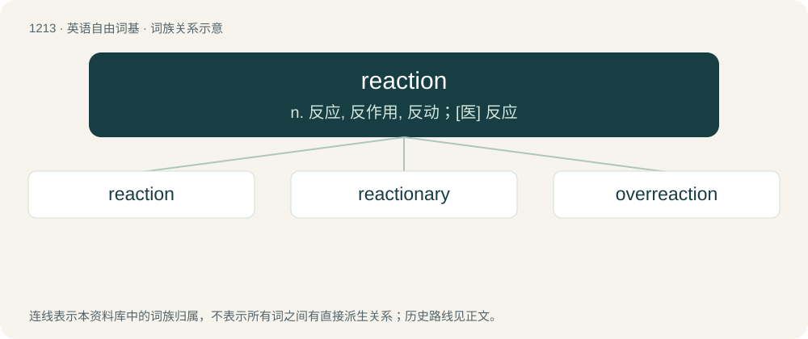

# 1293 · reaction — n. 反应, 反作用, 反动；\[医\] 反应

[总目录](../00_总目录_按常用程度.md)

**类型**：英语自由词基　｜　**来源语言**：见词源记录

## 核心含义与来源

- 核心含义：n. 反应, 反作用, 反动；\[医\] 反应
- 英文含义：An action or statement in response to a stimulus or other event.
- 词形：reaction

**来源记录 1**（名词；An action or statement in response to a stimulus or other event.）

Inherited from Middle English reaccion, from Old French reaction, from Latin reāctiō, from the verb reagō, from re- (“again”) + agō (“to act”); more at re-, action; equivalent to react + -ion.

## 词族图

## 单词速览（常用到不常用）

| 单词 | 音标 | 释义 |
|---|---|---|
| [reaction](#w-1) | /ɹiˈækʃən/ | n. 反应, 反作用, 反动；\[医\] 反应 |
| [reactionary](#w-2) | 英 /ɹiˈækʃən(ə)ɹi/；美 /ɹiˈæk.ʃəˌnɛɚ.i/ | n. 反动分子；a. 反动的, 反动主义的, 反对改革的 |
| [overreaction](#w-3) |  | \[经\] 反应过度 |

## 逐词详解

### 1. reaction

**词性**：名词　｜　**音标**：/ɹiˈækʃən/

**中文释义**：n. 反应, 反作用, 反动；\[医\] 反应

**英文义项**：An action or statement in response to a stimulus or other event. / A transformation in which one or more substances is converted into another by combination or decomposition.

**构词拆分**：react + -ion

**词源与演化**：

Inherited from Middle English reaccion, from Old French reaction, from Latin reāctiō, from the verb reagō, from re- (“again”) + agō (“to act”); more at re-, action; equivalent to react + -ion.

**例句**：

> In this reaction, the acid and base will neutralize each other, producing a salt.

该用例对应义项：A transformation in which one or more substances is converted into another by combination or decomposition.

### 2. reactionary

**词性**：形容词　｜　**音标**：英 /ɹiˈækʃən(ə)ɹi/；美 /ɹiˈæk.ʃəˌnɛɚ.i/

**中文释义**：n. 反动分子；a. 反动的, 反动主义的, 反对改革的

**英文义项**：Extremely conservative; opposing revolution (such as the French Revolution); favoring a return to a "golden age" of the past. / Of, pertaining to, participating in, or inducing a chemical reaction.

**构词拆分**：reaction + -ary

**词源与演化**：

Borrowed from French réactionnaire, equivalent to reaction + -ary. Used in the time of the French revolution to refer to a person opposing the revolution; as in favoring a reaction against the revolution.

**例句**：

> He claims to be a centrist, but he talks like a reactionary.

### 3. overreaction

**词性**：名词

**中文释义**：\[经\] 反应过度

**英文义项**：A reaction that is excessive.

**构词拆分**：over- + reaction

**词源与演化**：

From over- + reaction.

**例句**：

> She had every right to dump you, but cutting up all your clothes after she did so was an overreaction.

该用例对应义项：A reaction that is excessive.
