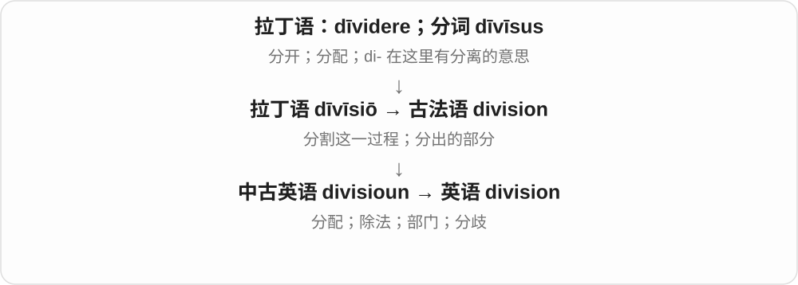
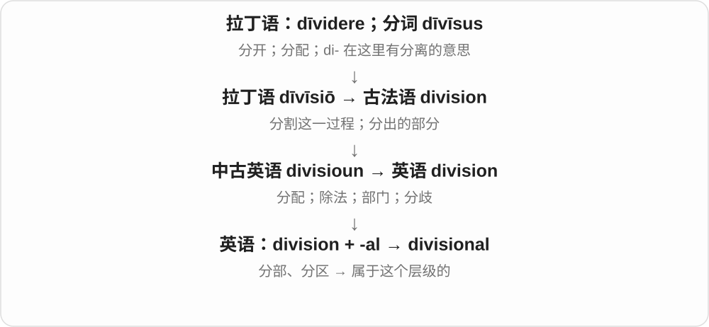
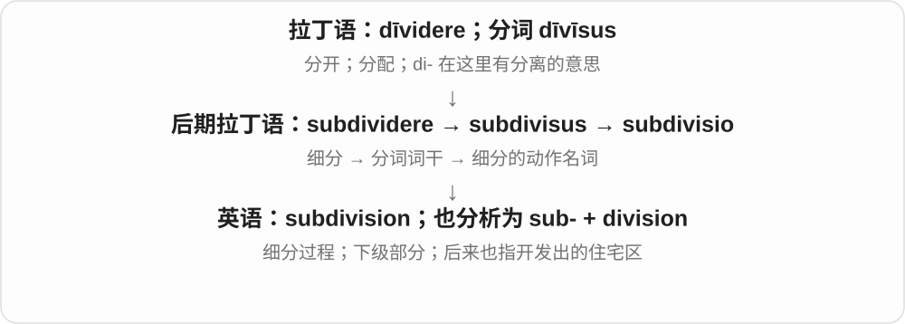

# 1294 · division — 划分；部分；部门

[逐词精讲目录](../00_逐词精讲目录.md) · [总目录](../00_总目录_按常用程度.md)

## 核心词根与来源

division 来自拉丁分开一支的名词，经法语等形式传入。subdivision 进一步分成小部分；divisional 描述某部门、分部或级别的。

**DIVISION：分开的动作和分出来的部分**

把整体划开，每块有自己的边界和用途。

- **动作与部分**：division
- **次级部分与属性**：subdivision · divisional

## 词形与演化规律

division 既可指动作、分歧，也可指部门或除法。sub- 在 subdivision 中表示次一级；divisional 为形容词。

## 单词速览（按词族由简到繁）

同一基础词的相关扩展放在一起，先读基础形式，再读扩展；各组之间优先读常用的。具体词源关系见各词讲解。

| 单词 | 音标 | 核心意思 |
|---|---|---|
| [division](#w-1) | /dɪˈvɪʒən/ | 划分；除法；部门；分歧；师〔军队单位〕 |
| [divisional](#w-3) | /dɪˈvɪʒənəl/ | 部门的；分区的；师级的 |
| [subdivision](#w-2) | /ˌsʌbdɪˈvɪʒən/ | 细分；分支；分出来的部分；住宅分区 |

## 逐词讲解

### 1. division — 划分；除法；部门；分歧；师〔军队单位〕

**音标**：/dɪˈvɪʒən/

**先抓住这个画面**

既能指“切开”这个动作，也能指切出来的一块。公司切成不同业务块，就有各个 division。

**怎么拆**

来自拉丁 dīvīsiō，经古法语进入英语；与 divide 同源，但名词的拉丁、法语形式已有自己的借入历史。

**怎么变成今天的意思**

division of labour 是分工；sales division 是销售部门；long division 是长除法。社会里的 division 则常说人群之间的隔阂，不一定有人真的划线。

**常见搭配与例句**

division of responsibility；a business division；deep divisions。

> The company opened a new research division.

公司设立了一个新的研究部门。

> A clear division of tasks made the project easier.

明确分工让项目更容易推进。

**别混淆**

division 可以说过程或组织部分；dividend 是除法里的被除数，也指分给股东的利润。

### 2. divisional — 部门的；分区的；师级的

**音标**：/dɪˈvɪʒənəl/

**先抓住这个画面**

事情发生在一个 division 这个层级：全公司有总经理，每个事业部又有 divisional manager。

**怎么拆**

division + -al，是英语形容词派生。

**怎么变成今天的意思**

通常接 manager、meeting、headquarters 等名词。军事里 divisional 属于师这一编制；商业里属于某个分部。

**常见搭配与例句**

a divisional manager；divisional headquarters；divisional results。

> Each divisional manager submitted a monthly report.

每位部门经理都提交了月报。

> The divisional meeting focused on training.

这次部门会议主要讨论培训。

**别混淆**

divisional 说所属层级；divisive 说引起争执、分裂。

### 3. subdivision — 细分；分支；分出来的部分；住宅分区

**音标**：/ˌsʌbdɪˈvɪʒən/

**先抓住这个画面**

大抽屉里再放小格子：细分这个动作和这些小格子，都可以叫 subdivision。

**怎么拆**

sub- + division；也与后期拉丁 subdivisio 的细分名词相应。它不必由现代英语 subdivide 换词尾才出现。

**怎么变成今天的意思**

美式语境里 a subdivision 常指一片划分成住宅地块的区域。读房产广告时，这个词不是在说一道除法题。

**常见搭配与例句**

a subdivision of a category；residential subdivisions。

> Each subdivision of the report has its own heading.

报告的每个分节都有自己的标题。

> They live in a quiet subdivision outside the city.

他们住在城外一个安静的住宅区。

**别混淆**

division 是一层划分；subdivision 强调下一级。住宅区义来自土地分块这一具体用法。

## 这一组要分清什么

division 不一定表示冲突：数学除法、公司部门和意见分裂是不同语境。

## 串起来练习

Each division has smaller subdivisions and its own divisional manager.

每个分部都有更小的部门和自己的分部经理。
