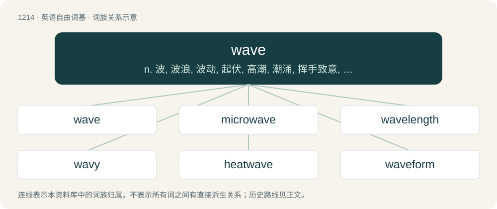

# 1294 · wave — n. 波, 波浪, 波动, 起伏, 高潮, 潮涌, 挥手致意, (气压)突变；vi. 波动, 飘动, 挥手示意, 起伏；vt. 使波动, 使飘扬, 挥舞, 使成波浪形

[总目录](../00_总目录_按常用程度.md)

**类型**：英语自由词基　｜　**来源语言**：见词源记录

## 核心含义与来源

- 核心含义：n. 波, 波浪, 波动, 起伏, 高潮, 潮涌, 挥手致意, (气压)突变；vi. 波动, 飘动, 挥手示意, 起伏；vt. 使波动, 使飘扬, 挥舞, 使成波浪形
- 英文含义：To move back and forth repeatedly and somewhat loosely.
- 词形：wave

**多个词源／构词路径**：同一拼写可能有不同来源；以下按词性和含义分别列出。

**来源记录 1**（动词；To move back and forth repeatedly and somewhat loosely.）

From Middle English waven, from Old English wafian (“to wave, fluctuate, waver in mind, wonder”), from Proto-West Germanic \*wabōn, from Proto-Germanic \*wabōną, \*wabjaną (“to wander, sway”), from Proto-Indo-European \*webʰ- (“to move to and from, wander”). Cognate with Middle High German waben (“to wave”), German wabern (“to waft”), Icelandic váfa (“to fluctuate, waver, doubt”). See also waver.

**来源记录 2**（名词；A moving disturbance in the level of a body of liquid; an undulation.）

From Middle English \*wave, partially from waven (“to fluctuate, wave”) (see above) and partially from Middle English wawe, waghe (“wave”), from Old English wǣg (“a wave, billow, motion, water, flood, sea”), from Proto-Germanic \*wēgaz (“motion, storm, wave”), from Proto-Indo-European \*weǵʰ- (“to drag, carry”). Cognates Cognate with North Frisian waag (“wave”), West Frisian weach (“wave”), Dutch waag (“wave”), German Woge, Wooge (“wave”), Danish vove, våg (“wave”), Faroese vágur (“bay”), Icelandic vogur (“bay”), Norwegian Bokmål, Norwegian Nynorsk and Swedish våg (“wave”), Gothic 𐍅𐌴𐌲𐍃 (wēgs, “wave”), French vague (“wave”) (from Old Norse vágr (“ocean, sea; wave”)). See also waw.

## 词族图

## 单词速览（常用到不常用）

| 单词 | 音标 | 释义 |
|---|---|---|
| [wave](#w-1) | 英 /weɪv/ | n. 波, 波浪, 波动, 起伏, 高潮, 潮涌, 挥手致意, (气压)突变；vi. 波动, 飘动, 挥手示意, 起伏；vt. 使波动, 使飘扬, 挥舞, 使成波浪形 |
| [microwave](#w-2) | 英 /ˈmaɪkɹəʊˌweɪv/；美 /ˈmaɪkɹoʊˌweɪv/ | n. 微波；\[计\] 微波 |
| [wavelength](#w-3) | 英 /ˈweɪvlɛŋ(k)θ/；美 /ˈweɪvˌlɛŋ(k)θ/ | n. 波长；\[化\] 波长 |
| [wavy](#w-4) | /ˈweɪvi/ | a. 有波浪的, 多浪的, 波浪状的, 波动的, 不稳定的 |
| [heatwave](#w-5) | /ˈhitˌweɪv/ | n. 热浪\[波\], 酷暑期 |
| [waveform](#w-6) | /ˈweivfɔːm/ | \[计\] 波形 |
| [waver](#w-7) | 英 /ˈweɪvə/；美 /ˈweɪvəɹ/ | 【英文】One who waves their arms, or causes something to swing or wave. |
| [waveguide](#w-8) | /ˈweiv^aid/ | \[计\] 波导, 波导管；\[化\] 波导 |
| [shortwave](#w-9) | 英 /ˈʃɔːtweɪv/；美 /ˈʃoɹtˌweɪv/ | n. 短波；vt. 用短波发射 |
| [wavelet](#w-10) | /ˈweivlit/ | n. 小浪, 微波；\[化\] 子波 |
| [brainwave](#w-11) | /ˈbreinweiv/ | n. 脑(电)波, 灵感 |
| [wavefront](#w-12) | /ˈweivfrʌnt/ | \[计\] 波前 |
| [wavefunction](#w-13) | /ˈweɪv.fʌŋ(k).ʃən/ | 波函数 |

## 逐词详解

### 1. wave

**词性**：动词　｜　**音标**：英 /weɪv/

**中文释义**：n. 波, 波浪, 波动, 起伏, 高潮, 潮涌, 挥手致意, (气压)突变；vi. 波动, 飘动, 挥手示意, 起伏；vt. 使波动, 使飘扬, 挥舞, 使成波浪形

**英文义项**：To move back and forth repeatedly and somewhat loosely. / To move one's hand back and forth (generally above the shoulders) in greeting or departure.

**词源与演化**：

From Middle English waven, from Old English wafian (“to wave, fluctuate, waver in mind, wonder”), from Proto-West Germanic \*wabōn, from Proto-Germanic \*wabōną, \*wabjaną (“to wander, sway”), from Proto-Indo-European \*webʰ- (“to move to and from, wander”). Cognate with Middle High German waben (“to wave”), German wabern (“to waft”), Icelandic váfa (“to fluctuate, waver, doubt”). See also waver.

**例句**：

> Jones waves at strike one.

该用例对应义项：To swing and miss at a pitch.

### 2. microwave

**词性**：名词　｜　**音标**：英 /ˈmaɪkɹəʊˌweɪv/；美 /ˈmaɪkɹoʊˌweɪv/

**中文释义**：n. 微波；\[计\] 微波

**英文义项**：An electromagnetic wave with wavelength between that of infrared light and radio waves.

**构词拆分**：From micro- + wave.

**词源与演化**：

From micro- + wave.

**例句**：

> Many radar systems use a combination of radio waves and microwaves.

该用例对应义项：An electromagnetic wave with wavelength between that of infrared light and radio waves.

### 3. wavelength

**词性**：名词　｜　**音标**：英 /ˈweɪvlɛŋ(k)θ/；美 /ˈweɪvˌlɛŋ(k)θ/

**中文释义**：n. 波长；\[化\] 波长

**英文义项**：The length of a single cycle of a wave, as measured by the distance between one peak or trough of a wave and the next; it is often designated in physics as λ, and corresponds to the velocity of the wave divided by its frequency. / A person's attitude and way of thinking as compared to another person's.

**构词拆分**：wave + length

**词源与演化**：

From wave + length.

**例句**：

> I think you and I are on a different wavelength.

该用例对应义项：A person's attitude and way of thinking as compared to another person's.

### 4. wavy

**词性**：形容词　｜　**音标**：/ˈweɪvi/

**中文释义**：a. 有波浪的, 多浪的, 波浪状的, 波动的, 不稳定的

**英文义项**：Rising or swelling in waves. / Full of waves.

**构词拆分**：wave + -y

**词源与演化**：

From wave + -y.

**用法示例／搭配（非完整句）**：

> wavy swimming pool

该用例对应义项：Full of waves.

### 5. heatwave

**词性**：名词　｜　**音标**：/ˈhitˌweɪv/

**中文释义**：n. 热浪\[波\], 酷暑期

**英文义项**：A heat haze.

**构词拆分**：From heat + wave.

**词源与演化**：

From heat + wave.

**例句**：

> The little dog drank all of his water during the heatwave.

### 6. waveform

**词性**：名词　｜　**音标**：/ˈweivfɔːm/

**中文释义**：\[计\] 波形

**英文义项**：The shape of a wave function represented by a graph showing some dependent variable as function of an independent variable. / The shape of a physical wave, such as sound, electric current or electromagnetic radiation, or its representation obtained by plotting a characteristic of the phenomenon (such as voltage) versus another variable, often time.

**构词拆分**：wave + form

**词源与演化**：

From wave + form.

### 7. waver

**词性**：名词　｜　**音标**：英 /ˈweɪvə/；美 /ˈweɪvəɹ/

**英文义项**：One who waves their arms, or causes something to swing or wave. / A person who specializes in treating hair to make it wavy.

**构词拆分**：wave (verb) + -er (suffix forming agent nouns)

**词源与演化**：

From wave (verb) + -er (suffix forming agent nouns).

**例句**：

> Johnny is such a little waver; everyone who passes by receives his preferred greeting.

该用例对应义项：One who waves their arms, or causes something to swing or wave.

### 8. waveguide

**词性**：名词　｜　**音标**：/ˈweiv^aid/

**中文释义**：\[计\] 波导, 波导管；\[化\] 波导

**英文义项**：A structure which guides waves, such as electromagnetic waves, light, or sound waves.

**构词拆分**：wave + guide

**词源与演化**：

From wave + guide.

### 9. shortwave

**词性**：名词　｜　**音标**：英 /ˈʃɔːtweɪv/；美 /ˈʃoɹtˌweɪv/

**中文释义**：n. 短波；vt. 用短波发射

**英文义项**：An electromagnetic wave with a relatively short wavelength; specifically, one with a wavelength generally between 10 and 100 metres, corresponding to a frequency between 3 and 30 megahertz. / Downward radiation in the shortwave (noun sense 1) frequency range which enters the Earth's atmosphere.

**构词拆分**：short (adjective) + wave (noun)

**词源与演化**：

The noun is derived from short (adjective) + wave (noun). The adjective is from an attributive use of the noun. The adverb is also derived from the noun.

**例句**：

> Shortwaves are longer than microwaves.

该用例对应义项：An electromagnetic wave with a relatively short wavelength; specifically, one with a wavelength generally between 10 and 100 metres, corresponding to a frequency between 3 and 30 megahertz.

### 10. wavelet

**词性**：名词　｜　**音标**：/ˈweivlit/

**中文释义**：n. 小浪, 微波；\[化\] 子波

**英文义项**：A small wave; a ripple. / A fast-decaying oscillation.

**构词拆分**：wave + -let

**词源与演化**：

From wave + -let; a calque of French ondelette, from onde (“wave”) + -ette (diminutive suffix).

### 11. brainwave

**词性**：名词　｜　**音标**：/ˈbreinweiv/

**中文释义**：n. 脑(电)波, 灵感

**英文义项**：Any of many rhythmic fluctuations of electric potential between parts of the brain, especially those seen on an electroencephalogram. / A sudden idea, understanding, or inspiration; a brainstorm.

**构词拆分**：brain + wave

**词源与演化**：

From brain + wave.

### 12. wavefront

**词性**：名词　｜　**音标**：/ˈweivfrʌnt/

**中文释义**：\[计\] 波前

**英文义项**：An imaginary surface passing through points of a medium oscillating in phase.

**构词拆分**：wave + front

**词源与演化**：

From wave + front.

### 13. wavefunction

**词性**：名词　｜　**音标**：/ˈweɪv.fʌŋ(k).ʃən/

**中文释义**：波函数

**英文义项**：A mathematical function that describes the propagation of the quantum mechanical wave associated with a particle (or system of particles), related to the probability of finding the particle in a particular region of space.

**构词拆分**：wave + function

**词源与演化**：

From wave + function.
