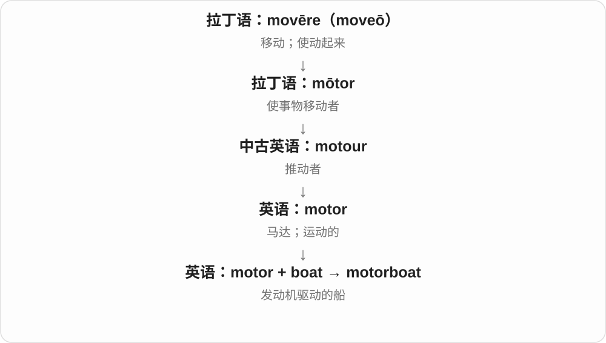
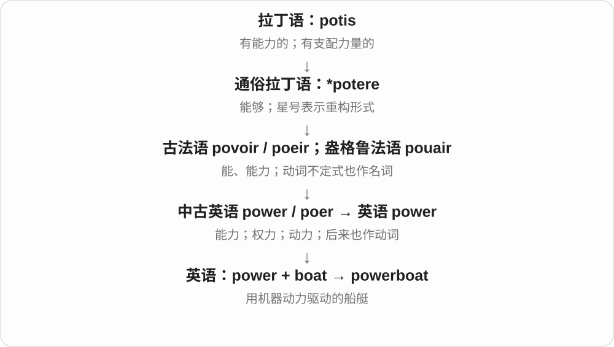

# 1295 · boat — 船；活动、人物、动力和用途命名

[逐词精讲目录](../00_逐词精讲目录.md) · [总目录](../00_总目录_按常用程度.md)

## 核心词根与来源

多数常见合成已有精讲，在船的基本画面下复习；生僻海事职务和历史艇名暂略。分类看侧重点，不当互斥的技术分类表。

**BOAT：浮水载人载物，前面的词说明动力或任务**

boat → boating、boatman、boater；sailboat、rowboat、motorboat、speedboat、powerboat 按动力；tugboat、ferryboat、lifeboat、gunboat 按用途；住所、场所与比喻再分组。

- **基本词、活动和人物**：boat · boating · boatman · boater
- **动力、速度和航区**：sailboat · rowboat · motorboat · speedboat · powerboat · riverboat
- **任务与运量**：tugboat · ferryboat · lifeboat · gunboat · boatload
- **住所、场所和比喻**：houseboat · boathouse · boatyard · showboat · dreamboat
- **boat → boats：船与乘船**：boat · boats

## 词形与演化规律

boat + -ing/-er/man/load；sail/row/motor/speed/power/tug/ferry/life/gun/river/house + boat；boat + house/yard。

本族古英语船名延续，更远来源不强定。

## 单词速览（按词族由简到繁）

同一基础词的相关扩展放在一起，先读基础形式，再读扩展；各组之间优先读常用的。具体词源关系见各词讲解。

| 单词 | 音标 | 核心意思 |
|---|---|---|
| [boat](#w-1) | 英 /bəʊt/；美 /boʊt/ | 船、小船；乘船、划船等〔动词〕 |
| [boats](#w-23) | 英 /bəʊts/；美 /boʊts/ | 船、小船〔boat 的复数〕 |
| [boating](#w-2) | 英 /ˈbəʊtɪŋ/；美 /ˈboʊtɪŋ/ | 乘船、划船、泛舟活动 |
| [boathouse](#w-5) | 英 /ˈbəʊthaʊs/；美 /ˈboʊthaʊs/ | 船库；船屋 |
| [boatman](#w-9) | 英 /ˈbəʊtmən/；美 /ˈboʊtmən/ | 船夫、操船者 |
| [boatload](#w-11) | 英 /ˈbəʊtləʊd/；美 /ˈboʊtloʊd/ | 一船的量；大量 |
| [boatyard](#w-19) | 英 /ˈbəʊtjɑːd/；美 /ˈboʊtjɑːrd/ | 小船建造、修理或存放场 |
| [boater](#w-20) | 英 /ˈbəʊtə/；美 /ˈboʊtər/ | 乘船、玩船者；平顶硬草帽 |
| [lifeboat](#w-3) | 英 /ˈlaɪfbəʊt/；美 /ˈlaɪfboʊt/ | 救生艇 |
| [sailboat](#w-4) | 英 /ˈseɪlbəʊt/；美 /ˈseɪlboʊt/ | 帆船〔尤美式〕 |
| [houseboat](#w-6) | 英 /ˈhaʊsbəʊt/；美 /ˈhaʊsboʊt/ | 船屋；供居住的船 |
| [tugboat](#w-7) | 英 /ˈtʌɡbəʊt/；美 /ˈtʌɡboʊt/ | 拖船 |
| [speedboat](#w-8) | 英 /ˈspiːdbəʊt/；美 /ˈspiːdboʊt/ | 快艇 |
| [motorboat](#w-10) | 英 /ˈməʊtəbəʊt/；美 /ˈmoʊtərboʊt/ | 汽艇；机动船 |
| [riverboat](#w-12) | 英 /ˈrɪvəˌbəʊt/；美 /ˈrɪvərˌboʊt/ | 内河船；河上游船 |
| [gunboat](#w-13) | 英 /ˈɡʌnbəʊt/；美 /ˈɡʌnboʊt/ | 炮艇 |
| [rowboat](#w-14) | 英 /ˈrəʊbəʊt/；美 /ˈroʊboʊt/ | 划艇、用桨划的小船〔尤美式〕 |
| [showboat](#w-15) | 英 /ˈʃəʊbəʊt/；美 /ˈʃoʊboʊt/ | 演出船；爱炫技的人；卖弄、出风头 |
| [powerboat](#w-18) | 英 /ˈpaʊəbəʊt/；美 /ˈpaʊərboʊt/ | 机动艇；动力艇 |
| [dreamboat](#w-21) | 英 /ˈdriːmbəʊt/；美 /ˈdriːmboʊt/ | 梦中情人；迷人的人〔口语，略显旧式〕 |
| [ferryboat](#w-22) | 英 /ˈferibəʊt/；美 /ˈferiboʊt/ | 渡船 |

## 逐词讲解

### 1. boat — 船、小船；乘船、划船等〔动词〕

**音标**：英 /bəʊt/；美 /boʊt/

**先抓住这个画面**

浮在水上载人、载物的工具。日常常指较小船只，但实际名称也有传统例外，不靠一个绝对尺寸界线区分 boat、ship。

**怎么拆**

本族词，接古英语 bāt，经中古英语延续。更远常联系劈开的木材等重建，近源先记可靠旧形；动词由船名发展。

**怎么变成今天的意思**

**古英语 bāt → 中古英语 bot、boot 等 → boat**  
船、较小的船舶；更远与劈木等联系的解释不强定

↓

**英语 boat 与用途、动力合成**  
乘船、划船；按帆、桨、牵引和渡运给船命名

by boat 乘船，a fishing boat 渔船，rock the boat 字面摇船，也可比喻打乱既有局面；in the same boat 同处一种处境。

**常见搭配与例句**

by boat；a fishing boat；rock the boat；in the same boat。

> We crossed the lake by boat.

我们乘船穿过了湖。

> We are all in the same boat with this difficult deadline.

面对这个紧迫期限，我们的处境都一样。

**别混淆**

boat 常较小、ship 常较大型，但用名有例外；in the same boat 是处境相同，不要求两个人真一起坐船。

### 2. boats — 船、小船〔boat 的复数〕

**音标**：英 /bəʊts/；美 /boʊts/

**先抓住这个画面**

浮在水面、载着人或物的一个个船体，是 boats；日常尤其容易想到小型船，但实际命名也受传统影响。

**怎么拆**

boat + -s，/t/ 后读 /s/。boat 继承古英语 bāt，经中古英语 bot、boot 等发展；较早与劈木相关的解释不当作定论。

**怎么变成今天的意思**

**古英语 bāt → 中古英语 → boat**  
船、船舶

↓

**boat + -s → boats**  
多艘船

fishing boats 渔船；rowing boats 划艇；boats on the lake 湖上的船；by boat 乘船。

**常见搭配与例句**

boats tied to the dock；boats returning to harbour。

> Small boats moved slowly across the lake.

几只小船缓缓驶过湖面。

> The fishing boats returned before sunset.

渔船在日落前返回了。

**别混淆**

boat 与 ship 都能说船，boat 常较小，ship 常较大；实际船名未必严格按尺寸分。by boat 泛说交通方式，通常不用复数。

### 3. boating — 乘船、划船、泛舟活动

**音标**：英 /ˈbəʊtɪŋ/；美 /ˈboʊtɪŋ/

**先抓住这个画面**

不先限定是帆船还是机动小船，而是统称在水上用船活动，常见休闲语境。

**怎么拆**

boat + -ing，活动名词、分词用法。-ing 不是每次都必须译成正在，go boating 是去泛舟、玩船。

**怎么变成今天的意思**

**古英语 bāt → 中古英语 bot、boot 等 → boat**  
船、较小的船舶；更远与劈木等联系的解释不强定

↓

**英语 boat 与用途、动力合成**  
乘船、划船；按帆、桨、牵引和渡运给船命名

↓

**boat + -ing → boating**  
乘船、用船活动

go boating 去泛舟，a boating holiday 水上游船假期，boating equipment 舟艇活动装备。

**常见搭配与例句**

go boating；a boating holiday；boating equipment。

> They went boating on the lake after lunch.

午饭后他们去湖上泛舟。

> The club organizes boating activities for its members.

俱乐部为会员组织舟艇活动。

**别混淆**

boating 泛称，rowing 明确划桨，sailing 明确帆航等；不见 boating 就断言一定双手划桨。

### 4. boathouse — 船库；船屋

**音标**：英 /ˈbəʊthaʊs/；美 /ˈboʊthaʊs/

**先抓住这个画面**

船不下水时，有一处岸边或水边结构把它停放、遮护。

**怎么拆**

boat（船）+ house（容纳结构），按存放对象命名。

**怎么变成今天的意思**

**英语 boat；house**  
并列组合的两部分

↓

**boat + house → boathouse**  
停放、存储船只的建筑

常为划艇、游船等存放点，可能直接临水。名字不等于可在水上航行的住宅。

**常见搭配与例句**

a lakeside boathouse；store boats in a boathouse；an old boathouse。

> The rowing boats are kept in the boathouse.

划艇存放在船库里。

> They converted the old boathouse into a café.

他们把旧船屋改成了咖啡馆。

**别混淆**

boathouse 是存船的房，houseboat 是可供居住的船；英文后半通常决定“它是什么”。

### 5. boatman — 船夫、操船者

**音标**：英 /ˈbəʊtmən/；美 /ˈboʊtmən/

**先抓住这个画面**

以操船、运人等为工作的人；故事里常是在河上把旅客送到对岸的船夫。

**怎么拆**

boat + man，来自中古英语 boteman 等旧组合，复数 boatmen。职业现代也可用 boat operator 等不限定性别的表达。

**怎么变成今天的意思**

**古英语 bāt → 中古英语 bot、boot 等 → boat**  
船、较小的船舶；更远与劈木等联系的解释不强定

↓

**英语 boat 与用途、动力合成**  
乘船、划船；按帆、桨、牵引和渡运给船命名

↓

**boat + man → boatman**  
操船、以船运人为业者

a local boatman 当地船夫，hire a boatman 请船夫，an experienced boatman 有经验的操船者。

**常见搭配与例句**

a local boatman；an experienced boatman；hire a boatman。

> The boatman took us across the river.

船夫送我们过了河。

> An experienced boatman guided the small vessel through the channel.

一位有经验的操船者引导小船穿过水道。

**别混淆**

boatman 常职业操船，passenger 乘客；不是船上每一个男性乘客都自然叫 boatman。

### 6. boatload — 一船的量；大量

**音标**：英 /ˈbəʊtləʊd/；美 /ˈboʊtloʊd/

**先抓住这个画面**

字面一条船载的东西，口语一大堆则不必真运来一艘船。

**怎么拆**

boat 船 + load 载量，从实际船运量形成大量的夸张表达。

**怎么变成今天的意思**

**古英语 lād 行程、运送 → 中古英语 lode、loade**  
运送 → 搬运的负荷

↓

**现代 load**  
货物、负担；装载 → 加载与数据传送

↓

**boat + load → boatload**  
船的一载 → 大量

a boatload of passengers 一船乘客，a boatload of money 一大笔钱；口语、非正式常见。

**常见搭配与例句**

a boatload of；boatloads of money；a boatload of work。

> The ferry brought a boatload of visitors to the island.

渡船带来了一船游客。

> The repairs cost a boatload of money.

维修花了一大笔钱。

**别混淆**

boatload 数量比喻不是精确标准单位；a boatload of work 不是工作坐船来。

### 7. boatyard — 小船建造、修理或存放场

**音标**：英 /ˈbəʊtjɑːd/；美 /ˈboʊtjɑːrd/

**先抓住这个画面**

小船、帆船停上岸后检查、修理、存放的一片作业场。名字按服务对象 boat 来叫。

**怎么拆**

boat 船 + yard 场地，合成船只建造、维修、存储设施名。

**怎么变成今天的意思**

**古英语 ġeard → 中古英语 yerd → yard**  
围起的地块、院子

↓

**boat + yard → boatyard**  
小船造修或存放的场地

a local boatyard 当地船修存放场，boatyard repairs 船场维修，store a boat at a boatyard 把船存放在船场。

**常见搭配与例句**

a local boatyard；at the boatyard；boatyard repairs。

> We left the sailing boat at the boatyard for repairs.

我们把帆船留在船场维修。

> The boatyard stores small boats over the winter.

这家船场在冬季存放小船。

**别混淆**

boatyard 偏小船相关作业，shipyard 较常说大型造船、修船设施；用词范围有重叠，不凭词强定船长界线。

### 8. boater — 乘船、玩船者；平顶硬草帽

**音标**：英 /ˈbəʊtə/；美 /ˈboʊtər/

**先抓住这个画面**

用船活动的人是 boater；过去晴天坐船常戴的平顶硬草帽，也借这类活动称呼来叫。

**怎么拆**

boat + -er，中古英语已有人物形式。草帽义由与乘船活动的关联命名，后来成为特定帽型名称。

**怎么变成今天的意思**

**古英语 bāt → 中古英语 bot、boot 等 → boat**  
船、较小的船舶；更远与劈木等联系的解释不强定

↓

**英语 boat 与用途、动力合成**  
乘船、划船；按帆、桨、牵引和渡运给船命名

↓

**boat + -er → boater**  
用船者；借活动关联命名平顶硬草帽

recreational boaters 休闲玩船者，a straw boater 平顶草帽，wear a boater 戴平顶草帽。

**常见搭配与例句**

recreational boaters；a straw boater；wear a boater。

> The harbour is popular with recreational boaters.

这个港口很受休闲玩船者欢迎。

> He wore a straw boater in the summer parade.

夏日游行时，他戴了一顶平顶草帽。

**别混淆**

boater 人物义比 boatman 职业更宽，boater 帽子义不要求佩戴者一定在船上。

### 9. lifeboat — 救生艇

**音标**：英 /ˈlaɪfbəʊt/；美 /ˈlaɪfboʊt/

**先抓住这个画面**

大船出事或有人落水时，用专门的船去接应、撤离或救援。

**怎么拆**

life（生命）+ boat（船），按救人用途组合命名。不是所有小船都自动叫 lifeboat。

**怎么变成今天的意思**

**英语 life；boat**  
并列组合的两部分

↓

**life + boat → lifeboat**  
用于救援或撤离的船艇

可指船上备用救生艇，也可指海上救援机构使用的救助船艇；具体设计、用途由对象决定。

**常见搭配与例句**

launch a lifeboat；a lifeboat crew；aboard the lifeboat。

> The crew prepared the lifeboat.

船员准备好了救生艇。

> A volunteer lifeboat crew answered the call.

一支志愿救生艇队响应了呼叫。

**别混淆**

lifeboat 是船艇，life jacket 是救生衣，lifeguard 是救生员；共享 life，但名词对象不同。

### 10. sailboat — 帆船〔尤美式〕

**音标**：英 /ˈseɪlbəʊt/；美 /ˈseɪlboʊt/

**先抓住这个画面**

竖起帆，利用风来推动，是命名重点。即使另有辅助发动机，也可以仍叫 sailboat。

**怎么拆**

sail 帆 + boat 船，按主要帆航用途、动力结构命名；英式也常用 sailing boat。

**怎么变成今天的意思**

**古英语 bāt → 中古英语 bot、boot 等 → boat**  
船、较小的船舶；更远与劈木等联系的解释不强定

↓

**英语 boat 与用途、动力合成**  
乘船、划船；按帆、桨、牵引和渡运给船命名

↓

**sail + boat → sailboat**  
以帆航为特点的船

a small sailboat 小帆船，sail a sailboat 驾帆船，a sailboat mast 帆船桅杆。

**常见搭配与例句**

a small sailboat；a sailboat mast；sail a sailboat。

> A small sailboat crossed the bay.

一艘小帆船驶过海湾。

> They lowered the sailboat’s sail before entering the harbour.

进港前，他们降下了帆船的帆。

**别混淆**

sailboat 帆船，sail 单独可帆、航行；不是一块帆布就等于一整艘船。

### 11. houseboat — 船屋；供居住的船

**音标**：英 /ˈhaʊsbəʊt/；美 /ˈhaʊsboʊt/

**先抓住这个画面**

不是把船放进屋，而是把日常居住空间安到船上。

**怎么拆**

house（居住用途）+ boat（船），后半 boat 决定它是一种船。

**怎么变成今天的意思**

**英语 house；boat**  
并列组合的两部分

↓

**house + boat → houseboat**  
用作住所的船

有些长期泊住，有些可以航行；是否安装发动机、怎样停泊，要看具体对象。houseboat 先说明居住功能。

**常见搭配与例句**

live on a houseboat；a moored houseboat；a houseboat holiday。

> She lives on a houseboat along the canal.

她住在运河边的一艘船屋里。

> They rented a houseboat for a quiet holiday.

他们租了一艘船屋，过安静假期。

**别混淆**

houseboat 与 boathouse 不能互换：前者是一艘船，后者是一处建筑。

### 12. tugboat — 拖船

**音标**：英 /ˈtʌɡbəʊt/；美 /ˈtʌɡboʊt/

**先抓住这个画面**

船体可以不大，但很有力气，负责拖、推或协助更大的船移动。不是船越大才越会拖。

**怎么拆**

tug 用力拉 + boat 船，按协助其他船移动的任务命名。实际可拖也可推。

**怎么变成今天的意思**

**古英语 bāt → 中古英语 bot、boot 等 → boat**  
船、较小的船舶；更远与劈木等联系的解释不强定

↓

**英语 boat 与用途、动力合成**  
乘船、划船；按帆、桨、牵引和渡运给船命名

↓

**tug + boat → tugboat**  
拖推、协助其他船舶移动的船

a harbour tugboat 港口拖船，a powerful tugboat 有力拖船，tugboats guide a ship 拖船协助引导船只。

**常见搭配与例句**

a harbour tugboat；a powerful tugboat；a tugboat crew。

> A tugboat helped the large ship enter the harbour.

拖船协助大船进港。

> The tugboat pushed the barge toward the dock.

拖船把驳船推向码头。

**别混淆**

tugboat 协助移动，ferryboat 渡运人车；两者都能在港口出现，主要任务不同。

### 13. speedboat — 快艇

**音标**：英 /ˈspiːdbəʊt/；美 /ˈspiːdboʊt/

**先抓住这个画面**

为了跑得快设计的小型动力船，名字强调速度性能。

**怎么拆**

speed + boat 船，合成快艇名称；现代还可转为乘快艇行进的动词，但名词最实用。

**怎么变成今天的意思**

**古英语 spēd、spēdan**  
成功、顺利进展；使成功、前进

↓

**中古英语 sped → speed**  
较早出现快速义 → 速度、加快、超速

↓

**speed + boat → speedboat**  
快速动力船 → 快艇

a speedboat ride 乘快艇游玩，a speedboat race 快艇赛，a small speedboat 小快艇。

**常见搭配与例句**

a speedboat ride；a speedboat race；a small speedboat。

> A speedboat crossed the bay in a few minutes.

快艇几分钟就穿过了海湾。

> They watched a speedboat race from the shore.

他们在岸上观看快艇比赛。

**别混淆**

boat 船的总称，speedboat 特指以高速为特点的船型；不等于所有 motorboats 动力船。

### 14. motorboat — 汽艇；机动船

**音标**：英 /ˈməʊtəbəʊt/；美 /ˈmoʊtərboʊt/

**先抓住这个画面**

motorboat 是用发动机推动的船，区别于只靠划桨或风帆前进的船。

**怎么拆**

motor + boat。

**怎么变成今天的意思**

通常让人想到较小的机动船；词本身不说明发动机安装在船内还是船外。

**常见搭配与例句**

rent a motorboat；a small motorboat；a motorboat engine。

> They crossed the lake in a small motorboat.

他们乘小汽艇渡过湖面。

> The motorboat slowed near the dock.

汽艇靠近码头时减速了。

**别混淆**

sailboat 以帆为特征；motorboat 以动力装置为特征，有些船兼具两种能力。

### 15. riverboat — 内河船；河上游船

**音标**：英 /ˈrɪvəˌbəʊt/；美 /ˈrɪvərˌboʊt/

**先抓住这个画面**

主要沿河行驶的船，旅游照片里常见，但名称不限于观光船。

**怎么拆**

river + boat，按航行水域命名。合成词保留两部分的常用意思。

**怎么变成今天的意思**

**拉丁 rīpa 河岸 → rīpārius → rīpāria**  
河岸的、岸边地带

↓

**法语 rivere／riviere → 英语 river**  
河岸、河边 → 河流

↓

**river + boat → riverboat**  
在河流上运行的船

a riverboat cruise 内河游船旅行，a riverboat captain 内河船船长。具体大小、动力和用途要另外说。

**常见搭配与例句**

a riverboat cruise；a riverboat captain；board a riverboat。

> We boarded a riverboat for a tour of the city.

我们登上游船，沿河游览城市。

> The riverboat carried supplies to villages along the bank.

内河船把物资送到沿岸村庄。

**别混淆**

riverboat 强调河上航行，ferry 强调摆渡运输；一艘船可以同时符合两种描述。

### 16. gunboat — 炮艇

**音标**：英 /ˈɡʌnbəʊt/；美 /ˈɡʌnboʊt/

**先抓住这个画面**

以搭载火炮等武器为特征的一类较小军用船，历史资料中常见。

**怎么拆**

gun + boat，按装备与船型命名。gunboat diplomacy 又借炮艇威胁来形容以军事压力施压的外交。

**怎么变成今天的意思**

**中古英语 gunne、gonne**  
战械、火炮；更早可能与人名 Gunilda 等相关，未完全确定

↓

**现代 gun**  
枪炮；按类似外形或作用命名的工具、设备

↓

**gun + boat → gunboat**  
装备火炮的小型军用船 → 炮艇外交比喻

a naval gunboat 海军炮艇，gunboat diplomacy 炮舰外交、武力恫吓式外交。

**常见搭配与例句**

a naval gunboat；a river gunboat；gunboat diplomacy。

> A restored gunboat is moored beside the museum.

一艘修复的炮艇停泊在博物馆旁。

> The chapter examines the history of gunboat diplomacy.

这一章研究炮舰外交的历史。

**别混淆**

gunboat 是船，gunship 在现代报道里也常是武装直升机或飞机；看到 ship 不一定只想海船。

### 17. rowboat — 划艇、用桨划的小船〔尤美式〕

**音标**：英 /ˈrəʊbəʊt/；美 /ˈroʊboʊt/

**先抓住这个画面**

人握桨划水，船就前进；名字直接说划行这种动力。

**怎么拆**

row 划桨 + boat 船。row 这里读 /rəʊ/、/roʊ/，不读吵架的 /raʊ/。英式也常说 rowing boat。

**怎么变成今天的意思**

**古英语 bāt → 中古英语 bot、boot 等 → boat**  
船、较小的船舶；更远与劈木等联系的解释不强定

↓

**英语 boat 与用途、动力合成**  
乘船、划船；按帆、桨、牵引和渡运给船命名

↓

**row + boat → rowboat**  
以划桨行进的小船

rent a rowboat 租划艇，a wooden rowboat 木划艇，row a rowboat 划小船。

**常见搭配与例句**

a wooden rowboat；rent a rowboat；row a rowboat。

> We rented a rowboat for an hour.

我们租了一小时划艇。

> A wooden rowboat was tied to the dock.

一条木划艇系在码头边。

**别混淆**

rowboat 划桨船，motorboat 机动船；row 的划桨义与 a row 争吵读音、来源用法不同。

### 18. showboat — 演出船；爱炫技的人；卖弄、出风头

**音标**：英 /ˈʃəʊbəʊt/；美 /ˈʃoʊboʊt/

**先抓住这个画面**

一艘船载着舞台沿河演出；后来把夸张抢镜的表演感用来形容爱出风头。

**怎么拆**

show + boat，历史上指有戏剧等表演的河船；动词炫技、出风头义联系过于戏剧化的表演方式。

**怎么变成今天的意思**

**show + boat → 供演出的河船**  
把演出带到沿河地区的船

↓

**英语 showboat 的人物、动词比喻**  
炫技抢镜、卖弄自己

He was showboating 常批评不必要地炫技，体育里可说光顾吸引观众忘了稳妥完成。也可保留演出船的历史名词义。

**常见搭配与例句**

stop showboating；a natural showboat；a river showboat。

> The coach warned the player to stop showboating.

教练警告球员别再卖弄。

> The exhibit tells the history of river showboats.

展览讲述沿河演出船的历史。

**别混淆**

showboat 比 showman 常更含卖弄、抢镜评价，showman 可以赞其调动观众能力；两者语气不固定等同。

### 19. powerboat — 机动艇；动力艇

**音标**：英 /ˈpaʊəbəʊt/；美 /ˈpaʊərboʊt/

**先抓住这个画面**

powerboat 是靠发动机或电动机推动的船，画面重点在“自身带动力”。

**怎么拆**

power 动力 + boat 船，英语复合词。

**怎么变成今天的意思**

常指较小的机动船或快艇，但这个词本身不保证航速特别快。动力也不必限定某一种燃料。

**常见搭配与例句**

a powerboat race；a small powerboat；powerboat racing。

> A powerboat crossed the lake before sunset.

日落前，一艘机动艇驶过湖面。

> The harbor has separate spaces for sailboats and powerboats.

港口为帆船和机动艇划分了不同的停泊区。

**别混淆**

sailboat 主要靠风帆；powerboat 主要靠机器动力。speedboat 特别突出速度。

### 20. dreamboat — 梦中情人；迷人的人〔口语，略显旧式〕

**音标**：英 /ˈdriːmbəʊt/；美 /ˈdriːmboʊt/

**先抓住这个画面**

喜欢得像从理想里走出来的人；常夸男性很有魅力，语气带玩笑、浪漫色彩。

**怎么拆**

dream + boat，可能联系承载梦想、爱情的船的比喻及旧流行歌曲。具体人物义形成不只凭两个词就能完全还原，保留可能性。

**怎么变成今天的意思**

**中古英语 dream、dreem；与北欧 draumr 等同族形式相关**  
睡梦；古英语 drēam 的快乐、音乐义与现代词如何衔接仍有争议

↓

**现代 dream**  
睡梦、想象；理想愿望；理想般美好的东西

↓

**dream + boat → dreamboat**  
梦想之舟的比喻 → 很迷人的理想对象

a real dreamboat 真是个梦中情人。现在常带轻松、戏谑或复古口吻。

**常见搭配与例句**

a real dreamboat；call someone a dreamboat；a teenage dreamboat。

> In the old film, everyone calls the singer a dreamboat.

老电影里，大家都说那位歌手是梦中情人。

> She jokingly described the actor as a dreamboat.

她开玩笑地称那个演员为梦中情人。

**别混淆**

dreamboat 迷人的人，不是所有梦到的船；dreamer 说有梦、爱想的人，不保证长得迷人。

### 21. ferryboat — 渡船

**音标**：英 /ˈferibəʊt/；美 /ˈferiboʊt/

**先抓住这个画面**

两岸或岛与陆地之间来回接送乘客、车辆的船。路线服务比具体船形更能抓住用途。

**怎么拆**

ferry 渡运 + boat 船，按运输任务命名，常可直接简称 ferry。

**怎么变成今天的意思**

**古英语 bāt → 中古英语 bot、boot 等 → boat**  
船、较小的船舶；更远与劈木等联系的解释不强定

↓

**英语 boat 与用途、动力合成**  
乘船、划船；按帆、桨、牵引和渡运给船命名

↓

**ferry + boat → ferryboat**  
渡运乘客、车辆等的船

take a ferryboat 乘渡船，a ferryboat service 渡船服务，a car ferryboat 载车渡船。

**常见搭配与例句**

take a ferryboat；a ferryboat service；a ferryboat crossing。

> The ferryboat carries passengers between the islands.

渡船在岛屿之间运送乘客。

> We watched the cars drive onto the ferryboat.

我们看着汽车驶上渡船。

**别混淆**

ferryboat 渡运用途，rowboat 划桨动力；渡船可以有不同动力和大小，不是固定的一种小木船。

## 这一组要分清什么

boating 泛称、rowing 划桨；boater 人或帽；sailboat可有辅助机；tugboat可推也可拖；boat/ship没有处处适用的单一大小线。

## 串起来练习

A tugboat guided the ferryboat past a small sailboat.

拖船引导渡船驶过一艘小帆船。
