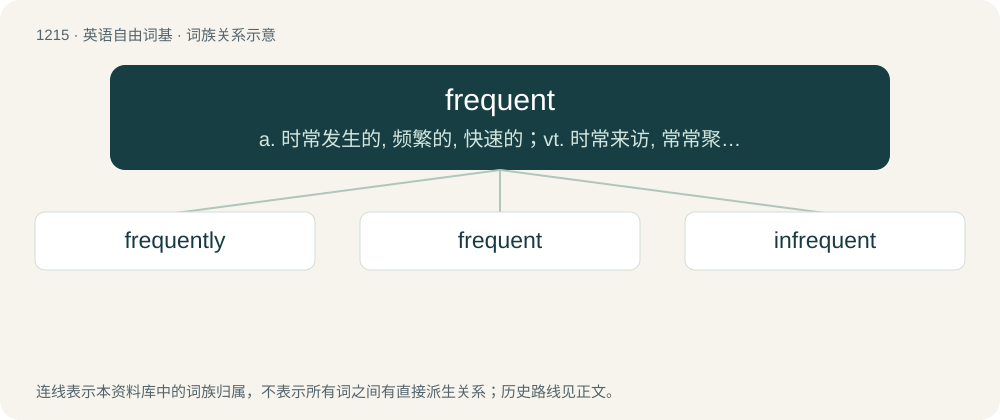

# 1295 · frequent — a. 时常发生的, 频繁的, 快速的；vt. 时常来访, 常常聚集, 常与...交往

[总目录](../00_总目录_按常用程度.md)

**类型**：英语自由词基　｜　**来源语言**：见词源记录

## 核心含义与来源

- 核心含义：a. 时常发生的, 频繁的, 快速的；vt. 时常来访, 常常聚集, 常与...交往
- 英文含义：Done or occurring often; common.
- 词形：frequent

**多个词源／构词路径**：同一拼写可能有不同来源；以下按词性和含义分别列出。

**来源记录 1**（形容词；Done or occurring often; common.）

From Old French frequent, from Latin frequens (“crowded, crammed, frequent, repeated, etc.”), possibly from a Proto-Indo-European \*bʰrekʷ- (“to cram together”).

**来源记录 2**（动词；To visit often.）

From Old French frequenter, from Latin frequentare (“to fill, crowd, visit often, do or use often, etc.”), from frequens (“frequent, crowded”).

## 词族图

## 单词速览（常用到不常用）

| 单词 | 音标 | 释义 |
|---|---|---|
| [frequently](#w-1) | 英 /ˈfɹiː.kwənt.li/ | adv. 频繁, 经常地 |
| [frequent](#w-2) | 英 /ˈfɹiː.kwənt/ | a. 时常发生的, 频繁的, 快速的；vt. 时常来访, 常常聚集, 常与...交往 |
| [infrequent](#w-3) | /inˈfriːkwənt/ | a. 稀少的, 珍贵的, 罕见的 |

## 逐词详解

### 1. frequently

**词性**：副词　｜　**音标**：英 /ˈfɹiː.kwənt.li/

**中文释义**：adv. 频繁, 经常地

**英文义项**：At frequent intervals. / For infinitely many terms of the sequence.

**构词拆分**：frequent + -ly

**词源与演化**：

From frequent + -ly.

**例句**：

> He was enrolled but frequently didn't attend class.

该用例对应义项：At frequent intervals.

### 2. frequent

**词性**：形容词　｜　**音标**：英 /ˈfɹiː.kwənt/

**中文释义**：a. 时常发生的, 频繁的, 快速的；vt. 时常来访, 常常聚集, 常与...交往

**英文义项**：Done or occurring often; common. / Occurring at short intervals.

**词源与演化**：

From Old French frequent, from Latin frequens (“crowded, crammed, frequent, repeated, etc.”), possibly from a Proto-Indo-European \*bʰrekʷ- (“to cram together”).

**例句**：

> There are frequent trains to the beach available.

该用例对应义项：Done or occurring often; common.

### 3. infrequent

**词性**：形容词　｜　**音标**：/inˈfriːkwənt/

**中文释义**：a. 稀少的, 珍贵的, 罕见的

**英文义项**：Not frequent; not happening frequently.

**构词拆分**：in- + frequent

**词源与演化**：

From in- + frequent.

**例句**：

> Infrequent outbursts of temper.

该用例对应义项：not frequent; not occurring regularly or at short intervals
