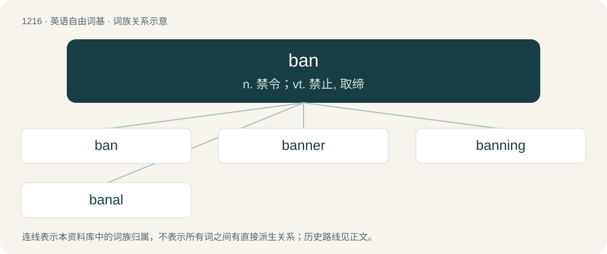

# 1296 · ban — n. 禁令；vt. 禁止, 取缔

[总目录](../00_总目录_按常用程度.md)

**类型**：英语自由词基　｜　**来源语言**：见词源记录

## 核心含义与来源

- 核心含义：n. 禁令；vt. 禁止, 取缔
- 英文含义：To prohibit; to interdict; to proscribe; to forbid or block from participation.
- 词形：ban

**多个词源／构词路径**：同一拼写可能有不同来源；以下按词性和含义分别列出。

**来源记录 1**（动词；To prohibit; to interdict; to proscribe; to forbid or block from participation.）

Inherited from Middle English bannen (“to summon; to banish; to curse”), partly from Old English bannan (“to summon, command, proclaim, call out”), from Proto-West Germanic \*bannan; and partly from Old Norse banna (“to prohibit; to curse”), both from Proto-Germanic \*bannaną (“to proclaim, to order; to summon; to ban; to curse, forbid”), from Proto-Indo-European \*bʰh₂-new-ti ~ bʰh₂-n̥w-énti, innovative nasal-infixed zero-grade athematic present of \*bʰeh₂- (“to say”). Cognate with Dutch bannen (“to ban, exile, discard”), German bannen (“to exile, to exorcise, captivate, excommunicate”), Swedish banna (“to ban, scold”), Vedic Sanskrit भन॑ति (bhánati), Armenian բան (ban) and perhaps Albanian banoj (“to reside, dwell”). See also banal, abandon.

**来源记录 2**（名词；A subdivision of currency, equal to one hundredth of a Romanian leu.）

Borrowed from Romanian ban of uncertain origin, perhaps from Serbo-Croatian bân.

**来源记录 3**（名词；A unit measuring information or entropy based on base-ten logarithms, rather than the base-two logarithms that define the bit.）

From Banburismus; coined by Alan Turing.

**来源记录 4**（名词；A title used in several states in central and south-eastern Europe between the 7th century and the 20th century.）

From South Slavic (compare Serbo-Croatian bȃn), from Proto-Slavic \*banъ; see there for more.

## 词族图

## 单词速览（常用到不常用）

| 单词 | 音标 | 释义 |
|---|---|---|
| [ban](#w-1) | 英 /ˈbæn/；/ˈbæːn/ | n. 禁令；vt. 禁止, 取缔 |
| [banner](#w-2) | 英 /ˈbænə/；美 /ˈbænɚ/ | 【英文】One who bans something. |
| [banning](#w-3) | /ˈbænɪŋ/ | \[人名\] 班宁; \[地名\] \[美国\] 班宁 |
| [banal](#w-4) | /bəˈnɑːl/ | a. 平凡的, 陈腐的 |

## 逐词详解

### 1. ban

**词性**：动词　｜　**音标**：英 /ˈbæn/；/ˈbæːn/

**中文释义**：n. 禁令；vt. 禁止, 取缔

**英文义项**：To prohibit; to interdict; to proscribe; to forbid or block from participation. / To anathematize; to pronounce an ecclesiastical curse upon; to place under a ban.

**词源与演化**：

Inherited from Middle English bannen (“to summon; to banish; to curse”), partly from Old English bannan (“to summon, command, proclaim, call out”), from Proto-West Germanic \*bannan; and partly from Old Norse banna (“to prohibit; to curse”), both from Proto-Germanic \*bannaną (“to proclaim, to order; to summon; to ban; to curse, forbid”), from Proto-Indo-European \*bʰh₂-new-ti ~ bʰh₂-n̥w-énti, innovative nasal-infixed zero-grade athematic present of \*bʰeh₂- (“to say”). Cognate with Dutch bannen (“to ban, exile, discard”), German bannen (“to exile, to exorcise, captivate, excommunicate”), Swedish banna (“to ban, scold”), Vedic Sanskrit भन॑ति (bhánati), Armenian բան (ban) and perhaps Albanian banoj (“to reside, dwell”). See also banal, abandon.

**例句**：

> No one has the right to ban the Berber flag in Algeria.

### 2. banner

**词性**：名词　｜　**音标**：英 /ˈbænə/；美 /ˈbænɚ/

**英文义项**：One who bans something.

**构词拆分**：ban + -er

**词源与演化**：

From ban + -er.

### 3. banning

**词性**：名词　｜　**音标**：/ˈbænɪŋ/

**中文释义**：\[人名\] 班宁; \[地名\] \[美国\] 班宁

**英文义项**：The act by which something is banned; a prohibition.

**构词拆分**：ban + -ing

**词源与演化**：

From Middle English banning, bannyng, bonnyng, equivalent to ban + -ing. Cognate with West Frisian banning, Dutch banning, German Low German Banning, German Bannung.

**例句**：

> The EU is banning the sale of cosmetics tested on guinea pigs.

### 4. banal

**词性**：形容词　｜　**音标**：/bəˈnɑːl/

**中文释义**：a. 平凡的, 陈腐的

**英文义项**：Common in a boring way, to the point of being predictable; containing nothing new or fresh.

**构词拆分**：ban + -al

**词源与演化**：

Borrowed from French banal (“held in common, relating to feudal service, by extension commonplace”), from Old French banel, related to Medieval Latin bannālis (“subject to feudal authority”), from Latin bannus (“jurisdiction”), both ultimately from Proto-Germanic \*bannaną (“to order, summon, forbid”). Equivalent to ban + -al. See also ban, abandon.

**例句**：

> The movie’s dialogue was predictable and banal.

该用例对应义项：Common in a boring way, to the point of being predictable; containing nothing new or fresh.
