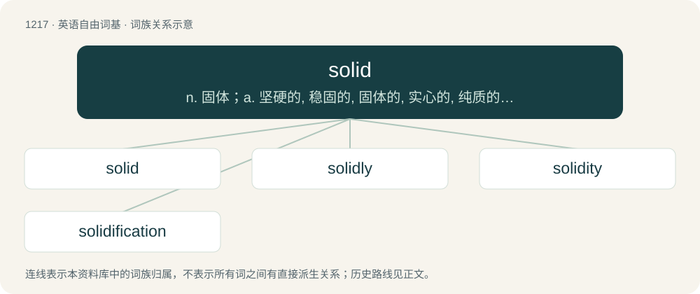

# 1297 · solid — n. 固体；a. 坚硬的, 稳固的, 固体的, 实心的, 纯质的, 立体的, 立方的；\[计\] 原色

[总目录](../00_总目录_按常用程度.md)

**类型**：英语自由词基　｜　**来源语言**：见词源记录

## 核心含义与来源

- 核心含义：n. 固体；a. 坚硬的, 稳固的, 固体的, 实心的, 纯质的, 立体的, 立方的；\[计\] 原色
- 英文含义：That can be picked up or held, having a texture, and usually firm. Unlike a liquid, gas or plasma.
- 词形：solid

**多个词源／构词路径**：同一拼写可能有不同来源；以下按词性和含义分别列出。

**来源记录 1**（形容词；That can be picked up or held, having a texture, and usually firm. Unlike a liquid, gas or plasma.）

From Middle English solide, borrowed from Old French solide, from Latin solidus (“solid”), from Proto-Indo-European \*solh₂-i-dʰ-o-s (“entire”), suffixed form of root \*solh₂- (“integrate, whole”). Doublet of sol, sold, soldo, solidus, sou, and xu.

**来源记录 2**（名词；A substance in the fundamental state of matter that retains its size and shape without need of a container (as opposed to a liquid or gas).）

From Middle English solid, from the adjective, Middle French solide, or Latin solidum. Doublet of solidum.

## 词族图

## 单词速览（常用到不常用）

| 单词 | 音标 | 释义 |
|---|---|---|
| [solid](#w-1) | 英 /ˈsɒl.ɪd/；美 /ˈsɑ.lɪd/ | n. 固体；a. 坚硬的, 稳固的, 固体的, 实心的, 纯质的, 立体的, 立方的；\[计\] 原色 |
| [solidly](#w-2) |  | adv. 坚硬地；坚固地；团结一致地 |
| [solidity](#w-3) | /səˈlɪdɪti/ | n. 固体性, 坚硬, 坚固, 稳健, 体积 |
| [solidification](#w-4) | /sə.lidifiˈkeiʃən/ | n. 团结, 凝固, 固体化；\[化\] 凝固 |

## 逐词详解

### 1. solid

**词性**：形容词　｜　**音标**：英 /ˈsɒl.ɪd/；美 /ˈsɑ.lɪd/

**中文释义**：n. 固体；a. 坚硬的, 稳固的, 固体的, 实心的, 纯质的, 立体的, 立方的；\[计\] 原色

**英文义项**：That can be picked up or held, having a texture, and usually firm. Unlike a liquid, gas or plasma. / Appreciably large in size, quantity, or value.

**词源与演化**：

From Middle English solide, borrowed from Old French solide, from Latin solidus (“solid”), from Proto-Indo-European \*solh₂-i-dʰ-o-s (“entire”), suffixed form of root \*solh₂- (“integrate, whole”). Doublet of sol, sold, soldo, solidus, sou, and xu.

**例句**：

> Radiohead's on tour! Have you heard their latest album yet? It's quite solid.

该用例对应义项：Excellent, of high quality, or reliable.

### 2. solidly

**词性**：副词

**中文释义**：adv. 坚硬地；坚固地；团结一致地

**英文义项**：In a solid or firm manner.

**构词拆分**：solid + -ly

**词源与演化**：

From solid + -ly.

**例句**：

> You can see that the house is solidly built.

### 3. solidity

**词性**：名词　｜　**音标**：/səˈlɪdɪti/

**中文释义**：n. 固体性, 坚硬, 坚固, 稳健, 体积

**英文义项**：The state or quality of being solid. / Moral firmness; validity; truth; certainty.

**构词拆分**：solid + -ity

**词源与演化**：

From solid + -ity, from Middle French solidité, from Latin soliditās.

**例句**：

> The solidity of the evidence worked in his favor.

该用例对应义项：the quality of being solid and reliable financially or factually or morally

### 4. solidification

**词性**：名词　｜　**音标**：/sə.lidifiˈkeiʃən/

**中文释义**：n. 团结, 凝固, 固体化；\[化\] 凝固

**英文义项**：The action of solidifying. / Concentration or consolidation.

**构词拆分**：solid + -ification

**词源与演化**：

From French solidification, or from solid + -ification.
