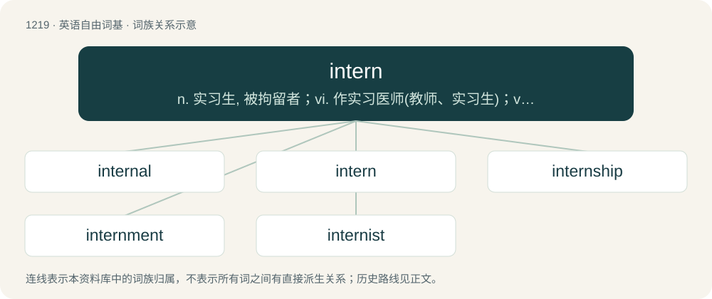

# 1299 · intern — n. 实习生, 被拘留者；vi. 作实习医师(教师、实习生)；vt. 拘留, 扣留

[总目录](../00_总目录_按常用程度.md)

**类型**：英语自由词基　｜　**来源语言**：见词源记录

## 核心含义与来源

- 核心含义：n. 实习生, 被拘留者；vi. 作实习医师(教师、实习生)；vt. 拘留, 扣留
- 英文含义：A person who is interned, forcibly or voluntarily.
- 词形：intern

**多个词源／构词路径**：同一拼写可能有不同来源；以下按词性和含义分别列出。

**来源记录 1**（名词；A person who is interned, forcibly or voluntarily.）

From French interner, from interne (“inner, internal”), from Latin internus (“within, internal”), compare Etymology 2.

**来源记录 2**（名词；A student or recent graduate who works in order to gain experience in their chosen field.）

From French interne (“inner, internal”), from Latin internus (“within, internal”), from inter (“between”); compare Etymology 1.

## 词族图

## 单词速览（常用到不常用）

| 单词 | 音标 | 释义 |
|---|---|---|
| [internal](#w-1) | 英 /ɪnˈtɜː.nəl/；美 /ɪnˈtɜɹ.nəl/ | a. 内在的, 国内的；\[医\] 内的, 内部的 |
| [intern](#w-2) | 英 /ɪnˈtɜːn/；美 /ɪnˈtɝn/ | n. 实习生, 被拘留者；vi. 作实习医师(教师、实习生)；vt. 拘留, 扣留 |
| [internship](#w-3) | 英 /ˈɪntɜːnʃɪp/；美 /ˈɪntɝnʃɪp/ | n. 实习医师的职务；\[医\] 实习医师职位, 实习医师期 |
| [internment](#w-4) | 英 /ɪnˈtɜːnmənt/；美 /ɪnˈtɝnmənt/ | n. 拘留；\[法\] 拘留, 收容, 禁闭 |
| [internist](#w-5) | /inˈtəːnist/ | n. 内科医师；\[医\] 内科医师 |

## 逐词详解

### 1. internal

**词性**：形容词　｜　**音标**：英 /ɪnˈtɜː.nəl/；美 /ɪnˈtɜɹ.nəl/

**中文释义**：a. 内在的, 国内的；\[医\] 内的, 内部的

**英文义项**：Of or situated on the inside. / Within the body.

**构词拆分**：By surface analysis, intern + -al

**词源与演化**：

From Middle English internall, internalle, borrowing from New Latin internālis (“of or pertaining to the inner part”), from internus (“inward, internal”) + -ālis (“-al”, adjectival suffix). By surface analysis, intern + -al.

**例句**：

> We saw the internal compartments of the machine.

该用例对应义项：Of or situated on the inside.

### 2. intern

**词性**：动词　｜　**音标**：英 /ɪnˈtɜːn/；美 /ɪnˈtɝn/

**中文释义**：n. 实习生, 被拘留者；vi. 作实习医师(教师、实习生)；vt. 拘留, 扣留

**英文义项**：To imprison somebody, usually without trial. / To confine or hold (foreign military personnel who stray into the state's territory) within prescribed limits during wartime.

**词源与演化**：

From French interner, from interne (“inner, internal”), from Latin internus (“within, internal”), compare Etymology 2.

**例句**：

> The Swiss government interned the Italian soldiers who had strayed onto Swiss territory.

该用例对应义项：To confine or hold (foreign military personnel who stray into the state's territory) within prescribed limits during wartime.

### 3. internship

**词性**：名词　｜　**音标**：英 /ˈɪntɜːnʃɪp/；美 /ˈɪntɝnʃɪp/

**中文释义**：n. 实习医师的职务；\[医\] 实习医师职位, 实习医师期

**英文义项**：A job taken by a student in order to learn a profession or trade. / The first year of a medical residency.

**构词拆分**：intern + -ship

**词源与演化**：

From intern + -ship.

**例句**：

> An internship is the most important credential for entering the job market.

### 4. internment

**词性**：名词　｜　**音标**：英 /ɪnˈtɜːnmənt/；美 /ɪnˈtɝnmənt/

**中文释义**：n. 拘留；\[法\] 拘留, 收容, 禁闭

**英文义项**：The state of being imprisoned, usually without trial.

**构词拆分**：intern + -ment

**词源与演化**：

From intern + -ment.

**例句**：

> The result was my internment in Villete.

### 5. internist

**词性**：名词　｜　**音标**：/inˈtəːnist/

**中文释义**：n. 内科医师；\[医\] 内科医师

**英文义项**：A physician who specialises in internal medicine.

**构词拆分**：intern (“internal”) + -ist

**词源与演化**：

From German Internist, corresponding to intern (“internal”) + -ist.
