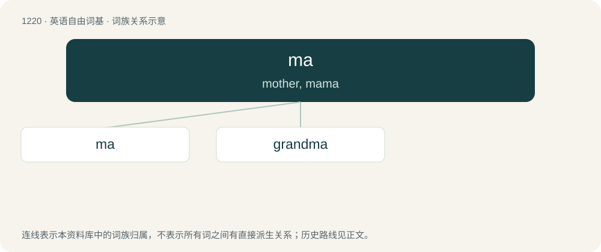

# 1300 · ma — mother, mama

[总目录](../00_总目录_按常用程度.md)

**类型**：英语自由词基　｜　**来源语言**：见词源记录

## 核心含义与来源

- 核心含义：mother, mama
- 英文含义：mother, mama
- 词形：ma

**多个词源／构词路径**：同一拼写可能有不同来源；以下按词性和含义分别列出。

**来源记录 1**（名词；mother, mama）

The sound, which parents interpret as a reference to themselves, is very commonly made by infants. For more on the linguistic process whereby infants' monosyllables are tied to ancient word roots for parents, see mama, papa, mātēr, and patēr.

**来源记录 2**（名词；May.）

Abbreviation.

**来源记录 3**（名词；Negative space in Japanese art.）

Borrowed from Japanese 間.

## 词族图

## 单词速览（常用到不常用）

| 单词 | 音标 | 释义 |
|---|---|---|
| [ma](#w-1) | /mɑː/ | 【英文】mother, mama |
| [grandma](#w-2) | /ˈɡɹænmɑː/ | n. 奶奶, 外婆 |

## 逐词详解

### 1. ma

**词性**：名词　｜　**音标**：/mɑː/

**英文义项**：mother, mama / The landlady of a theater.

**词源与演化**：

The sound, which parents interpret as a reference to themselves, is very commonly made by infants. For more on the linguistic process whereby infants' monosyllables are tied to ancient word roots for parents, see mama, papa, mātēr, and patēr.

**例句**：

> A Maß is a beer mug that contains 1 litre of beer.

### 2. grandma

**词性**：名词　｜　**音标**：/ˈɡɹænmɑː/

**中文释义**：n. 奶奶, 外婆

**英文义项**：Grandmother. / Any elderly woman, regardless of if she has grandchildren.

**构词拆分**：grand- + ma

**词源与演化**：

From grand- + ma, after grandmother.

**例句**：

> On my bed is a coloured bedspread, which my grandma once made.
