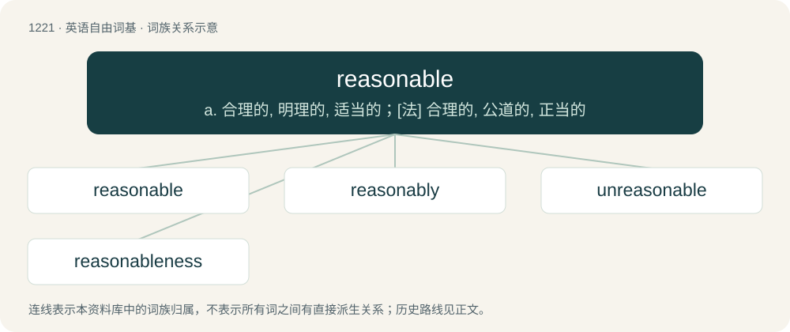

# 1301 · reasonable — a. 合理的, 明理的, 适当的；\[法\] 合理的, 公道的, 正当的

[总目录](../00_总目录_按常用程度.md)

**类型**：英语自由词基　｜　**来源语言**：见词源记录

## 核心含义与来源

- 核心含义：a. 合理的, 明理的, 适当的；\[法\] 合理的, 公道的, 正当的
- 英文含义：Just; fair; agreeable to reason.
- 词形：reasonable

**来源记录 1**（形容词；Just; fair; agreeable to reason.）

From Middle English resonable, from Old French resnable, from Classical Latin ratiōnābilis, from ratiō. By surface analysis, reason + -able. Doublet of rationable.

## 词族图

## 单词速览（常用到不常用）

| 单词 | 音标 | 释义 |
|---|---|---|
| [reasonable](#w-1) | 英 /ˈɹiː.zə.nə.bəl/；美 /ˈɹi.zə.nə.bəl/ | a. 合理的, 明理的, 适当的；\[法\] 合理的, 公道的, 正当的 |
| [reasonably](#w-2) | /ˈɹiː.zən.ə.bli/ | adv. 适度地, 相当地 |
| [unreasonable](#w-3) | /ʌnˈɹiːz.(ə)nə.bl̩/ | a. 不合理的, 过度的, 不切实际的；\[法\] 不讲道理的, 非理智的, 不合理的 |
| [reasonableness](#w-4) | /ˈɹiː.zə.nə.bəl.nəs/ | \[计\] 合理性 |

## 逐词详解

### 1. reasonable

**词性**：形容词　｜　**音标**：英 /ˈɹiː.zə.nə.bəl/；美 /ˈɹi.zə.nə.bəl/

**中文释义**：a. 合理的, 明理的, 适当的；\[法\] 合理的, 公道的, 正当的

**英文义项**：Just; fair; agreeable to reason. / Not excessive or immoderate; within due limits; proper.

**词源与演化**：

From Middle English resonable, from Old French resnable, from Classical Latin ratiōnābilis, from ratiō. By surface analysis, reason + -able. Doublet of rationable.

**例句**：

> $20 a bottle is very reasonable for a good wine at a restaurant.

该用例对应义项：Not expensive; fairly priced.

### 2. reasonably

**词性**：副词　｜　**音标**：/ˈɹiː.zən.ə.bli/

**中文释义**：adv. 适度地, 相当地

**英文义项**：In accordance with reason. / Fairly; satisfactorily; not extremely.

**构词拆分**：reasonable + -ly

**词源与演化**：

From Middle English resonably, equivalent to reasonable + -ly. Piecewise doublet of rationably.

**例句**：

> They were able handle their disagreements reasonably.

该用例对应义项：In accordance with reason.

### 3. unreasonable

**词性**：形容词　｜　**音标**：/ʌnˈɹiːz.(ə)nə.bl̩/

**中文释义**：a. 不合理的, 过度的, 不切实际的；\[法\] 不讲道理的, 非理智的, 不合理的

**英文义项**：Without the ability to reason; unreasoning. / Not reasonable; going beyond what could be expected or asked for.

**构词拆分**：un- + reasonable

**词源与演化**：

From Middle English unresonable, equivalent to un- + reasonable, originally partly after Latin irratiōnābilis.

**例句**：

> I don't think that this is an unreasonable request to make.

### 4. reasonableness

**词性**：名词　｜　**音标**：/ˈɹiː.zə.nə.bəl.nəs/

**中文释义**：\[计\] 合理性

**英文义项**：The state or characteristic of being reasonable. / A reasonable action or behaviour.

**构词拆分**：reasonable + -ness

**词源与演化**：

From Middle English resonabilnes, resonabilnesse, resonablenesse, equivalent to reasonable + -ness.

**例句**：

> The store is famous for the reasonableness of its prices.

该用例对应义项：the property of being moderate in price or expenditures
