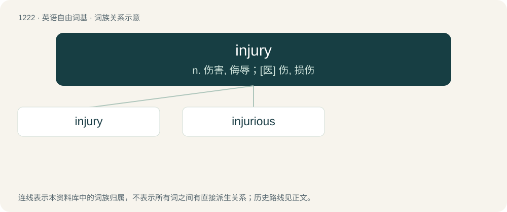

# 1303 · injury — n. 伤害, 侮辱；\[医\] 伤, 损伤

[总目录](../00_总目录_按常用程度.md)

**类型**：英语自由词基　｜　**来源语言**：见词源记录

## 核心含义与来源

- 核心含义：n. 伤害, 侮辱；\[医\] 伤, 损伤
- 英文含义：Damage to the body of a living thing.
- 词形：injury

**来源记录 1**（名词；Damage to the body of a living thing.）

From Middle English injurie, from Anglo-Norman injurie, from Latin iniūria (“injustice; wrong; offense”), from in- (“not”) + iūs, iūris (“right, law”). Doublet of injuria.

## 词族图

## 单词速览（常用到不常用）

| 单词 | 音标 | 释义 |
|---|---|---|
| [injury](#w-1) | 英 /ˈɪn.d͡ʒə.ɹi/；美 /ˈɪn.d͡ʒɚ.i/ | n. 伤害, 侮辱；\[医\] 伤, 损伤 |
| [injurious](#w-2) | 英 /ɪnˈdʒʊə.ɹɪ.əs/；美 /ɪnˈd͡ʒʊɹ.i.əs/ | a. 有害的, 不公正的；\[法\] 伤害的, 有害的, 不公平的 |

## 逐词详解

### 1. injury

**词性**：名词　｜　**音标**：英 /ˈɪn.d͡ʒə.ɹi/；美 /ˈɪn.d͡ʒɚ.i/

**中文释义**：n. 伤害, 侮辱；\[医\] 伤, 损伤

**英文义项**：Damage to the body of a living thing. / Other forms of damage sustained by a living thing, e.g. psychologically.

**词源与演化**：

From Middle English injurie, from Anglo-Norman injurie, from Latin iniūria (“injustice; wrong; offense”), from in- (“not”) + iūs, iūris (“right, law”). Doublet of injuria.

**例句**：

> The passenger sustained a severe injury in the car accident.

该用例对应义项：Damage to the body of a living thing.

### 2. injurious

**词性**：形容词　｜　**音标**：英 /ɪnˈdʒʊə.ɹɪ.əs/；美 /ɪnˈd͡ʒʊɹ.i.əs/

**中文释义**：a. 有害的, 不公正的；\[法\] 伤害的, 有害的, 不公平的

**英文义项**：Causing physical harm or injury; harmful, hurtful. / Causing harm to one's reputation; invidious, defamatory, libelous, slanderous.

**构词拆分**：injury + -ous

**词源与演化**：

From Middle English injurious, from Anglo-Norman enjurius, from Latin iniūriōsus; analysable as injury + -ous.

**例句**：

> The report contends the current system is injurious to mental well-being and violates the human rights of patients.
