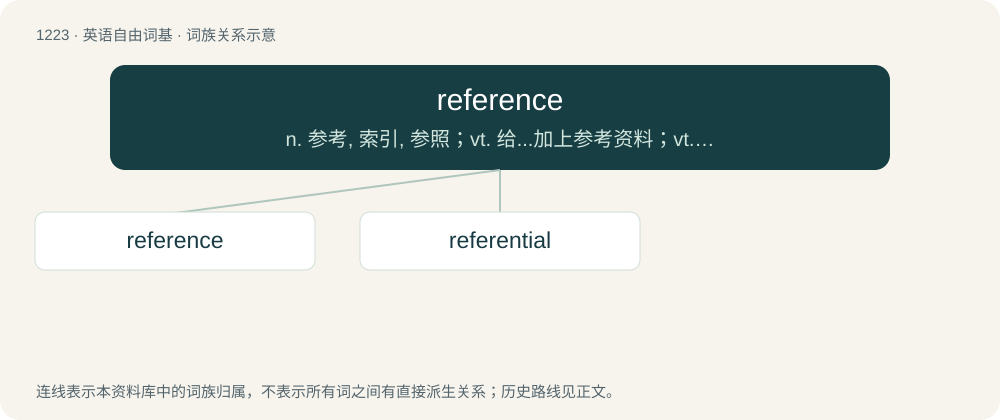

# 1304 · reference — n. 参考, 索引, 参照；vt. 给...加上参考资料；vt. 引用

[总目录](../00_总目录_按常用程度.md)

**类型**：英语自由词基　｜　**来源语言**：见词源记录

## 核心含义与来源

- 核心含义：n. 参考, 索引, 参照；vt. 给...加上参考资料；vt. 引用
- 英文含义：A measurement one can compare (some other measurement) to.
- 词形：reference

**来源记录 1**（名词；A measurement one can compare (some other measurement) to.）

From Middle French référence, from Medieval Latin referentia, nominative neuter plural of referēns, present participle of referō (“return, reply”, literally “carry back”). Morphologically refer + -ence.

## 词族图

## 单词速览（常用到不常用）

| 单词 | 音标 | 释义 |
|---|---|---|
| [reference](#w-1) | 英 /ˈɹɛf.(ə.)ɹəns/ | n. 参考, 索引, 参照；vt. 给...加上参考资料；vt. 引用 |
| [referential](#w-2) | /ɹɛfəˈɹɛnʃəl/ | a. 与...有关的, 有所指的；\[法\] 参考的, 参照的, 指示的 |

## 逐词详解

### 1. reference

**词性**：名词　｜　**音标**：英 /ˈɹɛf.(ə.)ɹəns/

**中文释义**：n. 参考, 索引, 参照；vt. 给...加上参考资料；vt. 引用

**英文义项**：A measurement one can compare (some other measurement) to. / Information about a person, provided by someone (a referee) with whom they are well acquainted.

**构词拆分**：refer + -ence

**词源与演化**：

From Middle French référence, from Medieval Latin referentia, nominative neuter plural of referēns, present participle of referō (“return, reply”, literally “carry back”). Morphologically refer + -ence.

**用法示例／搭配（非完整句）**：

> Reference Dictionary of Linguistics

该用例对应义项：A reference work.

### 2. referential

**词性**：形容词　｜　**音标**：/ɹɛfəˈɹɛnʃəl/

**中文释义**：a. 与...有关的, 有所指的；\[法\] 参考的, 参照的, 指示的

**英文义项**：Of a word or phrase applied to a particular person, place, or thing and not to any other. / Of or relating to a referent.

**构词拆分**：reference + -ial

**词源与演化**：

From reference + -ial.

**例句**：

> The standard pitch A is used as referential pitch for tuning most of all instruments and is set to 440 Hertz.
