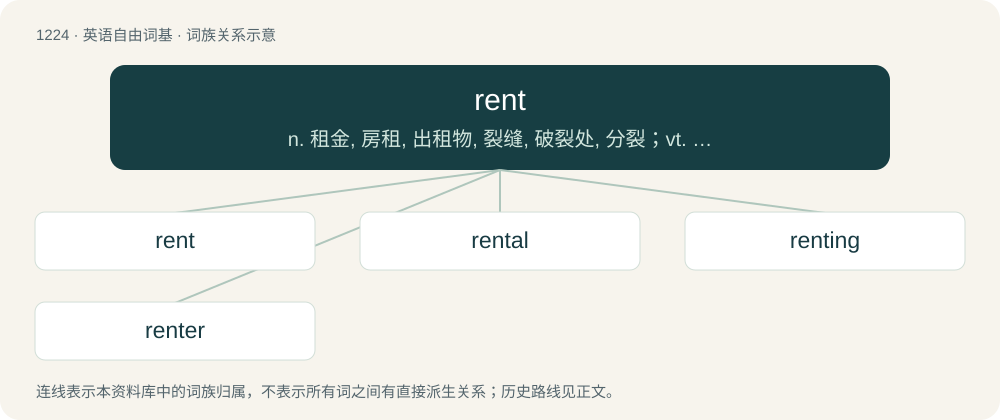

# 1305 · rent — n. 租金, 房租, 出租物, 裂缝, 破裂处, 分裂；vt. 租用, 租出；vi. 出租

[总目录](../00_总目录_按常用程度.md)

**类型**：英语自由词基　｜　**来源语言**：见词源记录

## 核心含义与来源

- 核心含义：n. 租金, 房租, 出租物, 裂缝, 破裂处, 分裂；vt. 租用, 租出；vi. 出租
- 英文含义：A payment made by a tenant at intervals in order to lease a property.
- 词形：rent

**多个词源／构词路径**：同一拼写可能有不同来源；以下按词性和含义分别列出。

**来源记录 1**（名词；A payment made by a tenant at intervals in order to lease a property.）

From Middle English rent, rente, from Old French rente, from Early Medieval Latin rendita, from Late Latin rendere, from Latin reddere.

**来源记录 2**（名词；A tear or rip in some surface.）

See rend.

## 词族图

## 单词速览（常用到不常用）

| 单词 | 音标 | 释义 |
|---|---|---|
| [rent](#w-1) | /ˈɹɛnt/ | n. 租金, 房租, 出租物, 裂缝, 破裂处, 分裂；vt. 租用, 租出；vi. 出租 |
| [rental](#w-2) | /ˈɹɛntəl/ | n. 租费, 租金收入；a. 租赁的, 收取租金的 |
| [renting](#w-3) | /ˈɹɛntɪŋ/ | v. 租用；出租（rent的ing形式） |
| [renter](#w-4) | /ˈrentə/ | n. 承租人, 佃户, 出租人；\[经\] 租赁人, 租户, 出租人 |

## 逐词详解

### 1. rent

**词性**：名词　｜　**音标**：/ˈɹɛnt/

**中文释义**：n. 租金, 房租, 出租物, 裂缝, 破裂处, 分裂；vt. 租用, 租出；vi. 出租

**英文义项**：A payment made by a tenant at intervals in order to lease a property. / A similar payment for the use of a product, equipment or a service.

**词源与演化**：

From Middle English rent, rente, from Old French rente, from Early Medieval Latin rendita, from Late Latin rendere, from Latin reddere.

**例句**：

> A New York city taxicab license earns more than $10,000 a year in rent.

该用例对应义项：A profit from possession of a valuable right, as a restricted license to engage in a trade or business.

### 2. rental

**词性**：名词　｜　**音标**：/ˈɹɛntəl/

**中文释义**：n. 租费, 租金收入；a. 租赁的, 收取租金的

**英文义项**：Something that is rented. / The payment made to rent something.

**构词拆分**：From rent + -al.

**词源与演化**：

From rent + -al.

**例句**：

> It's just a rental, so I don't need to take very good care of it.

该用例对应义项：Something that is rented.

### 3. renting

**词性**：名词　｜　**音标**：/ˈɹɛntɪŋ/

**中文释义**：v. 租用；出租（rent的ing形式）

**英文义项**：The act by which something is rented; a rental.

**构词拆分**：From rent + -ing.

**词源与演化**：

From rent + -ing.

**例句**：

> The apartments are still there and people are renting them from William.

### 4. renter

**词性**：名词　｜　**音标**：/ˈrentə/

**中文释义**：n. 承租人, 佃户, 出租人；\[经\] 租赁人, 租户, 出租人

**英文义项**：One who rents property or other goods from another. / One who owns or controls property and rents that property to another.

**构词拆分**：rent + -er

**词源与演化**：

From rent + -er.

**例句**：

> It'll be easy to find a renter for this house.
